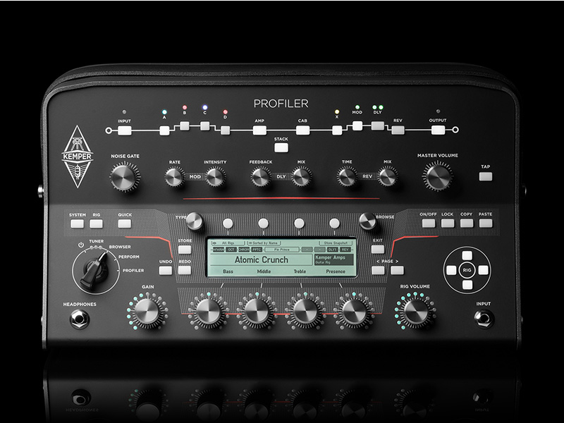
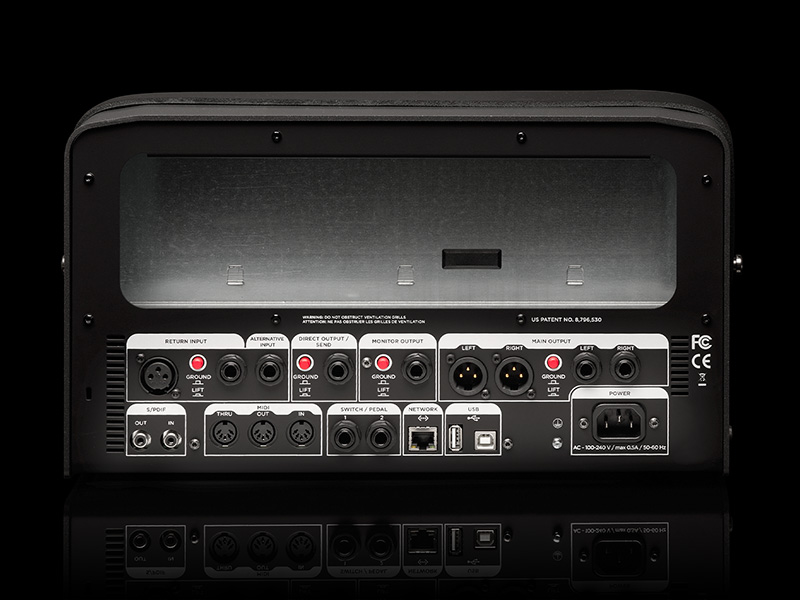
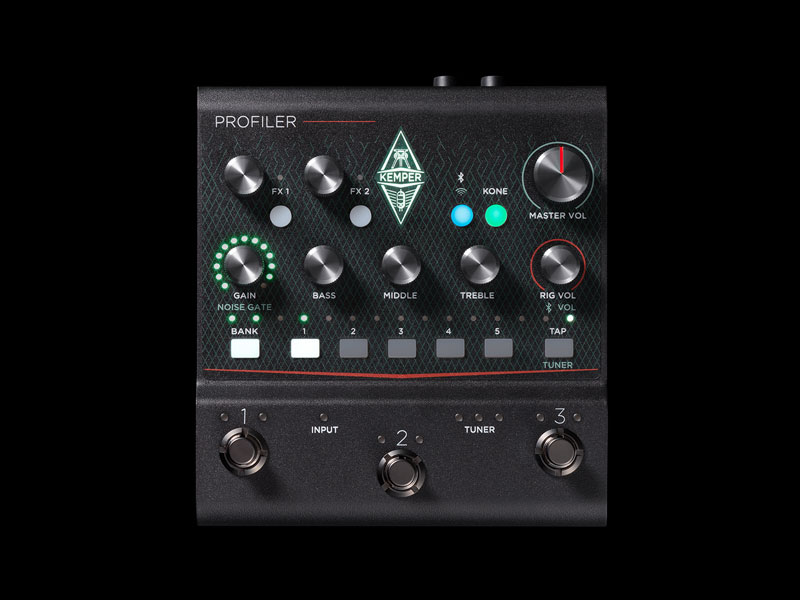
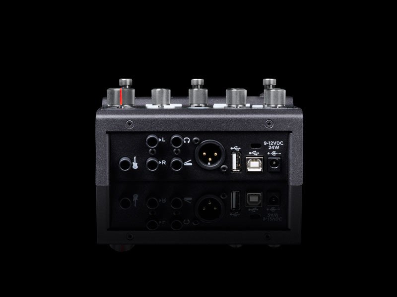
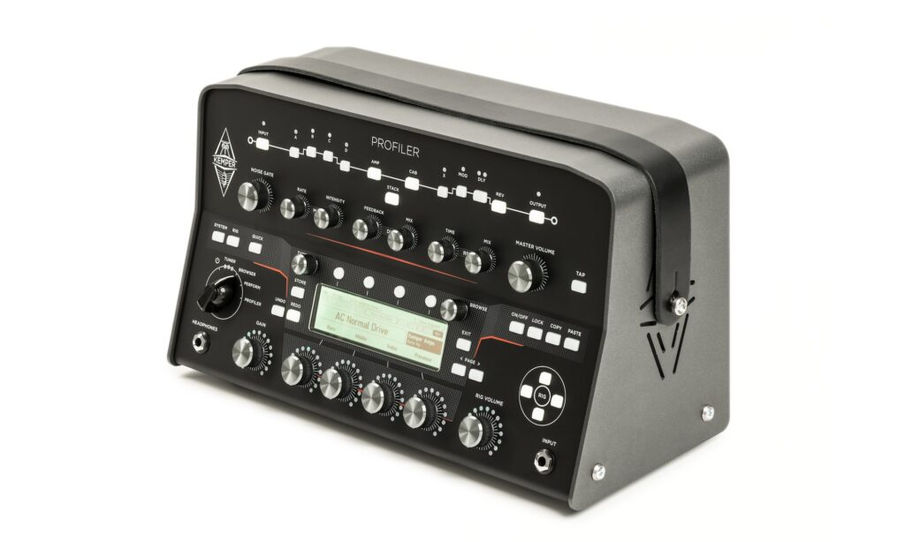
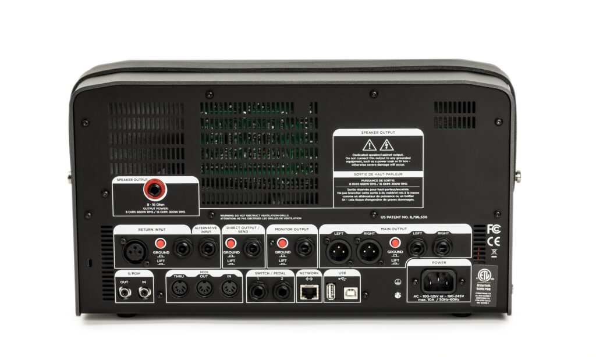
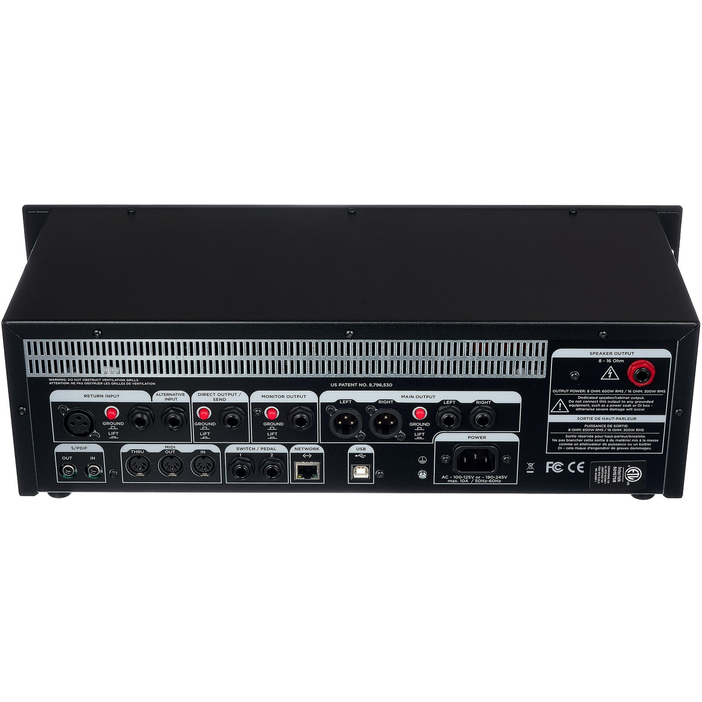
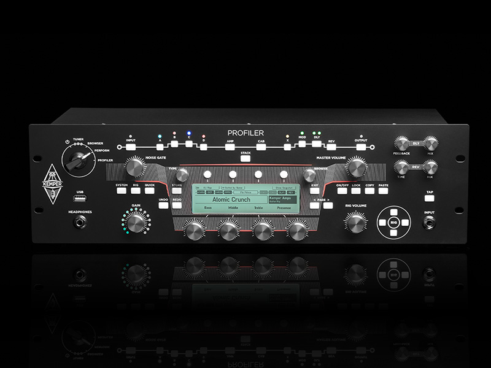

# Kemper — multi-effects

[Repository](../README.md) · [Guitar](../all-guitar.md) · [Bass](../all-bass.md)

<!-- brand-index begins -->
**Model and section index — A–Z, natural numeric order**

- [PROFILER Head MK2](#profiler-head-mk2)
- [PROFILER Player](#profiler-player)
- [PROFILER PowerHead MK2](#profiler-powerhead-mk2)
- [PROFILER PowerRack MK2](#profiler-powerrack-mk2)
- [PROFILER Rack MK2](#profiler-rack-mk2)
- [PROFILER Stage MK2](#profiler-stage-mk2)
<!-- brand-index ends -->

## PROFILER Head MK2

<!-- firmware-pitch:Kemper::PROFILER Head MK2 begins -->
### Firmware and pitch audit — Kemper PROFILER Head MK2

| Field | Sourced finding |
|---|---|
| Firmware / first hardware release | 2025-05-28 (Public announcement/immediate-availability report; not individual shipment). Official MK2 announcement includes Head and says immediately available, but its readable page omits a date. Contemporary 28 May 2025 announcement coverage supplies the date; original 2011/2012 Head launch is not assigned to MK2. [launch 1](https://www.kemper-amps.com/news/95/Introducing-the-all-new-KEMPER-PROFILER-MK-2) [launch 2](https://www.bonedo.de/artikel/der-kemper-profiler-mk-2-ist-da/) |
| Firmware / latest verification | 14.2.2 — Located; latest status unverified. Latest located official release announcement fixes S/PDIF Output Volume affecting Noise Gate 2:1 and improves Rig Manager interaction. Requires Rig Manager 4.3.13 desktop, 1.9.25 iOS or 1.9.42 Android/Fire OS. Dynamic downloads listing exposed no version entries, so a newer unindexed build is not ruled out. [firmware 1](https://forum.kemper-amps.com/forum/thread/68400-os-14-2-2-release/) [firmware 2](https://www.kemper-amps.com/downloads) |
| Firmware / release date | 2026-09-22 (day precision) |
| Firmware / release-to-update duration | 1.32 years; observed release span, not continuous support or promised future updates. |
| Firmware / audit date | 2026-11-22; [firmware recap](../FIRMWARE-UPDATES.md). |
| Pitch / note handling | Documented polyphonic. Transpose, Pedal Pitch, Pedal Vinyl Stop, Chromatic Pitch, Harmonic Pitch and Analog Octaver listed for Head/Rack. Chord-capable chromatic pitch processing is documented; Harmonic Pitch tracks single notes, and Formant Shift/Freeze Formants are single-note options. Do not label every pitch type polyphonic. [pitch 1](https://www.kemper-amps.com/store/en/profiler-head-b.html) [pitch 2](https://www.kemper-amps.com/effects/pitch-shifter) [pitch 3](https://manuals.plus/m/4d9ba53ba1e4942c8c47b9ed090ae87c4bf3efb6382613b4952700e86a74decd.pdf) |
| Pitch / preset recall | Pitch settings belong to stored Rigs/Performances; MK2 Transpose is also a Fixed FX function. Manufacturer documents Performance switching and Morphing. MIDI CC4 controls Pitch Pedal; pedal linkage is documented in manual 13.0. |
| Pitch / DSP resources | A flexible pitch effect occupies one selected flexible A–REV module; Head MK2 has eight flexible modules plus fixed effects. Fixed Transpose avoids using a flexible slot. No numeric per-algorithm DSP percentage located. Slot counts and maximum simultaneous-block marketing are not CPU-load measurements. |
| Pitch / qualifications | Manual 13.0 explicitly covers MK2, revised May 2025; it predates OS14.2.2 and is not proof of a complete current algorithm census. Smooth Chords trades smoother chords for more latency; mono audio routing before the stack is distinct from monophonic note tracking. |
| Pitch / comparison | [Polyphony, presets and DSP recap](../PITCH-SHIFTING.md). |

Sources checked:

- [Kemper PROFILER Head MK2 SKU15300000 product](https://www.kemper-amps.com/store/en/profiler-head-b.html) — Head MK2; eight flexible plus eight fixed effects, Performance switching, Morphing, Rig Manager editing and MIDI/expression control. (readable official exact-model page).
- [Kemper introducing PROFILER MK2](https://www.kemper-amps.com/news/95/Introducing-the-all-new-KEMPER-PROFILER-MK-2) — Head included in immediately available MK2 series; additional fixed effects and 20 total audio blocks with broader counting convention. (readable official undated announcement).
- [Bonedo contemporary MK2 announcement 28 May2025](https://www.bonedo.de/artikel/der-kemper-profiler-mk-2-ist-da/) — 28.05.2025 coverage corroborates public introduction date; not used for pitch or hardware technical claims. (dated contemporary announcement coverage).
- [Kemper official OS14.2.2 release announcement](https://forum.kemper-amps.com/forum/thread/68400-os-14-2-2-release/) — 22 September2026 release; S/PDIF/Noise Gate2:1 fix and Rig Manager minimum versions. (readable administrator official post).
- [Kemper official downloads](https://www.kemper-amps.com/downloads) — Cannot independently enumerate current firmware build list from returned page. (readable shell; dynamic version list unavailable).
- [Kemper official pitch-shifter effects](https://www.kemper-amps.com/effects/pitch-shifter) — Six pitch effect types for Head/Rack; describes chord tracking latency and scale-aware harmony. (readable official effects matrix).
- [Kemper manufacturer Main Manual13.0 German](https://manuals.plus/m/4d9ba53ba1e4942c8c47b9ed090ae87c4bf3efb6382613b4952700e86a74decd.pdf) — Printed pp256–264,290: Smooth Chords latency, formant single-note restriction, MK2 Fixed Transpose, CC4 Pedal Pitch, two-voice Chromatic Pitch, single-note Harmonic Pitch and polyphonic chromatic pitch-delay input. (manufacturer-authored PDF on mirror,438pages; May2025 revision and MK2 sections verified).

<!-- firmware-pitch:Kemper::PROFILER Head MK2 ends -->

<!-- model-images:Kemper::PROFILER Head MK2 begins -->

Product pictures — top and rear ports

**PROFILER Head powered control-face photo supplied on the Head MK2 SKU15300000 page: LCD and effect indicators lit.**

[Image source](https://www.kemper-amps.com/store/en/profiler-head-b.html). Official listing labels this top view, but visually it is a front/control-face perspective of the upright Head chassis. It is not perpendicular overhead. Image lacks a visible MK2 badge; attribution is to the exact MK2 product listing, not independent internal-revision identification. No PowerHead amplifier output shown.

**Unpowered PROFILER Head rear panel from the Head MK2 listing, with no speaker power-amplifier socket.**

[Image source](https://www.kemper-amps.com/store/en/profiler-head-b.html). Visible RETURN XLR/quarter-inch and ALTERNATIVE INPUT, DIRECT/SEND, MONITOR, stereo MAIN XLR/quarter-inch, S/PDIF RCA in/out, MIDI thru/out/in, two pedal sockets, NETWORK, USB-A/B and IEC mains. Red ground-lift controls are also visible. No MK2 revision badge is visible; listing provenance establishes intended model use but not an independently photographed internal revision. Printed mains label is narrower than the current 90–275 V specification; existing conflict remains.

<!-- model-images:Kemper::PROFILER Head MK2 ends -->

Partial record checked **2026-10-17**. Exact manufacturer **SKU 15300000**, distinct from PowerHead and controller/speaker bundles. [kh-p]

| Required field | Evidence / qualification |
|---|---|
| Built-in / external / toe expression | Two onboard TRS pedal/switch sockets,10–100 kohm [kh-s]. Remote provides **four additional sockets**;switches must be momentary,normally open [kh-f]. Built-in/toe behavior unverified. Four-pedal marketing is not four onboard sockets [kh-p]. |
| Knobs / footswitches / buttons | **16 adjustable rotary / ? footswitches / ? buttons**,derived Manual13.0 pp.28–41: Noise Gate1+directFX6+Master1+Type/Browse2+soft4+Gain1+Rig Volume1. Power/mode selector separate;current MK2 button census unresolved [kh-m]. |
| Display | Published diagonal,color/monochrome and touch unresolved. |
| Dimensions / weight | **378W×173D×217H mm;5.32 kg**, explicit Head specifications,not PowerHead mass [kh-s]. |
| Simultaneous blocks / category choices | **4 flexible pre +4 flexible stereo post**, plus **6 fixed pre +2 fixed stereo post**, around AMP/CAB. Complete category census unresolved [kh-p]. |
| Preset / factory / user memory | Manual13.0 pp.339–342,419: **125 Performances×5 slots=625 Rigs**,independent of Browse storage. All slots initially contain a standard Rig based on CK0;some example Performances supplied,remaining named New Performance. Exact factory examples,Browse capacity and combined total unresolved [kh-m]. |
| Synth / acoustic | Manual13.0 pp.234–235: **electric-to-acoustic simulator** with Pickup,Body,Bronze,Sparkle. Recommended post-stack,preferably X,with AMP/CAB disabled. Not intended for acoustic/piezo instruments. Dedicated synth algorithms unresolved [kh-m]. |
| IR / NAM / captures | Proprietary amp PROFILE creation documented [kh-p]. Current FAQ: **MK2 creates/plays PROFILE2.0 at high resolution**;MK1 playback is standard resolution with OS14. Desktop Rig Manager **converts imported IRs into cabinet presets**;native onboard IR limits and native/converted NAM unresolved [kh-f]. Manual13.0 p.96 specifies desktop Rig Manager≥3;importer accepts arbitrary source rate/length,not proof of unlimited native playback.18 Celestion-derived cabinet presets documented since OS5.5 [kh-m]. |
| Audio I/O | Front¼-inch TS;balanced alternative TRS;balanced XLR/¼-inch return. Stereo main XLR balanced/TS unbalanced;monitor and direct/send TS;¼-inch stereo phones32–600ohm. S/PDIF RCA24bit44.1/48/88.2/96kHz master/slave [kh-s]. Rear guitar input selection is global and requires front INPUT unplugged;DI Analog requires front input. One FX loop:mono send,mono/stereo return [kh-f]. Manual13.0 pp.43–45,144: **Monitor Stereo pairs MONITOR OUT and DIRECT OUT**;monitor source,volume,EQ,Cab Off andaux settings then govern both. RETURN+ALTERNATIVE IN provide stereo return or aux input. XLR RETURN supplies **no phantom power**;MAIN XLR outputs protected against48V,but manual advises avoiding phantom feed [kh-m]. No powered SPEAKER OUTPUT in Head specification;that output is explicitly PowerHead/PowerRack only. |
| Control / USB | USB-A/B,USB MIDI,DIN in/out/thru,RJ45,two pedal sockets;**4in/4out USB audio at44.1kHz** for MK2 [kh-s] [kh-p]. |
| Power / battery / USB operation | **90–275V AC,max0.5A,50–60Hz**, Head rating [kh-s]. FAQ confirms automatic mains adaptation [kh-f]. Manual13.0 p.45 describes internal universal **100–240V AC IEC** supply,a narrower range than current90–275V Head specifications;revision/label reconciliation unresolved. Actual consumption,battery/USB operation unresolved;DC polarity not applicable to mains. [kh-m] |
| Editor platforms / drivers | Rig Manager Windows/macOS over USB;mobile iOS/Android/FireOS over external WiFi router. [kh-p]. **OS14.2.2**,official2026-09-22: Rig Manager≥4.3.13 Windows/macOS,≥1.9.25 iOS,≥1.9.42 Android/FireOS. Rig Manager4 requires Windows10 version1703/macOS10.14;separate Windows ARM64 installer. These are firmware-specific requirements,not seller installedOS proof;drivers and mobile parity unresolved [kh-r]. |
| Practical features | Morphing,Performance switching,instrument/line external FX loop,Kone output modes documented. [kh-p]. Current FAQ gives MK2 looper **up to120 seconds** [kh-f]. Manual13.0 pp.350–356 qualifies120sec to **Looper Location Input**. Input records dry signal before effects,so Rig changes recolor playback;Output records processed stereo after REV and requires a Master… output source for playback. Unlimited overdubs;loops lost at power-off. Remote maps record/play/overdub,stop/delete,undo/redo,trigger,reverse andspeed functions;record/play/overdub andstop can also be assigned to external switches. Generic60/30sec speed examples in the same manual are not proof of every MK2 mode duration. Current firmware/controller parity,drums and exact switching limits unresolved [kh-m]. |
| Bass capability | Exact MK2 manufacturer page explicitly identifies guitar and bass;not equal-performance certification [kh-p]. |

### Head MK2 — separate IDR asking-price evidence

| Condition / access | Amount | Exact offer / qualifications |
|---|---:|---|
| Condition-unverified cached ask | **Rp28.900.000** | [Seller253483262/item4945179423](https://shopee.co.id/Kemper-Profiler-Head-MK-2-Guitar-Amp-System-i.253483262.4945179423),exact Head MK2 hardware title,Jakarta Pusat in [Shopee search](https://shopee.co.id/search?keyword=kemper+profiler). September2026 cache checked2026-10-17;previous click cache-missed;clean direct URL now inaccessible through research tool. display_model_id21460754905. Seller name,condition,new/used,stock,bundle,variation,voucher,warranty,authenticity and installed OS unresolved. Cached ask,not live checkout or completed sale. |
| Second condition-unverified cached ask | **Rp28.980.000** | [Seller2655003/item56115345772](https://shopee.co.id/Kemper-Profiler-Head-MK2-i.2655003.56115345772),exact Head MK2 title,Jakarta Utara. Same September2026 search cache checked2026-10-17;indexed crossed priceRp28.990.000 and1%badge retained as displayed,not recomputed or voucher proof. Direct click cache-missed;display_model_id401314457527. Seller name,new/used,stock,bundle,variation,voucher,warranty,authenticity and installedOS unresolved. Not live checkout or completed sale. |
| Verified new IDR | ? | Not established. |
| Verified used IDR | ? | Not established. |

[kh-m]: https://manuals.plus/m/4d9ba53ba1e4942c8c47b9ed090ae87c4bf3efb6382613b4952700e86a74decd.pdf
[kh-f]: https://www.kemper-amps.com/faqs
[kh-r]: https://forum.kemper-amps.com/forum/thread/68400-os-14-2-2-release/
[kh-p]: https://www.kemper-amps.com/store/en/profiler-head-b.html
[kh-s]: https://www.kemper-amps.com/profiler/technical-specifications

Manual13.0 is manufacturer-authored,Rev.May2025,identity checked on mirrored PDF;not a claim to be current OS14 documentation. Manufacturer foreign stock does not prove Indonesian availability. No downloads,exchange-rate conversion or visual inspection claimed.

### Head MK2 — revision-qualified volume lock

Checked **2026-10-28**. [Manufacturer-authored German Main Manual13.0,Rev.May2025,pp175–178](https://manuals.plus/m/4d9ba53ba1e4942c8c47b9ed090ae87c4bf3efb6382613b4952700e86a74decd.pdf) documents direct Head pedal connections and **Lock Volume Pedal** retaining rig-stored placement/range across rig changes. Positions: Off,Input,Pre Stack,Post Stack,Output. Post Stack preserves delay/reverb tails;Output cuts them. Range−5 gives0–100%;+5 permits up to24dB boost;center is ineffective.

[Kemper Support,2024-04-07](https://forum.kemper-amps.com/forum/thread/63352-volume-pedal/) explicitly separates **global pedal assignment** from rig-stored placement/range, and requires Volume Pedal Lock separately in Browse and Performance modes. This is manufacturer support for Head/Rack,not a current MK2 firmware test. The [current FAQ](https://www.kemper-amps.com/faqs) confirms two direct pedal sockets on all Head models;its conditional Wah-to-Volume link is a separate setup.

Disposition: **documented global assignment plus locked rig settings,revision-qualified**;current MK2 UI/persistence untested. Existing378W×173Dmm fails preferred fit. Headphone, bypass, recorded-loop attenuation and held-position recall remain unknown. Dedicated stereo phones are documented above. Onboard preset footswitch down/up remains unverified;Remote/external switches are separate hardware. No Player dimensions or controls transferred.

## PROFILER Player

<!-- firmware-pitch:Kemper::PROFILER Player begins -->
### Firmware and pitch audit — Kemper PROFILER Player

| Field | Sourced finding |
|---|---|
| Firmware / first hardware release | 2023-12-19 (Dated manufacturer public introduction; not individual first shipment). Kemper Amps Official published its Player introduction on 19 December2023. The later MK2-series launch is not a new Player hardware release; paid Levels are feature entitlements. [launch 1](https://www.youtube.com/watch?v=wQEmMYp6C9I) |
| Firmware / latest verification | 14.2.2 — Located; latest status unverified. Latest located official OS release announcement dated22 September2026. Requires Rig Manager4.3.13 desktop,1.9.25 iOS or1.9.42 Android/Fire OS. S/PDIF/Noise Gate fix concerns hardware with S/PDIF, not a new Player socket. Dynamic downloads list was not enumerable; latest-build status remains qualified. [firmware 1](https://forum.kemper-amps.com/forum/thread/68400-os-14-2-2-release/) [firmware 2](https://www.kemper-amps.com/downloads) |
| Firmware / release date | 2026-09-22 (day precision) |
| Firmware / release-to-update duration | 2.76 years; observed release span, not continuous support or promised future updates. |
| Firmware / audit date | 2026-11-22; [firmware recap](../FIRMWARE-UPDATES.md). |
| Pitch / note handling | Documented polyphonic. Level I: Transpose and single-note Analog Octaver. Level II/III add Pedal Pitch, Pedal Vinyl Stop, Chromatic Pitch and Harmonic Pitch; upgraded pitch processing supports chords, but Harmonic Pitch and formant modes require single notes. Level is essential to interpreting polyphonic capability. [pitch 1](https://www.kemper-amps.com/store/es/profiler-player-upgrades.html) [pitch 2](https://www.scribd.com/document/1071321958/KEMPER-PROFILER-Player-Main-Manual-14-2-English) [pitch 3](https://www.kemper-amps.com/effects/pitch-shifter) [pitch 4](https://manuals.plus/m/4d9ba53ba1e4942c8c47b9ed090ae87c4bf3efb6382613b4952700e86a74decd.pdf) |
| Pitch / preset recall | Pitch settings stored by Rig. I/II:50 Rigs in10 banks; III:625 in125 banks. Fixed Transpose does not require a flexible effect slot. Level upgrades are separate from free OS updates. |
| Pitch / DSP resources | Four flexible modules at I/II; eight at III. Flexible pitch choices consume a selected flexible module; fixed Transpose leaves those modules available. OS14.2 manual counts up to16 total serial blocks at I/II or20 at III including fixed processing, not freely assignable slots. No per-algorithm DSP percentage located. |
| Pitch / qualifications | Player is one hardware model; do not create separate Level hardware records. Analog Octaver is explicitly single-note; simultaneous generated octave voices do not establish polyphonic tracking. |
| Pitch / comparison | [Polyphony, presets and DSP recap](../PITCH-SHIFTING.md). |

Sources checked:

- [Kemper Amps Official Player introduction](https://www.youtube.com/watch?v=wQEmMYp6C9I) — Exact Player video published2023-12-19; establishes public introduction date, not an individual delivery. (readable indexed manufacturer video metadata).
- [Kemper official OS14.2.2 announcement](https://forum.kemper-amps.com/forum/thread/68400-os-14-2-2-release/) — September22,2026; Rig Manager minimum versions and S/PDIF/Noise Gate2:1 fix. (readable official administrator release post).
- [Kemper official downloads](https://www.kemper-amps.com/downloads) — No independently enumerable latest-build list; release announcement treated as latest located. (dynamic version list not exposed in returned page).
- [Kemper Player upgrade-level comparison](https://www.kemper-amps.com/store/es/profiler-player-upgrades.html) — II adds broad pitch effects with4 flexible modules; III8 modules and625 Rigs;I/II50 Rigs; paid upgrades do not replace free software updates. (readable official upgrade page).
- [Kemper Player manufacturer manual OS14.2](https://www.scribd.com/document/1071321958/KEMPER-PROFILER-Player-Main-Manual-14-2-English) — pp38,129–130,148–150,161:fixed/flexible topology,Transpose,Analog Octaver single-note limitation,upgraded polyphonic pitch support. (manufacturer-authored manuscript on mirror;203pages;July2026 revision verified, excluding generated description).
- [Kemper official pitch effects matrix](https://www.kemper-amps.com/effects/pitch-shifter) — Distinguishes Player LevelI fromII/III for Pedal Pitch,Vinyl Stop,Chromatic/Harmonic Pitch. (readable official feature-level matrix).
- [Kemper manufacturer Main Manual13.0](https://manuals.plus/m/4d9ba53ba1e4942c8c47b9ed090ae87c4bf3efb6382613b4952700e86a74decd.pdf) — pp256–264:chord/latency tradeoff,single-note Harmonic Pitch and Formant Shift/Freeze restrictions; Player level availability independently checked. (manufacturer-authored PDF on mirror;May2025revision).

<!-- firmware-pitch:Kemper::PROFILER Player ends -->

<!-- model-images:Kemper::PROFILER Player begins -->

Product pictures — top and rear ports

**PROFILER Player powered-on overhead control panel: eight knobs, three footswitches and illuminated status indicators; no screen.**

[Image source](https://www.kemper-amps.com/store/en/profiler-player.html). Exact Player hardware from official SKU24000000 listing. Gain-ring, bank/rig, wireless and Kone indicators visibly lit. Photo does not establish installed OS or paid upgrade Level.

**PROFILER Player rear connectors: instrument input, L/R monitor outputs, headphones, pedal socket, XLR main, USB-A/B and DC input.**

[Image source](https://www.kemper-amps.com/store/en/profiler-player.html). Readable inlet label:9–12 V DC,24 W,centre-negative. This is a hardware power rating, not measured consumption or DSP utilization. No DIN MIDI, S/PDIF or dedicated external audio-loop send/return visible. Kensington slot above DC/USB area is not an audio connector; USB socket presence alone does not establish bus powering.

<!-- model-images:Kemper::PROFILER Player ends -->

Partial record checked **2026-10-17**. One hardware model; paid Levels are feature entitlements,not separate inventory models. The offer does not establish its installed OS or upgrade Level.

| Required field | Evidence / qualification |
|---|---|
| Built-in / external / toe expression | No built-in treadle; **one TRS pedal socket**,10–100kohm,shared with single/dual switch. Toe configuration unresolved. [Specs][kp-s];[FAQ][kp-f]. |
| Knobs / footswitches / buttons | **8/3/11**,derived from complete OS11 numbered control text:Gain,Bass,Middle,Treble,RigVolume,MasterVolume,FX1/2;three footswitches;Bank,five Rig buttons,Tap/Tuner,two FX buttons,wireless,Kone. Push-knobs counted once. [Manual][kp-m] pp.13–19. |
| Display | LED rings/row and tuner indicators documented; dedicated LCD,diagonal/color/touch specifications not established. LEDs are not touchscreen evidence. [Manual][kp-m] pp.13–19. |
| Dimensions / weight | **145W×166D×68H mm;1.11kg**. Medium footprint. [Specs][kp-s]. |
| Simultaneous effects / category choices | **Levels I/II:4 flexible modules;III:8**,four pre/four post stack. Older upgrade material:38→91 types,199→441 presets;counts are historical and not independent concurrent blocks. Current Fixed FX additions mean these are not a current complete census. [Upgrade][kp-u];[FAQ][kp-f]. Per-category census unresolved. |
| Firmware-qualified model changes | Current FAQ includes **Morphing at Level I**,where older upgrade presentation assigned it to II;minimum transition OS unresolved. Current bundle prose says up to16 effects but inconsistently describes2pre+4post flexible modules;retain4/4/8 Level table rather than silently treating that prose as verified concurrency. [FAQ][kp-f];[Bundle][kp-b];[Upgrade][kp-u]. |
| Preset / factory / user memory | **I/II:50 Rigs/10banks;III:625/125**,five per bank;not separate factory+user totals. [Upgrade][kp-u]. Manufacturer staff's2024 statement says50 factory Rigs including five bass and an acoustic bank;current filled count unresolved. [Factory provenance][kp-factory]. |
| Synth / acoustic | Dedicated Acoustic Simulator appears in essential EQ list; acoustic profiles differ from simulation. Synth inventory unresolved. [Upgrade][kp-u];[Bundle][kp-b]. |
| IR / NAM / captures | Rig Manager imports IRs as converted cabinet presets. Current FAQ supports creating/playing **PROFILE2.0 on Player**;official OS14 announcement introduced creation at all Levels. This supersedes launch-era playback-only assumptions. Native/converted NAM unverified;Kemper PROFILE is proprietary,not NAM. [FAQ][kp-f];[OS14][kp-news]. |
| I/O | ¼-inch TS instrument input,1Mohm;XLR main described **balanced mono or unbalanced stereo**;two balanced¼-inch TRS monitor outs;+4dBu outputs;¼-inch TRS stereo phones32–600ohm. USB-A/B;one pedal TRS;WiFi2.4GHz/WPA2;Bluetooth playback. NoDIN MIDI or S/PDIF in Player inventory. XLR stereo wiring requires further verification. [Specs][kp-s]. |
| USB functions | **4in/4out audio**,record/play/reamp;USB MIDI client/host. Specs list44.1kHz. These do not establish USB bus power. [FAQ][kp-f];[Specs][kp-s]. |
| Power / battery / USB operation | OS11 manual:**9–12VDC,24W,center-negative**. Exact replacement supply:**9V2.5A22.5W,positive outside**,not measured consumption. Generic specs'Player mains100–230VAC entry is not the DC inlet rating. USB/battery operation and connector barrel size unresolved. [Manual][kp-m] p.171;[Adapter][kp-power];[Specs][kp-s]. |
| Editor platforms / drivers | Rig Manager **Windows/macOS** USB editor/librarian;**iOS/Android/FireOS** WiFi editors. Desktop converts IRs and manages updates. Current OS minima/drivers unresolved;mobile editor does not imply desktop library parity. [FAQ][kp-f]. |
| Practical features | III adds parallel path/looper;effect loops unavailable even upgraded. Two combo footswitch actions supplement three switches. Loop duration,drums and exact freeze controls unresolved. Paid upgrades do not replace free firmware updates. [Upgrade][kp-u];[FAQ][kp-f]. |
| Bass capability | Official Player bundle explicitly supports bass and acoustic guitar;shared bass record,not inferred from Bass knob. [Bundle][kp-b]. |
| Fixed effects / routing — OS14.2 | Manufacturer Player manuscript **RevJuly2026**,pp.38,148–150: **up to16 serial blocks at I/II,20 at III**,including fixed processing;not16/20 freely assignable effects. Flexible A/B are mono pre-stack,DLY/REV stereo post-stack;III adds C/D/X/MOD. Seven additional fixed effects:pre-stack Noise Gate,Compressor,Pure Booster,Wah Wah,Vintage Chorus;post-stack Air Chorus,Double Tracker. Transpose already existed and joins the fixed concept;Input Noise Gate and movable Volume Pedal remain distinct. Fixed versions expose reduced parameter sets;full versions consume flexible modules. FX1/2 and virtual Effect Buttons control fixed effects. DLY/REV support Rig-change spillover. This resolves the earlier bundle topology using revision-specific manual evidence;installed OS remains unknown. [14.2 manual][kp-m142]. |
| PROFILE2.0 capture workflow / ports | **OS14.2 pp.189–190:** Requires current desktop Rig Manager Windows/macOS and its Profiling Assistant. Creates Studio,Direct and Liquid PROFILEs. **Right Monitor Out becomes profiling send** to reference amp input;Player instrument input becomes microphone/DI return. Its TS unbalanced input may need an adapter. Monitor via XLR main,left Monitor Out or headphones;stereo XLR monitoring requires special adapter. Starting Rig effects carry into the new Rig. Switching reference/Kemper evaluation requires exchanging microphone/guitar at the input;after capture restore guitar input,save,and exit via Bank. Direct capture uses suitable DI equipment. This does not add a dedicated capture/mic input,phantom power or live vocal classification. The manuscript retains older Head/Rack/Stage-only creation wording in its Liquid Profile chapter p.177;the explicit Player capture chapter supersedes that limitation for this revision. [14.2 manual][kp-m142]. |
| Category choices — upgrade-table audit | Historical essential groups:wah1,compressor1,gate2,distortion7,booster1,EQ3,chorus **5 printed/4 named**,tremolo7,phaser/flanger2,pitch2,delay3,reverb4. Listed upgrade additions:compressor1,wah7,distortion2,booster3,shaper5,EQ5,chorus2,phaser/flanger3,pitch4,delay4,pitch-delay10,reverb4. **Derived sums:37 essential names versus38 using printed counts;50 additions;87 named/88 printed total versus91 headline.** Do not infer missing algorithms. Four named essential chorus entries are Vintage Chorus,Air Chorus,Vibrato,Rotary Speaker. This audits the published upgrade table,not a complete current installed library;fixed processing,presets and module capacity remain separate. [Upgrade][kp-u],checked2026-10-17. |
| IR import / Rig compatibility — OS14.2 | **pp.167–174:** Desktop Rig Manager accepts IRs at **any sample rate/length**,converting them to cabinet presets;**18 Celestion-based IR cabinet presets preinstalled**. This is import acceptance,not unlimited internal processing length or extra Rig memory;internal truncation/format limits unresolved. At Level I,unavailable imported effects become Empty,except Natural Reverb substitutes Easy Reverb. Level III imports all effect modules/types except unsupported effect loops. Imported Output presets warrant Player-specific review because ports differ. IR presets,amp PROFILEs and NAM files remain distinct. [14.2 manual][kp-m142]. |
| Output routing / EQ — OS14.2 | **pp.23,67–74:** Main Out Stereo is global:balanced mono XLR becomes unbalanced stereo using custom adapter. Pinout diagram was not inspected;no standard balanced splitter equivalence claimed. Main pad reduces12dB;manual suggests it when downstream clips or main volume must be below−12dB. Main/Monitor have global four-band EQ;Main EQ also affects headphones;DI Low/DI High sources bypass EQ. Low/High Cut affect all analog outputs. Output-to-MasterVolume links are individually selectable,allowing fixed FOH level with adjustable monitor. Constant Latency fixes otherwise dynamic latency for multi-unit mixing. XLR withstands mixer48V phantom,but manufacturer advises avoiding it for best audio quality;this is protection,not phantom supply. [14.2 manual][kp-m142]. |

### Separate IDR asking-price evidence

| Condition / access | Amount | Exact hardware offer and limits |
|---|---:|---|
| Condition-unverified cached retail ask | **Rp13.134.000** | [Seven Stereo Music & Audio Store,seller16879370/item24561694371](https://shopee.co.id/KEMPER-PROFILER-Player-Guitar-Amp-Pedal-i.16879370.24561694371),KotaBandung. Direct reader2026-10-17 returns exact title/ask but stale30August delivery. Stock,new/used,Level entitlement,bundle,adapter,warranty,variant,authenticity and voucher applicability unresolved. Late-delivery compensation is not an applied discount. |
| Verified new IDR | ? | Seller identity alone does not establish new condition. |
| Verified used IDR | ? | No qualified used offer established. |

Do not add foreign upgrade costs to an Indonesian hardware ask or assume LevelIII from product name.

### Source revisions and remaining work

[kp-s]: https://www.kemper-amps.com/profiler/technical-specifications
[kp-f]: https://load2.kemper-amps.com/faqs
[kp-u]: https://www.kemper-amps.com/store/es/profiler-player-upgrades.html
[kp-b]: https://www.kemper-amps.com/store/au/profiler-player-power-bundle.html
[kp-m]: https://manuals.plus/m/b6e2f2f951cd9a3569d34ec7ab6a5b7c467b8e55dbfc455fb37469e2c1139e78.pdf
[kp-power]: https://www.kemper-amps.com/store/en_ca/profiler-player-power-supply.html
[kp-factory]: https://forum.kemper-amps.com/forum/thread/63137-new-stage-user-question-about-the-kemper-profile-player-factory-rigs/
[kp-news]: https://www.kemper-amps.com/news

OS11 manual is manufacturer-authored March2024 Player manuscript on a mirror:cover,numbered controls and Player-specific specs checked against official specifications. It predates paid upgrades and PROFILE2.0. Original current downloads/product pages returned regional shells;no current manual downloaded. Current FAQ and official upgrade material conflict on Morphing and installer minima (FAQ3.7/OS11.1 vs [store3.8/OS12](https://www.load1.kemper-amps.com/store/us/profiler-player-upgrade-1.html));neither proves the seller unit's entitlement. OS14 news retains public-beta wording,not current stable-status proof.

Remaining:exact feature transition dates,complete category census and remaining14.2 details,display/control confirmation,IR formats/NAM,looper/drums,power-operation and qualified current new/used offers. No software,firmware,manual files or dependencies downloaded;no hardware operated.

[kp-m142]: https://www.scribd.com/document/1071321958/KEMPER-PROFILER-Player-Main-Manual-14-2-English

14.2 source is a manufacturer-authored manuscript reproduced on Scribd,not its AI description:Player/OS14.2 title,July2026 copyright/revision,numbered control sequence and core ports match the earlier Player manual and official specifications. The original manufacturer download page remained inaccessible as a regional shell on the previous pass. Only manuscript text was used;no files downloaded and no screenshot inspection claimed. This supplements the older manual without erasing it.

### PROFILER Player — global target versus Rig-dependent volume, 2026-10-28

| Field | Evidence / qualification |
|---|---|
| Expression / assignment | [Matched OS14.2 Player manuscript][kp-m142],pp80–85:Volume Pedal target **globally assigned**,no effect slot required. Location/range remain Rig-dependent;Off disables it. Universal active volume without Rig edits/global lock **unverified**. Default WahPedal→Volume instead controls active wah,volume only otherwise. |
| Expression / range and placement | Input/beforeA;PreStack;PostStack preservesdelay/reverb tails;Output afterREV attenuatestails. Bipolar range:centerinactive,leftsetsheelminimum,extremeleftzero;rightboostsupto+24dB. Held-positionrecall,bypass,phones andrecorded-loopcoverage unknown. |
| Expression / wiring and toe | DirectTRS,SystemSettings;automaticcalibration bysweep. EP-1KP separate toe switch cannotbeused whilePlayer’sonesocket servesexpression. Thisdoesnotcertify M-VAVEpinout. |
| Controls / preset navigation | Same manuscript,p14:defaultFS1 **RigPrevious**,FS3 **RigNext**,throughbanks. Combinationsaddswitchingtimeout;noextraphysicalswitches. |
| Dimensions / screening | Existing145W×166Dmm:depth26mmoverpreference. Dedicatedphones. Existing10–100kΩspec retained;nohardwaretest. |

Manufacturer manuscript identity/revision established above;no downloads. Current offer/Level/firmware remains unverified;all earlier sources preserved.

### PROFILER Player — manufacturer-confirmed global volume lock, 2026-10-28

| Field | Evidence / qualification |
|---|---|
| Expression / global settings lock | [Kemper Support #1,identified as Kemper GmbH,Player-specific reply2024-03-24](https://forum.kemper-amps.com/forum/thread/63242-player-volume-pedal-location/) explicitly confirms using **Volume Pedal Lock** to make volume-pedal settings global rather than saving locations individually per Rig. This is manufacturer support evidence for a global settings path,not merely calibration or held-position recall. It resolves the prior missing lock documentation;exact OS/RigManager versions and current UI operation unverified. |
| Expression / setup qualification | Combine the manual’s globally assigned dedicated **Volume Pedal** function with the supported lock for consistent Rig settings. The default WahPedal→Volume link remains conditional and isnot a guarantee of volume while wah isactive. Lock doesnot byitself prove final-output mute,headphone/bypass coverage orrecorded-loop attenuation. Earlier range/placement evidence retained. |

The earlier OS14.2 review’s unverified-lock statement is historical;this added manufacturer reply isPlayer-specific and doesnot borrow a larger PROFILER manual. Generic effect-module locking is a separate question. No settings changed orhardware tested;145W×166Dmm still exceeds preferred depth.

### Player — DI output sources exclude Volume Pedal

Checked **2026-10-28**: [Kemper official administrator reply,19December2025](https://forum.kemper-amps.com/forum/thread/67053-kemper-player-m-vave-chocolate-and-lehle-dual-expression/),Player-specific discussion,states **DI Analog/DI Low output sources omit Volume Pedal**;Location Off orRange0 also make it ineffective. CC7 support at the receiver is distinct fromverification that a Chocolate controller sends a compatible continuous sweep. This qualifies any all-output volume claim;headphones,bypass andrecorded-loop coverage remain independently unresolved. No current firmware/device test orpinout inferred.

## PROFILER PowerHead MK2

<!-- firmware-pitch:Kemper::PROFILER PowerHead MK2 begins -->
### Firmware and pitch audit — Kemper PROFILER PowerHead MK2

| Field | Sourced finding |
|---|---|
| Firmware / first hardware release | 2025-05-28 (Public announcement/immediate-availability report; not individual shipment). Official MK2 announcement explicitly includes powered versions and immediate availability. Contemporary28 May2025 coverage supplies the date and names PowerHead. This is the MK2 announcement, not the original PowerHead launch or an individual shipment. [launch 1](https://www.kemper-amps.com/news/95/Introducing-the-all-new-KEMPER-PROFILER-MK-2) [launch 2](https://www.bonedo.de/artikel/der-kemper-profiler-mk-2-ist-da/) |
| Firmware / latest verification | 14.2.2 — Located; latest status unverified. Latest located official release announcement fixes S/PDIF Output Volume affecting Noise Gate 2:1 and improves Rig Manager interaction. Requires Rig Manager 4.3.13 desktop, 1.9.25 iOS or 1.9.42 Android/Fire OS. Dynamic downloads listing exposed no version entries, so a newer unindexed build is not ruled out. [firmware 1](https://forum.kemper-amps.com/forum/thread/68400-os-14-2-2-release/) [firmware 2](https://www.kemper-amps.com/downloads) |
| Firmware / release date | 2026-09-22 (day precision) |
| Firmware / release-to-update duration | 1.32 years; observed release span, not continuous support or promised future updates. |
| Firmware / audit date | 2026-11-22; [firmware recap](../FIRMWARE-UPDATES.md). |
| Pitch / note handling | Documented polyphonic. Transpose, Pedal Pitch, Pedal Vinyl Stop, Chromatic Pitch, Harmonic Pitch and Analog Octaver are listed for PowerHead. Chromatic processing supports chords; Harmonic Pitch, Analog Octaver and formant-processing modes are single-note functions. Do not treat every pitch type as polyphonic. [pitch 1](https://www.kemper-amps.com/store/en/profiler-powerhead-b.html) [pitch 2](https://www.kemper-amps.com/effects/pitch-shifter) [pitch 3](https://manuals.plus/m/4d9ba53ba1e4942c8c47b9ed090ae87c4bf3efb6382613b4952700e86a74decd.pdf) |
| Pitch / preset recall | Pitch settings belong to stored Rigs/Performances; MK2 Transpose is also a Fixed FX function. Manufacturer documents Performance switching and Morphing. MIDI CC4 controls Pitch Pedal; pedal linkage is documented in manual 13.0. |
| Pitch / DSP resources | One flexible pitch effect occupies a selected flexible module. PowerHead MK2 provides eight flexible modules plus fixed effects; fixed Transpose preserves flexible slots. No per-algorithm DSP percentage located. The600 W power-amplifier rating is not DSP utilization. |
| Pitch / qualifications | Manual 13.0 explicitly covers MK2, revised May 2025; it predates OS14.2.2 and is not proof of a complete current algorithm census. Smooth Chords trades smoother chords for more latency; mono audio routing before the stack is distinct from monophonic note tracking. |
| Pitch / comparison | [Polyphony, presets and DSP recap](../PITCH-SHIFTING.md). |

Sources checked:

- [Kemper PROFILER PowerHead MK2 SKU18300000](https://www.kemper-amps.com/store/en/profiler-powerhead-b.html) — PowerHead MK2,600 W built-in amp,eight flexible and eight fixed effects,Performance switching,Morphing and USB/MIDI/expression routing. (readable official exact-model page).
- [Kemper introducing PROFILER MK2](https://www.kemper-amps.com/news/95/Introducing-the-all-new-KEMPER-PROFILER-MK-2) — Head included in immediately available MK2 series; additional fixed effects and 20 total audio blocks with broader counting convention. (readable official undated announcement).
- [Bonedo contemporary MK2 announcement 28 May2025](https://www.bonedo.de/artikel/der-kemper-profiler-mk-2-ist-da/) — 28.05.2025 coverage corroborates public introduction date; not used for pitch or hardware technical claims. (dated contemporary announcement coverage).
- [Kemper official OS14.2.2 release announcement](https://forum.kemper-amps.com/forum/thread/68400-os-14-2-2-release/) — 22 September2026 release; S/PDIF/Noise Gate2:1 fix and Rig Manager minimum versions. (readable administrator official post).
- [Kemper official downloads](https://www.kemper-amps.com/downloads) — Cannot independently enumerate current firmware build list from returned page. (readable shell; dynamic version list unavailable).
- [Kemper official pitch-shifter effects](https://www.kemper-amps.com/effects/pitch-shifter) — Six pitch effect types for Head/Rack; describes chord tracking latency and scale-aware harmony. (readable official effects matrix).
- [Kemper manufacturer Main Manual13.0 German](https://manuals.plus/m/4d9ba53ba1e4942c8c47b9ed090ae87c4bf3efb6382613b4952700e86a74decd.pdf) — Printed pp256–264,290: Smooth Chords latency, formant single-note restriction, MK2 Fixed Transpose, CC4 Pedal Pitch, two-voice Chromatic Pitch, single-note Harmonic Pitch and polyphonic chromatic pitch-delay input. (manufacturer-authored PDF on mirror,438pages; May2025 revision and MK2 sections verified).

<!-- firmware-pitch:Kemper::PROFILER PowerHead MK2 ends -->

<!-- model-images:Kemper::PROFILER PowerHead MK2 begins -->

Product pictures — top and rear ports

**PowerHead MK2 review-unit front/control-face perspective with active LCD showing a Rig.**

[Image source](https://www.bonedo.de/artikel/test-kemper-profiler-powerhead-mk-2-ist-profiling-2-0-der-grosse-wurf/). Actual photographed unit in an exact-model MK2 review; LCD visibly displays AC Normal Drive. This upright Head has front-facing controls, so this is a powered control-face view rather than perpendicular overhead. The official listing reused a less revision-specific Head image, retained only as inspected alternative evidence.

**PowerHead MK2 review-unit rear panel with red SPEAKER OUTPUT, amplifier ventilation and full connector bank.**

[Image source](https://www.bonedo.de/artikel/test-kemper-profiler-powerhead-mk-2-ist-profiling-2-0-der-grosse-wurf/). Visible RETURN XLR/quarter-inch, ALTERNATIVE INPUT, DIRECT/SEND, MONITOR, stereo MAIN XLR/quarter-inch, S/PDIF RCA, MIDI thru/out/in, two pedal sockets, NETWORK, USB-A/B and IEC mains. Speaker label says8–16ohm,600W at8ohm/300W at16ohm; manual13.0 additionally permits4ohm with600W limiting, so label/manual scope difference remains explicit. Mains label100–125V or190–245V,max10A. Photographed unit is PowerHead, not unpowered Head; installed OS is not established.

<!-- model-images:Kemper::PROFILER PowerHead MK2 ends -->

Partial record checked **2026-10-17**. Exact manufacturer SKU18300000 and Shopee MK2 title; distinct from unpowered Head,PowerRack and Remote bundles.

| Required field | Evidence / qualification |
|---|---|
| Built-in / external / toe expression | **Two onboard TRS pedal/switch sockets**,10–100kohm [kh-s]. Manufacturer FAQ explicitly adds **four sockets on Remote**;switches must be momentary,normally open. Built-in/toe details unverified. Generic four-pedal product wording is not four onboard inputs. [kh-f];[kh-p] |
| Knobs / footswitches / buttons | **16 adjustable rotary / ? footswitches / ? buttons**, derived from Manual13.0 pp.28–41: Noise Gate1+directFX6+Master1+Type/Browse2+soft4+Gain1+Rig Volume1. Power/mode selector separate. Manual explicitly gives PowerHead six direct-effect knobs versus Rack four. Remaining physical census/current MK2 panel confirmation pending;Remote excluded. [kh-m] |
| Display | Diagonal,color/monochrome and touch unresolved. |
| Dimensions / weight | **378W×173D×217H mm;6.50kg**, manufacturer PowerHead specification;not Head's5.32kg [kh-s]. |
| Simultaneous blocks / category choices | Four flexible pre+four flexible stereo post; six fixed pre+two fixed stereo post,around AMP/CAB. Category census and total-count definitions unresolved [kh-p]. |
| Preset / factory / user memory | Manual13.0 p.419: **125 Performances ×5 slots =625 Rigs**,stored independently of Browse pool. Browse capacity,combined total andfactory occupancy unresolved. [kh-m] |
| Synth / acoustic | **Dedicated electric-to-acoustic simulator**, Manual13.0 pp.234–235;prefer post-stack X with Amplifier/Cabinet disabled. Controls Pickup,Body,Bronze,Sparkle. Not intended for acoustic/piezo instruments;distinct from acoustic PROFILEs. Synth algorithms unresolved. [kh-m] |
| IR / NAM / captures | Proprietary amp PROFILING creation documented [kh-p]. Manual13.0 p.96: **desktop Rig Manager≥3 converts imported cabinet IRs to cabinet presets**. Software accepts arbitrary source sample rate/length;not unlimited native onboard length.18 Celestion-derived factory presets documented since OS5.5. Current manufacturer FAQ confirms **MK2 creates and plays PROFILE2.0 in high resolution**;MK1 only plays standard resolution with OS14. Native/converted NAM and seller installedOS unresolved. [kh-f] [kh-m] |
| Audio I/O | Front¼-inchTS1Mohm;balanced alternative TRS825kohm;balanced XLR/¼-inch return825kohm. Main stereo balancedXLR/unbalancedTS;monitor anddirect/send unbalancedTS,+4dBu;¼-inchTRS phones32–600ohm. S/PDIF RCA24bit44.1/48/88.2/96kHz,master/slave [kh-s]. Exact stereo-monitor routing and phantom details require matching manual. |
| Audio I/O — speaker output | **600W at8ohm /300W at16ohm**, built-in power amp [kh-s];[kh-p]. Manufacturer Main Manual13.0, Rev.May2025, pp.114–116 permits **passive4/8/16ohm loads**, with4ohm output limited to600W and brief protection muting at that limit. **No loads below4ohm;no grounded active devices/power soaks at SPEAKER OUT**. No cabinet connection is required for operation. Power stage follows MONITOR OUT settings;current FAQ explicitly calls SPEAKER OUTPUT **mono**,separate from stereo main/monitor routing. [kh-f] Connector detail/current hardware-label confirmation remains open. [kh-m] |
| Control / USB | USB-A/B,USB MIDI;DIN in/out/thru;RJ45;two pedal sockets. **4in/4out USB audio**,44.1kHz [kh-s];[kh-p]. |
| Power / battery / USB operation | **100–125 or190–245V AC,max10A,50–60Hz**, PowerHead/PowerRack rating;not unpowered Rack's mains specification [kh-s]. Region/selection behavior,actual consumption,battery/USB operation unresolved. DC polarity not applicable to mains. |
| Editor platforms / drivers | Windows/macOS Rig Manager viaUSB; iOS/Android/FireOS via external WiFi router [kh-p]. **OS14.2.2** official2026-09-22 announcement requires desktop≥4.3.13,iOS≥1.9.25,Android/Fire OS≥1.9.42. Rig Manager4 host minimum Windows10 version1703/macOS10.14;separate Windows ARM64 installer. Firmware-specific requirements,not installedOS proof. Driver requirements/mobile parity unresolved. [kh-r] |
| Practical features | Morphing,Performance switching,instrument/line external loop and Kone modes documented [kh-p]. Looper/control requirements,drums and gapless qualifications unresolved. |
| Bass capability | Exact PowerHead MK2 page explicitly identifies electric guitar and bass [kh-p];not a complete bass algorithm or low-end performance audit. |
| Practical features — power stage controls | Manual13.0 pp.114–116: output-section Power Amp switch; **Power Amp Boost up to12dB**;Power Amp Volume mirrors Monitor Volume. Wattmeter estimates speaker heating and is calibrated to4ohm: halve displayed watts for8ohm,quarter for16ohm. Adequate ventilation required;thermal protection can mute output. Revision-qualified manufacturer guidance,not measured performance. [kh-m] |

### PowerHead MK2 — separate IDR asking-price evidence

| Condition / access | Amount | Exact offer / qualifications |
|---|---:|---|
| Condition-unverified cached ask | **Rp37.200.000** | [Seller253483262/item9807619085](https://shopee.co.id/Kemper-Profiler-Power-Head-MK2-Digital-Guitar-Amplifier-Multi-Effect-Processor-i.253483262.9807619085),exact Power Head MK2 title,Jakarta Pusat in [Shopee search](https://shopee.co.id/search?keyword=kemper+profiler). September2026 cache checked2026-10-17;item click cache-missed;display_model_id33098715508. Seller name,new/used,stock,variation,bundle,voucher,warranty,authenticity,installedOS and mains-region variant unknown. Not live checkout or completed sale. |
| Additional condition-unverified cached ask | **Rp37.280.000** | [Seller2655003/item57265350878](https://shopee.co.id/Kemper-Profiler-PowerHead-MK2-i.2655003.57265350878),exact PowerHead MK2 title,Jakarta Utara in [Shopee search](https://shopee.co.id/search?keyword=kemper+profiler). September2026 cache checked2026-10-17;Rp37.290.000 crossed out,-1% displayed,not verified checkout/voucher discount. display_model_id441314569536;item click cache-missed. Seller name,new/used,stock,variation,bundle,warranty,authenticity,installedOS and mains-region variant unknown. Not live stock or completed sale. |
| Verified new IDR | ? | Not established. |
| Verified used IDR | ? | Not established. |

[kh-f]: https://www.kemper-amps.com/faqs
[kh-r]: https://forum.kemper-amps.com/forum/thread/68400-os-14-2-2-release/
[kh-m]: https://manuals.plus/m/4d9ba53ba1e4942c8c47b9ed090ae87c4bf3efb6382613b4952700e86a74decd.pdf
[kh-p]: https://www.kemper-amps.com/store/en/profiler-powerhead-b.html
[kh-s]: https://www.kemper-amps.com/profiler/technical-specifications

Current manufacturer shared specification explicitly names PowerHead;revision-sensitive panel and electrical behavior still need the exact manual. Foreign stock/price not Indonesian availability or converted IDR evidence. No downloads.

### PowerHead MK2 — monitor-volume target boundary

Checked **2026-10-28**. [Manufacturer Main Manual13.0,German,Rev.May2025,p183](https://manuals.plus/m/4d9ba53ba1e4942c8c47b9ed090ae87c4bf3efb6382613b4952700e86a74decd.pdf) explicitly names **PowerHead**: the separate **Monitor Volume** pedal option targets MONITOR OUTPUT and its internal power amplifier;MIDI access is CC73. This is not evidence of main-output or headphone attenuation, nor the ordinary Volume Pedal target. Current MK2 behavior remains untested.

[Current manufacturer specifications](https://www.kemper-amps.com/profiler/technical-specifications) explicitly group PowerHead with two **quarter-inch TRS pedal/switch inputs,10–100kΩ**,and dedicated quarter-inch stereo headphones32–600Ω. Existing378W×173Dmm footprint fails the preference. Across-preset ordinary volume assignment/lock applicability,placement,min/max,held-position recall,bypass,phones,tails andrecorded-loop coverage still require a model/revision-qualified follow-up;this monitor-only finding does not settle them. Onboard preset footswitch down/up remains unverified;Remote is separate hardware. Older power-stage,mains,price andmodel qualifications are preserved.

## PROFILER PowerRack MK2

<!-- firmware-pitch:Kemper::PROFILER PowerRack MK2 begins -->
### Firmware and pitch audit — Kemper PROFILER PowerRack MK2

| Field | Sourced finding |
|---|---|
| Firmware / first hardware release | 2025-05-28 (Public announcement/immediate-availability report; not individual shipment). The official MK2-series announcement includes powered rack versions and immediate availability; contemporary28 May2025 coverage explicitly names PowerRack. This dates the MK2 public announcement, not the original PowerRack or an individual delivery. [launch 1](https://www.kemper-amps.com/news/95/Introducing-the-all-new-KEMPER-PROFILER-MK-2) [launch 2](https://www.bonedo.de/artikel/der-kemper-profiler-mk-2-ist-da/) |
| Firmware / latest verification | 14.2.2 — Located; latest status unverified. Latest located official release announcement fixes S/PDIF Output Volume affecting Noise Gate 2:1 and improves Rig Manager interaction. Requires Rig Manager 4.3.13 desktop, 1.9.25 iOS or 1.9.42 Android/Fire OS. Dynamic downloads listing exposed no version entries, so a newer unindexed build is not ruled out. [firmware 1](https://forum.kemper-amps.com/forum/thread/68400-os-14-2-2-release/) [firmware 2](https://www.kemper-amps.com/downloads) |
| Firmware / release date | 2026-09-22 (day precision) |
| Firmware / release-to-update duration | 1.32 years; observed release span, not continuous support or promised future updates. |
| Firmware / audit date | 2026-11-22; [firmware recap](../FIRMWARE-UPDATES.md). |
| Pitch / note handling | Documented polyphonic. Transpose, Pedal Pitch, Pedal Vinyl Stop, Chromatic Pitch, Harmonic Pitch and Analog Octaver are listed for PowerRack. Chromatic processing supports chords; Harmonic Pitch, Analog Octaver and formant-processing modes are single-note functions. Do not treat every pitch type as polyphonic. [pitch 1](https://www.kemper-amps.com/store/en/profiler-powerrack-b.html) [pitch 2](https://www.kemper-amps.com/effects/pitch-shifter) [pitch 3](https://manuals.plus/m/4d9ba53ba1e4942c8c47b9ed090ae87c4bf3efb6382613b4952700e86a74decd.pdf) |
| Pitch / preset recall | Pitch settings belong to stored Rigs/Performances; MK2 Transpose is also a Fixed FX function. Manufacturer documents Performance switching and Morphing. MIDI CC4 controls Pitch Pedal; pedal linkage is documented in manual 13.0. |
| Pitch / DSP resources | One flexible pitch effect occupies a selected flexible module. PowerRack MK2 provides eight flexible modules plus fixed effects; fixed Transpose preserves flexible slots. No per-algorithm DSP percentage located. The600 W power-amplifier rating is not DSP utilization. |
| Pitch / qualifications | Manual 13.0 explicitly covers MK2, revised May 2025; it predates OS14.2.2 and is not proof of a complete current algorithm census. Smooth Chords trades smoother chords for more latency; mono audio routing before the stack is distinct from monophonic note tracking. |
| Pitch / comparison | [Polyphony, presets and DSP recap](../PITCH-SHIFTING.md). |

Sources checked:

- [Kemper PROFILER PowerRack MK2 SKU19300000](https://www.kemper-amps.com/store/en/profiler-powerrack-b.html) — PowerRack MK2,600W amplifier,eight flexible and eight fixed effects,Performance switching,Morphing and MIDI/expression/USB. Product prose incorrectly says Head device; rack form factor independently retained. (readable official exact-model page).
- [Kemper introducing PROFILER MK2](https://www.kemper-amps.com/news/95/Introducing-the-all-new-KEMPER-PROFILER-MK-2) — Head included in immediately available MK2 series; additional fixed effects and 20 total audio blocks with broader counting convention. (readable official undated announcement).
- [Bonedo contemporary MK2 announcement 28 May2025](https://www.bonedo.de/artikel/der-kemper-profiler-mk-2-ist-da/) — 28.05.2025 coverage corroborates public introduction date; not used for pitch or hardware technical claims. (dated contemporary announcement coverage).
- [Kemper official OS14.2.2 release announcement](https://forum.kemper-amps.com/forum/thread/68400-os-14-2-2-release/) — 22 September2026 release; S/PDIF/Noise Gate2:1 fix and Rig Manager minimum versions. (readable administrator official post).
- [Kemper official downloads](https://www.kemper-amps.com/downloads) — Cannot independently enumerate current firmware build list from returned page. (readable shell; dynamic version list unavailable).
- [Kemper official pitch-shifter effects](https://www.kemper-amps.com/effects/pitch-shifter) — Six pitch effect types for Head/Rack; describes chord tracking latency and scale-aware harmony. (readable official effects matrix).
- [Kemper manufacturer Main Manual13.0 German](https://manuals.plus/m/4d9ba53ba1e4942c8c47b9ed090ae87c4bf3efb6382613b4952700e86a74decd.pdf) — Printed pp256–264,290: Smooth Chords latency, formant single-note restriction, MK2 Fixed Transpose, CC4 Pedal Pitch, two-voice Chromatic Pitch, single-note Harmonic Pitch and polyphonic chromatic pitch-delay input. (manufacturer-authored PDF on mirror,438pages; May2025 revision and MK2 sections verified).

<!-- firmware-pitch:Kemper::PROFILER PowerRack MK2 ends -->

<!-- model-images:Kemper::PROFILER PowerRack MK2 begins -->

Product pictures — top and rear ports

**PowerRack MK2 listing powered control-face picture: active LCD, effect LEDs and rack-ear mounting holes.**

[Image source](https://www.kemper-amps.com/store/en/profiler-powerrack-b.html). Manufacturer supplies this shared Rack-front image on PowerRack MK2 SKU19300000 page. Front alone does not distinguish powered versus unpowered Rack or prove internal MK2 revision. Four direct-effect knobs differ from six on Head; front USB-A, headphones and input visible. Upright rack control face, not perpendicular overhead.

**PowerRack MK2 rear photograph: red SPEAKER OUTPUT and amplifier vent distinguish it from unpowered Rack.**

[Image source](https://www.thomann.de/de/kemper_profiler_powerrack_mk_2.htm). Exact MK2 retailer page supplies this photograph. Visible RETURN XLR/quarter-inch,ALTERNATIVE INPUT,DIRECT/SEND,MONITOR,stereo MAIN XLR/quarter-inch,S/PDIF RCA,MIDI thru/out/in,two pedal sockets,NETWORK,USB-B and IEC mains. USB-A is on front. Speaker label8–16ohm,600W at8ohm/300W at16ohm; manual13.0 also allows4ohm with600W limiting,retained as separate qualification. Mains100–125V or190–245V,max10A. No visible MK2 badge independently proves internal revision.

<!-- model-images:Kemper::PROFILER PowerRack MK2 ends -->

Partial record checked **2026-10-17**. Manufacturer SKU19300000 and exact Shopee Power Rack MK2 title. Distinct from Rack,PowerHead and bundled controllers. Product prose calls it a “Head device”;explicit PowerRack dimensions below take precedence for form factor,without silently deleting that source inconsistency.

| Required field | Evidence / qualification |
|---|---|
| Built-in / external / toe expression | **Two onboard TRS pedal/switch sockets**,10–100kohm [kp-s]. Current FAQ explicitly gives **four additional sockets on Remote**;switches momentary,normally open. Built-in/toe details unverified;generic four-pedal marketing is not four onboard sockets. [kp-f] |
| Knobs / footswitches / buttons | **14 adjustable rotary / ? footswitches / ? buttons**, derived Manual13.0 pp.28–41: Noise Gate1+directFX4+Master1+Type/Browse2+soft4+Gain1+Rig Volume1;power/mode selector separate. Manual explicitly gives PowerRack four direct-effect knobs versus PowerHead six. Current MK2 panel/button census unresolved. [kp-m] |
| Display | Diagonal,color/monochrome,touch unverified. |
| Dimensions / weight | **483W×220D×139H mm;6.18kg;3U**, explicit PowerRack specifications [kp-s]. |
| Simultaneous blocks / category choices | Four flexible pre+four flexible stereo post;6fixed pre+2fixed stereo post,around AMP/CAB. Fixed/flexible distinctions retained;complete category counts unresolved [kp-p]. |
| Preset / factory / user memory | Manual13.0 p.419: **125 Performances ×5 slots =625 Rigs**,independent of Browse storage. Browse capacity,combined total andfactory occupancy unresolved. [kp-m] |
| Synth / acoustic | **Dedicated electric-to-acoustic simulator**, Manual13.0 pp.234–235;recommended post-stack X with Amplifier/Cabinet disabled. Controls Pickup,Body,Bronze,Sparkle. Not intended for acoustic/piezo instruments;distinct from acoustic PROFILEs. Synth algorithms unresolved. [kp-m] |
| IR / NAM / captures | Proprietary amp PROFILING creation documented [kp-p]. Manual13.0 p.96 documents **desktop Rig Manager≥3 cabinet IR conversion to cabinet presets**. Arbitrary source sample rate/length accepted by importer does not establish unlimited native onboard length.18 Celestion-derived presets documented since OS5.5. Current FAQ confirms **MK2 creates/plays PROFILE2.0 in high resolution**;MK1 only plays standard resolution with OS14. Native/converted NAM andseller installedOS unresolved. [kp-f] [kp-m] |
| Audio I/O | Front¼-inchTS1Mohm;balanced alternativeTRS825kohm;balancedXLR/¼-inch return825kohm. Stereo main balancedXLR/unbalancedTS;monitor/direct-send unbalancedTS,+4dBu;¼-inchTRS phones32–600ohm. S/PDIF RCA24bit44.1/48/88.2/96kHz master/slave [kp-s]. Optional stereo-monitor routing requires manual qualification. |
| Audio I/O — input source restrictions | Rear ALTERNATIVE INPUT must be selected globally,not per Rig,and works as guitar input only with front INPUT unplugged. Front/rear guitar inputs cannot operate simultaneously;DI Analog output source requires front INPUT. Current FAQ explicitly names PowerRack. [kp-f] |
| Audio I/O — powered output | **600W at8ohm /300W at16ohm**, built-in speaker power amp [kp-s]. Manual13.0 pp.114–116 allows passive4/8/16ohm loads;4ohm limited600W with brief protection muting at the limit. No loads below4ohm or grounded active devices/power soaks at SPEAKER OUT. Operation without cabinet allowed. Power stage follows MONITOR OUT. Current FAQ explicitly identifies **mono SPEAKER OUTPUT** for PowerRack. Connector/current-label corroboration remains open. [kp-f] [kp-m] |
| Control / USB | USB-A/B,USB MIDI,DIN in/out/thru,RJ45,two pedal sockets. **4in/4out USB audio**,44.1kHz [kp-s];[kp-p]. |
| Power / battery / USB operation | **100–125 or190–245V AC,max10A,50–60Hz**, powered-model rating [kp-s]. Current FAQ confirms automatic adaptation within these two ranges;do not interpret them as continuous100–245V. Exact seller mains variant,actual consumption,battery/USB operation unresolved;DC polarity not applicable to mains. [kp-f] |
| Editor platforms / drivers | Rig Manager Windows/macOS viaUSB; iOS/Android/FireOS through external WiFi router [kp-p]. **OS14.2.2** official2026-09-22 release requires desktop Rig Manager≥4.3.13,iOS≥1.9.25,Android/Fire OS≥1.9.42. Rig Manager4 host minimum Windows10 version1703/macOS10.14;separate Windows ARM64 installer. Firmware-specific minima,not seller installedOS proof;driver/mobile parity unresolved. [kp-r] |
| Practical features | Morphing,Performance switching,instrument/line FX loop,Kone modes documented [kp-p]. Looper,drums and exact gapless/control limits unresolved. |
| Bass capability | Exact PowerRack MK2 manufacturer page explicitly identifies electric guitar and bass [kp-p];not complete bass algorithm/performance certification. |
| Practical features — powered routing | Manual13.0 pp.112–116: Monitor Stereo pairs DIRECT OUT with MONITOR OUT;not two dedicated monitor sockets. Power Amp switch;Boost up to12dB;Volume follows Monitor. Wattmeter calibrated4ohm: halve watts for8ohm,quarter for16ohm. Ventilation needed;thermal protection can mute. Revision-qualified guidance,not measured performance. [kp-m] |

### PowerRack MK2 — separate IDR asking-price evidence

| Condition / access | Amount | Exact offer / qualifications |
|---|---:|---|
| Condition-unverified cached ask | **Rp37.200.000** | [Seller253483262/item5945173489](https://shopee.co.id/Kemper-Profiler-Power-Rack-Mk2-600-watt-Rackmount-Profiling-Amp-Head-Gitar-i.253483262.5945173489),exact Power Rack MK2 hardware title,Jakarta Pusat in [Shopee search](https://shopee.co.id/search?keyword=kemper+profiler). September2026 cache checked2026-10-17;direct click cache-missed;display_model_id50511361171. Seller name,new/used,stock,variation,bundle,voucher,warranty,authenticity,installedOS and mains-region variant unresolved. Cached ask,not live checkout/completed sale. |
| Verified new IDR | ? | Not established. |
| Verified used IDR | ? | Not established. |

[kp-f]: https://www.kemper-amps.com/faqs
[kp-r]: https://forum.kemper-amps.com/forum/thread/68400-os-14-2-2-release/
[kp-m]: https://manuals.plus/m/4d9ba53ba1e4942c8c47b9ed090ae87c4bf3efb6382613b4952700e86a74decd.pdf
[kp-p]: https://www.kemper-amps.com/store/en_ca/profiler-powerrack-b.html
[kp-s]: https://www.kemper-amps.com/profiler/technical-specifications

Manufacturer foreign stock does not verify Indonesian stock. No exchange-rate conversion,downloads or visual inspection claimed. All technical/market gaps remain explicit.

### Expression assignment and volume lock

Checked **2026-10-28**. [Current exact MK2 store identity](https://www.kemper-amps.com/store/en_ca/profiler-powerrack-b.html),SKU19300000,and[manufacturer specifications](https://www.kemper-amps.com/profiler/technical-specifications) establish ordinary guitar input,two quarter-inch TRS10–100kΩ pedal/switch sockets,dedicated quarter-inch stereo headphones,and483W×220Dmm footprint: **fails preference**. Remote sockets are additional hardware. The [manufacturer-authored Main Manual13.0,May2025][kp-m],front-control inventory pp28–41,describes PowerRack rack controls without a treadle;not a fresh current-panel visual count. Onboard preset down/up footswitches remain unverified.

Manualpp175–178 explicitly include PowerRack direct pedal connections anddescribe Volume Pedal Location/Range plus **Lock Volume Pedal**. Locations Off/Input/PreStack/PostStack/Output;Off disables control. Range−5 gives0–100%;center has no effect;+5 permits up to24dB boost. PostStack preserves delay/reverb decay;Output attenuates those tails. [Kemper Support,7April2024](https://forum.kemper-amps.com/forum/thread/63352-volume-pedal/),answering a600W Rack question,separates global assignment from Rig-stored location/range andinstructs locking separately in Browse andPerformance. Together these document a global settings path,not merely calibration. Historical firmware/manuscript evidence is not a current MK2 hardware test.

Held-position recall,bypass,headphone andrecorded-loop attenuation remain unknown. Ordinary Volume Pedal is separate from Monitor Volume/CC73 andthe powered monitor path;no all-output mute guarantee inferred. Current firmware UI/persistence andactual controller pinout/taper still need confirmation. Older mains,power-stage andoffer qualifications preserved.

## PROFILER Rack MK2

<!-- firmware-pitch:Kemper::PROFILER Rack MK2 begins -->
### Firmware and pitch audit — Kemper PROFILER Rack MK2

| Field | Sourced finding |
|---|---|
| Firmware / first hardware release | 2025-05-28 (Public announcement/immediate-availability report; not individual shipment). Official MK2-series announcement includes Rack with immediate availability; contemporary 28 May 2025 coverage explicitly names the unpowered Rack. This is the MK2 announcement, not original Rack hardware or an individual delivery. [launch 1](https://www.kemper-amps.com/news/95/Introducing-the-all-new-KEMPER-PROFILER-MK-2) [launch 2](https://www.bonedo.de/artikel/der-kemper-profiler-mk-2-ist-da/) |
| Firmware / latest verification | 14.2.2 — Located; latest status unverified. Latest located official release announcement fixes S/PDIF Output Volume affecting Noise Gate 2:1 and improves Rig Manager interaction. Requires Rig Manager 4.3.13 desktop, 1.9.25 iOS or 1.9.42 Android/Fire OS. Dynamic downloads listing exposed no version entries, so a newer unindexed build is not ruled out. [firmware 1](https://forum.kemper-amps.com/forum/thread/68400-os-14-2-2-release/) [firmware 2](https://www.kemper-amps.com/downloads) |
| Firmware / release date | 2026-09-22 (day precision) |
| Firmware / release-to-update duration | 1.32 years; observed release span, not continuous support or promised future updates. |
| Firmware / audit date | 2026-11-22; [firmware recap](../FIRMWARE-UPDATES.md). |
| Pitch / note handling | Documented polyphonic. Transpose, Pedal Pitch, Pedal Vinyl Stop, Chromatic Pitch, Harmonic Pitch and Analog Octaver are listed for Rack. Chromatic processing supports chords; Harmonic Pitch, Analog Octaver and formant-processing modes are single-note functions. Do not treat every pitch type as polyphonic. [pitch 1](https://www.kemper-amps.com/store/en/profiler-rack-b.html) [pitch 2](https://www.kemper-amps.com/effects/pitch-shifter) [pitch 3](https://manuals.plus/m/4d9ba53ba1e4942c8c47b9ed090ae87c4bf3efb6382613b4952700e86a74decd.pdf) |
| Pitch / preset recall | Pitch settings belong to stored Rigs/Performances; MK2 Transpose is also a Fixed FX function. Manufacturer documents Performance switching and Morphing. MIDI CC4 controls Pitch Pedal; pedal linkage is documented in manual 13.0. |
| Pitch / DSP resources | A flexible pitch effect occupies one selected flexible module. Rack MK2 provides eight flexible modules plus fixed effects; fixed Transpose preserves the flexible modules. No per-algorithm DSP percentage located. Fixed/flexible slot counts are not processor-utilization measurements. |
| Pitch / qualifications | Manual 13.0 explicitly covers MK2, revised May 2025; it predates OS14.2.2 and is not proof of a complete current algorithm census. Smooth Chords trades smoother chords for more latency; mono audio routing before the stack is distinct from monophonic note tracking. |
| Pitch / comparison | [Polyphony, presets and DSP recap](../PITCH-SHIFTING.md). |

Sources checked:

- [Kemper PROFILER Rack MK2 SKU17300000](https://www.kemper-amps.com/store/en/profiler-rack-b.html) — Unpowered 3U Rack MK2; eight flexible plus eight fixed effects, Performance switching, Morphing, USB audio/MIDI and expression routing. (readable official exact-model page).
- [Kemper introducing PROFILER MK2](https://www.kemper-amps.com/news/95/Introducing-the-all-new-KEMPER-PROFILER-MK-2) — Head included in immediately available MK2 series; additional fixed effects and 20 total audio blocks with broader counting convention. (readable official undated announcement).
- [Bonedo contemporary MK2 announcement 28 May2025](https://www.bonedo.de/artikel/der-kemper-profiler-mk-2-ist-da/) — 28.05.2025 coverage corroborates public introduction date; not used for pitch or hardware technical claims. (dated contemporary announcement coverage).
- [Kemper official OS14.2.2 release announcement](https://forum.kemper-amps.com/forum/thread/68400-os-14-2-2-release/) — 22 September2026 release; S/PDIF/Noise Gate2:1 fix and Rig Manager minimum versions. (readable administrator official post).
- [Kemper official downloads](https://www.kemper-amps.com/downloads) — Cannot independently enumerate current firmware build list from returned page. (readable shell; dynamic version list unavailable).
- [Kemper official pitch-shifter effects](https://www.kemper-amps.com/effects/pitch-shifter) — Six pitch effect types for Head/Rack; describes chord tracking latency and scale-aware harmony. (readable official effects matrix).
- [Kemper manufacturer Main Manual13.0 German](https://manuals.plus/m/4d9ba53ba1e4942c8c47b9ed090ae87c4bf3efb6382613b4952700e86a74decd.pdf) — Printed pp256–264,290: Smooth Chords latency, formant single-note restriction, MK2 Fixed Transpose, CC4 Pedal Pitch, two-voice Chromatic Pitch, single-note Harmonic Pitch and polyphonic chromatic pitch-delay input. (manufacturer-authored PDF on mirror,438pages; May2025 revision and MK2 sections verified).

<!-- firmware-pitch:Kemper::PROFILER Rack MK2 ends -->

<!-- model-images:Kemper::PROFILER Rack MK2 begins -->

Product pictures — top and rear ports

**PROFILER Rack MK2 listing powered front/control face: active LCD, effect LEDs and rack mounting ears.**

[Image source](https://www.kemper-amps.com/store/en/profiler-rack-b.html). Exact SKU17300000 listing supplies this shared Rack-front picture. Four direct delay/reverb knobs, front USB-A, headphones and instrument input visible. Upright rack controls face forward; this is not perpendicular overhead. No visible MK2 badge or rear power-stage identity can be established from the front alone.

**Unpowered PROFILER Rack rear panel supplied by the Rack MK2 listing; no speaker power-amplifier socket.**

[Image source](https://www.kemper-amps.com/store/en/profiler-rack-b.html). Visible RETURN XLR/quarter-inch, ALTERNATIVE INPUT, DIRECT/SEND, MONITOR, stereo MAIN XLR/quarter-inch, S/PDIF RCA, MIDI thru/out/in, two pedal sockets, NETWORK, USB-B and IEC mains. USB-A is on the front. Large blank right-side area has no red speaker output, unlike PowerRack. The small printed mains range differs from current generic unpowered specifications; no revision reconciliation is inferred. Listing provenance does not independently establish internal MK2 revision or installed firmware.

<!-- model-images:Kemper::PROFILER Rack MK2 ends -->

Partial record checked **2026-10-17**. Exact manufacturer SKU17300000 and Shopee MK2 title. Distinct from PowerRack, original Rack and Remote bundles.

| Required field | Evidence / qualification |
|---|---|
| Built-in / external / toe expression | **Two onboard TRS expression/switch inputs**,10–100kohm [kr-s]. Current manufacturer FAQ explicitly identifies **four additional sockets on Remote**, resolving the connection distinction: not four onboard Rack inputs. Switches must be momentary,normally open. Built-in treadle/toe details not independently checked. Store generic four-pedal wording retained as contextual,not an onboard-socket count. [kr-f];[kr-p] |
| Knobs / footswitches / buttons | **14 adjustable rotary / ? footswitches / ? separate buttons**, derived from manufacturer Manual13.0 pp.28–41: Noise Gate1+direct delay/reverb4+Master1+Type/Browse2+soft4+Gain1+Rig Volume1. Rotary power/mode selector counted separately. Rack has four direct-effect knobs; Head has six, so Head totals are not copied. Button/footswitch census and current MK2 panel confirmation remain open; Remote controls excluded. [kr-m] |
| Display | Diagonal, color/monochrome and touch unverified. |
| Dimensions / weight | **483W×220D×139H mm;5.00kg;3U**, manufacturer Rack specification. PowerRack's6.18kg is separate [kr-s]. |
| Simultaneous blocks / category choices | **4 flexible pre+4 flexible stereo post**, plus6 fixed pre and2 fixed stereo post, around AMP/CAB. Fixed and flexible counts are different scopes; full category census unresolved [kr-p]. |
| Preset / factory / user memory | Manual13.0 p.419: **125 Performances ×5 slots =625 Rigs**, independent of Browse storage. Browse capacity, combined total and factory occupancy remain unresolved; this is not Player-derived memory. [kr-m] |
| Synth / acoustic | **Dedicated electric-to-acoustic simulator**, Manual13.0 pp.234–235. Recommended post-stack,preferably X,with Amplifier/Cabinet disabled; controls Pickup,Body,Bronze,Sparkle. Not intended for acoustic/piezo instruments. Distinct from loading acoustic PROFILEs. Synth algorithms unresolved. [kr-m] |
| IR / NAM / captures | Proprietary amp PROFILING creation documented [kr-p]. Manual13.0 p.96: **desktop Rig Manager≥3 imports cabinet IRs and converts them to cabinet presets** for transfer; arbitrary source sample rate/length accepted by the software, not proof of unlimited native onboard IR length. Manual lists18 Celestion-derived factory cabinet presets since OS5.5. Current manufacturer FAQ confirms **MK2 creates and plays PROFILE2.0 in high resolution**; MK1 playback is standard resolution and requires OS14. Native/converted NAM and exact installed firmware unresolved. [kr-f] [kr-m] |
| Audio I/O | Front¼-inchTS input1Mohm;balanced¼-inchTRS alternative input825kohm;balanced XLR/¼-inch return825kohm. Main stereo balancedXLR/unbalancedTS;monitor anddirect/send unbalancedTS,+4dBu;¼-inchTRS phones32–600ohm. S/PDIF RCA24bit44.1/48/88.2/96kHz,master/slave [kr-s]. Stereo monitor uses routing configuration,not proof of two dedicated monitor sockets [kr-p]. |
| Control / USB | USB-A/B,USB MIDI;DIN MIDI in/out/thru;RJ45. **4in/4out USB audio**,44.1kHz. Two onboard pedal sockets; Remote's additional sockets are separate hardware [kr-s];[kr-p]. |
| Power / battery / USB operation | **90–275V AC,max0.5A,50–60Hz**, Head/Rack rating, distinct from powered variants [kr-s]. Manual13.0, Rev.May2025, p.45 instead states **100–240V AC via internal IEC supply**; unresolved source conflict, not a revised rating inferred by us. Actual consumption,battery/USB operation unresolved;DC polarity not applicable to mains. [kr-m] |
| Editor platforms / drivers | Rig Manager Windows/macOS viaUSB; iOS/Android/FireOS through an **external WiFi router** [kr-p]. Current FAQ identifies desktop editor,librarian,Rig Exchange,local library,update management,IR conversion and backup browsing; mobile WiFi versions mainly focus on editing. Do not assume complete mobile feature parity. **OS14.2.2** official2026-09-22 release requires desktop Rig Manager≥4.3.13,iOS≥1.9.25,Android/Fire OS≥1.9.42. Rig Manager4 needs Windows10 version1703/macOS10.14 minimum;separate Windows ARM64 installer. Firmware-specific minima,not proof of seller firmware. Drivers remain unresolved. [kr-r] [kr-f] |
| Practical features | Morphing,Performance switching and instrument/line external loop documented [kr-p]. Looper duration/control requirements,drums and exact gapless constraints unresolved. |
| Bass capability | Exact Rack MK2 page explicitly identifies electric guitar and bass [kr-p]. Shared bass capability,not a complete bass-algorithm/performance certification. |
| Audio routing / phantom / revision | Manufacturer Main Manual13.0, Rev.May2025, Rack sections pp.43–46: **Monitor Stereo pairs MONITOR OUT with DIRECT OUT**, sharing monitor controls. RETURN plus ALTERNATIVE INPUT form stereo loop returns or auxiliary playback inputs. RETURN XLR **does not supply phantom power**; main XLR outputs tolerate mixer48V, but the manual recommends avoiding it. USB-A is front-mounted on Rack; USB-B supports computer editing/audio/MIDI. Speaker output belongs only to powered variants. This is manual-revision evidence, not a fresh panel inspection. [kr-m] |

### Rack MK2 — separate IDR asking-price evidence

| Condition / access | Amount | Exact offer / qualifications |
|---|---:|---|
| Condition-unverified cached search ask | **Rp28.900.000** | [Seller253483262/item9807793662](https://shopee.co.id/Kemper-Profiler-Rack-MK2-Rackmount-Profiling-Amp-Head-i.253483262.9807793662), exact Rack MK2 hardware title, Jakarta Pusat, [Shopee search](https://shopee.co.id/search?keyword=kemper+profiler). Search cache labeled September2026; checked2026-10-17. Item click cache-missed; indexed display_model_id80578354848. Variation,bundle,seller name,new/used,stock,voucher,warranty,authenticity and installedOS unresolved. Not live checkout or completed sale. |
| Additional condition-unverified cached ask | **Rp28.980.000** | [Seller2655003/item47515362518](https://shopee.co.id/Kemper-Profiler-Rack-MK2-i.2655003.47515362518), exact Rack MK2 title in [Shopee search](https://shopee.co.id/search?keyword=kemper+profiler),Jakarta Utara. Cached September2026 page checked2026-10-17; crossed-out Rp28.990.000 and -1% displayed,not a verified voucher/checkout discount. Indexed display_model_id292845588555;item click cache-missed and clean URL inaccessible. Seller name,new/used,stock,variation,bundle,warranty,authenticity and installedOS unknown. Separate offer,not live stock or completed sale. |
| Verified new IDR | ? | Not established. |
| Verified used IDR | ? | Not established. |

[kr-r]: https://forum.kemper-amps.com/forum/thread/68400-os-14-2-2-release/
[kr-f]: https://www.kemper-amps.com/faqs
[kr-m]: https://manuals.plus/m/4d9ba53ba1e4942c8c47b9ed090ae87c4bf3efb6382613b4952700e86a74decd.pdf
[kr-p]: https://www.kemper-amps.com/store/uk/profiler-rack-b.html
[kr-s]: https://www.kemper-amps.com/profiler/technical-specifications

Manufacturer UK availability is not Indonesian stock evidence. No currency conversion or files downloaded. Current shared specifications explicitly distinguish MK2 USB channels; remaining revision-sensitive physical and software details need the matching manual.

### Rack MK2 — direct pedal and volume-lock scope

Checked **2026-10-28**. [Current manufacturer specifications](https://www.kemper-amps.com/profiler/technical-specifications) explicitly include Rack: **two TRS pedal inputs,10–100kΩ**,dedicated quarter-inch stereo headphones32–600Ω,**483W×220Dmm**. Preferred fit fails. Remote sockets are additional hardware.

[Manufacturer German Main Manual13.0,Rev.May2025,pp175–178](https://manuals.plus/m/4d9ba53ba1e4942c8c47b9ed090ae87c4bf3efb6382613b4952700e86a74decd.pdf) explicitly covers direct Rack connections. Volume placement/range are rig settings retained across changes by **Lock Volume Pedal**: Off/Input/Pre Stack/Post Stack/Output;−5 gives0–100%,+5 up to24dB boost. Post Stack preserves delay/reverb tails;Output cuts them. [Kemper Support,2024-04-07](https://forum.kemper-amps.com/forum/thread/63352-volume-pedal/) says pedal assignment is global and lock must be enabled separately in Browse/Performance. **Revision-qualified global assignment plus lock**,not current MK2 firmware certification. Held-position recall,bypass,headphone andrecorded-loop attenuation remain unknown. Onboard preset footswitch down/up unverified;external Rig up/down switches are separate. Existing model-specific controls,memory,prices andrevision gaps remain intact.

## PROFILER Stage MK2

<!-- firmware-pitch:Kemper::PROFILER Stage MK2 begins -->
### Firmware and pitch audit — Kemper PROFILER Stage MK2

| Field | Sourced finding |
|---|---|
| Firmware / first hardware release | 2025-05-28 (Public announcement/immediate-availability report; not individual shipment). Official MK2-series announcement includes Stage and immediate availability; contemporary 28 May 2025 coverage explicitly names Stage MK2. Original Stage launch is not assigned to this revision; individual shipment date is not established. [launch 1](https://www.kemper-amps.com/news/95/Introducing-the-all-new-KEMPER-PROFILER-MK-2) [launch 2](https://www.bonedo.de/artikel/der-kemper-profiler-mk-2-ist-da/) |
| Firmware / latest verification | 14.2.2 — Located; latest status unverified. Latest located official release announcement fixes S/PDIF Output Volume affecting Noise Gate 2:1 and improves Rig Manager interaction. Requires Rig Manager 4.3.13 desktop, 1.9.25 iOS or 1.9.42 Android/Fire OS. Dynamic downloads listing exposed no version entries, so a newer unindexed build is not ruled out. [firmware 1](https://forum.kemper-amps.com/forum/thread/68400-os-14-2-2-release/) [firmware 2](https://www.kemper-amps.com/downloads) |
| Firmware / release date | 2026-09-22 (day precision) |
| Firmware / release-to-update duration | 1.32 years; observed release span, not continuous support or promised future updates. |
| Firmware / audit date | 2026-11-22; [firmware recap](../FIRMWARE-UPDATES.md). |
| Pitch / note handling | Documented polyphonic. Transpose, Pedal Pitch, Pedal Vinyl Stop, Chromatic Pitch, Harmonic Pitch and Analog Octaver are listed for Stage. Chromatic processing supports chords; Harmonic Pitch, Analog Octaver and formant-processing modes are single-note functions. Do not treat every pitch type as polyphonic. [pitch 1](https://www.kemper-amps.com/store/us/profiler-stage-b.html) [pitch 2](https://www.kemper-amps.com/effects/pitch-shifter) [pitch 3](https://manuals.plus/m/4d9ba53ba1e4942c8c47b9ed090ae87c4bf3efb6382613b4952700e86a74decd.pdf) |
| Pitch / preset recall | Pitch settings belong to stored Rigs/Performances; MK2 Transpose is also a Fixed FX function. Manufacturer documents Performance switching and Morphing. MIDI CC4 controls Pitch Pedal; pedal linkage is documented in manual 13.0. |
| Pitch / DSP resources | A flexible pitch effect occupies one selected flexible module. Stage MK2 provides eight flexible modules plus fixed processing; fixed Transpose preserves flexible slots. No per-algorithm DSP percentage located. Product-page18-effect headline versus20 total serial blocks in addendum use different scopes and remain qualified; neither is a CPU utilization measurement. |
| Pitch / qualifications | Manual 13.0 explicitly covers MK2, revised May 2025; it predates OS14.2.2 and is not proof of a complete current algorithm census. Smooth Chords trades smoother chords for more latency; mono audio routing before the stack is distinct from monophonic note tracking. |
| Pitch / comparison | [Polyphony, presets and DSP recap](../PITCH-SHIFTING.md). |

Sources checked:

- [Kemper PROFILER Stage MK2 official product](https://www.kemper-amps.com/store/us/profiler-stage-b.html) — Stage MK2 floorboard, Performance switching, Morphing, four expression/switch inputs and eight flexible effects; headline total-effect scope differs from addendum and is preserved. (readable official exact-model page).
- [Kemper introducing PROFILER MK2](https://www.kemper-amps.com/news/95/Introducing-the-all-new-KEMPER-PROFILER-MK-2) — Head included in immediately available MK2 series; additional fixed effects and 20 total audio blocks with broader counting convention. (readable official undated announcement).
- [Bonedo contemporary MK2 announcement 28 May2025](https://www.bonedo.de/artikel/der-kemper-profiler-mk-2-ist-da/) — 28.05.2025 coverage corroborates public introduction date; not used for pitch or hardware technical claims. (dated contemporary announcement coverage).
- [Kemper official OS14.2.2 release announcement](https://forum.kemper-amps.com/forum/thread/68400-os-14-2-2-release/) — 22 September2026 release; S/PDIF/Noise Gate2:1 fix and Rig Manager minimum versions. (readable administrator official post).
- [Kemper official downloads](https://www.kemper-amps.com/downloads) — Cannot independently enumerate current firmware build list from returned page. (readable shell; dynamic version list unavailable).
- [Kemper official pitch-shifter effects](https://www.kemper-amps.com/effects/pitch-shifter) — Six pitch effect types for Head/Rack; describes chord tracking latency and scale-aware harmony. (readable official effects matrix).
- [Kemper manufacturer Main Manual13.0 German](https://manuals.plus/m/4d9ba53ba1e4942c8c47b9ed090ae87c4bf3efb6382613b4952700e86a74decd.pdf) — Printed pp256–264,290: Smooth Chords latency, formant single-note restriction, MK2 Fixed Transpose, CC4 Pedal Pitch, two-voice Chromatic Pitch, single-note Harmonic Pitch and polyphonic chromatic pitch-delay input. (manufacturer-authored PDF on mirror,438pages; May2025 revision and MK2 sections verified).

<!-- firmware-pitch:Kemper::PROFILER Stage MK2 ends -->

<!-- model-images:Kemper::PROFILER Stage MK2 begins -->

Product pictures — top and rear ports

**PROFILER Stage powered-on overhead control panel from the Stage MK2 listing: active LCD and status LEDs, eight rotary controls and fourteen footswitches.**

[Image source](https://www.kemper-amps.com/store/us/profiler-stage-b.html). Exact MK2 SKU23000001 page supplies this overhead gallery image. No built-in treadle; complete footswitch layout visible. Picture does not establish installed OS, internal revision or factory-content count; no MK2 badge is visible.

**Stage rear panel: input, four returns, two sends, stereo main and monitor outputs, headphones, S/PDIF, four pedal inputs, MIDI in/out, USB-A/B and IEC mains.**

[Image source](https://www.kemper-amps.com/store/us/profiler-stage-b.html). Stage-specific routing differs from Head/Rack: two sends and four return sockets, four pedal connections and MIDI IN/OUT rather than three DIN sockets. Main outputs are XLR plus quarter-inch; monitor outputs are quarter-inch. No speaker power-amplifier output. Exact MK2 listing provenance is retained; no internal revision is inferred from the unbadged exterior.

<!-- model-images:Kemper::PROFILER Stage MK2 ends -->

Partial record checked **2026-10-17**. Exact MK2 search-item identity;generic Stage offer not assigned MK2 capabilities. Stage is an independent processor,not the Remote controller. Original Stage remains a separate unresolved lead.

| Required field | Evidence / qualification |
|---|---|
| Built-in / external / toe expression | No built-in treadle; **four TRS pedal/switch sockets**,10–100kohm. Mission manufacturer indexed EP1-KP documentation explicitly includes Stage and specifies **TRS for expression plus separate TS for toe switch**: a two-connection arrangement, not toe data over the expression cable. Direct Mission pages/PDF timed out; MK2-specific calibration/configuration still unverified. [Specs][ks-s];[MK2store][ks-p];[Mission](https://missionengineering.com/shop/ep1-kp/);[Mission guide](https://missionengineering.com/ep1kp-electronic-user-guide/). |
| Knobs / footswitches / buttons | **8/14/28**, derived from Stage inventory, Main Manual13.0 pp.48–63. Rotary: Master,Type,Browse,Gain,4soft. Footswitches:2bank+5Rig+4FX+Tap/Tuner/Looper. Buttons:2mode+12signal(Input/Output,10modules)+System/Pedals/Rig+4soft+Morph/Lock/Edit+Store/Exit+2Page. Power separate; encoder pushes counted once; no separate Copy/Paste buttons. Revision-qualified inventory, not visual recount. [Manual13][ks-m13]. |
| Display | Diagonal,color/monochrome,touch unresolved. No photographic estimate. |
| Dimensions / weight | **470W×260D×85H mm;4.1kgMK2**,large. Official page separately gives4.6kgoriginalStage;not a seller-weight measurement. [Specs][ks-s]. |
| Simultaneous blocks / category choices | Current MK2 store advertises **18 simultaneous effects**. Manufacturer Addendum 13.0, Rev. May 2025, pp.20–22 instead describes **eight flexible modules plus seven added fixed effects**, with **up to20 serial blocks** overall. Fixed additions: pre-A Noise Gate, Compressor, Pure Booster, Wah and Vintage Chorus; post-amp Air Chorus and Double Tracker. Existing Transpose, input gate and volume are distinct. These counts use different scopes; the18 headline remains unreconciled. Complete category census unresolved. [MK2store][ks-p];[Addendum][ks-a]. |
| Preset / factory / user memory | Manufacturer German Main Manual13.0, Rev. May2025, p.419 documents **125 Performances ×5 slots =625 Rigs**, stored independently of the Browse pool. This is performance capacity, not factory occupancy or combined total. Exact Browse capacity and factory/user split remain unresolved. Current store describes hundreds of supplied amp PROFILEs without an exact count. [Manual13][ks-m13];[MK2store][ks-p]. |
| Synth / acoustic | **Dedicated Acoustic Simulator** documented in manufacturer Main Manual13.0 pp.234–235: electric-to-acoustic simulation, preferably post-stack in X with Amplifier/Cabinet disabled. Controls: Pickup, Body, Bronze, Sparkle. Not intended for acoustic/piezo instruments; not merely an acoustic PROFILE. Synth algorithms unresolved. [Manual13][ks-m13]. |
| IR / NAM / captures | **Proprietary ampPROFILING creation** documented. Current FAQ distinguishesMK2 high-resolutionPROFILE2.0 creation/playback fromMK1standard-resolutionplayback. NativeNAM,convertedNAM andexactStageIRformat/limits requireverification. [MK2store][ks-p];[FAQ][ks-f]. |
| Audio I/O | ¼-inchTSinstrumentin1Mohm;four balancedTRSreturns100kohm;stereo mainXLRbalanced+¼-inchTSunbalanced;stereo¼-inchTSmonitor;two¼-inchTSsends;3.5mmTRSphones32–600ohm. Outputs+4dBu. S/PDIFRCAin/out24bit44.1/48/88.2/96kHz,master/slave. [Specs][ks-s]. |
| Control / USB | USB-A/B,USBMIDI,DINMIDIin/out;WiFi2.4GHzWPA2. **Eight USBaudio channels**44.1kHz;FAQclarifies4in/4out. NoUSBpowerinference. [Specs][ks-s];[FAQ][ks-f]. |
| Power / battery / USB operation | Current specifications: **100–230 V AC,max0.5A,50–60Hz**. Manufacturer Main Manual13.0, Rev.May2025, Stage section p.68 instead states **100–240 V AC, internal universal supply/IEC inlet**. Voltage conflict retained; exact MK2 label verification needed. DC polarity not applicable to mains; actual consumption, USB/battery operation unresolved. No speaker power amp included. [Specs][ks-s];[Manual13][ks-m13];[MK2store][ks-p]. |
| Editor platforms / drivers | Rig Manager desktop Windows/macOS via USB; iOS/Android/Fire OS mobile editors via WiFi. **OS14.2.1 requires desktop Rig Manager≥4.2.13, iOS≥1.9.24, Android/Fire OS≥1.9.36**. Official2026-08-10 announcement gives **Windows10 version1703 or macOS10.14 minimum for Rig Manager4**, with a separate Windows ARM64 installer. These are editor requirements, not driver or mobile-audio specifications; feature parity unresolved. [FAQ][ks-f];[OS14.2.1][ks-r1421]. |
| Practical features | Morphing, Performance Mode, Tap/Tuner; two independent FX loops with stereo returns. **Looper up to120 seconds at half speed with Location=Input**, per OS13 addendum p.23; current FAQ confirms MK2 doubled duration. Fixed FX editable through Rig Manager or Rig Settings and assignable to effect switches; save the Rig. Drums, gapless constraints and other looper-location limits unresolved. [MK2store][ks-p];[Addendum][ks-a];[FAQ][ks-f]. |
| Bass capability | Manufacturer'sStageQuickStartp.7explicitlysupportsbass;currentMK2storeidentifiescompleteStagePROFILERarchitecture. Sharedbass,notfullbassalgorithmcensusorlow-endperformancecertification. [Stageguide][ks-q];[MK2store][ks-p]. |
| Expression / global Volume Pedal Lock | [Main Manual13.0,RevMay2025](#stage-mk2--global-volume-lock-and-onboard-navigation): global target plusLock Volume Pedal retains Rig location/range;no flexible effect slot needed. Off/Input/PreStack/PostStack/Output;Range−5…+5. PostStack preserves delay/reverb tails;Output cuts them. Current MK2 behavior andall-source coverage untested. |
| Controls / onboard preset navigation | Same Stage-specific p61: Browser Up/Down selects individual Rigs orfive-Rig groups bysetting. Performance mode selects Performances;Performance Load determines immediate Slot recall versus extra Rig-button confirmation. |
| Historical Stage workflow / revision limit | Manufacturer Quick Start **Rev. April 2019**, pp.15–17: Morphing moves multiple continuous parameters between Base and Morph endpoints; save the Rig to retain edits. Pedal Links are global, with controller-level feedback; listed MIDI controllers are Morph CC11, Wah CC1, Volume CC7, Pitch CC4. LOCK can retain a module across Rig changes; holding LOCK shows locked modules. This predates MK2: preserved as Stage workflow provenance, not current MK2 panel/count or firmware confirmation. The current MK2 store independently confirms Morphing, but exact current assignments still need its manual. [2019 guide](https://cdn.korn.eu/documents/product/268937_i.pdf). |
| Practical features — OS14.2.1 revision | Official2026-08-10 release adds compressor sidechain for non-Player models; stereo parameters for Vintage/Hyper/Air Chorus and Micro Pitch; fixes Fixed Noise Gate placement before Parallel Path. Stage MK2 gains **experimental MIDI2.0 UDP** support. Version-specific features; not proof of installed firmware or universal network-MIDI compatibility. [Release][ks-r1421]. |
| Practical features — OS14.2.2 revision | Official **2026-09-22** release fixes S/PDIF Output Volume influencing the Noise Gate2:1 effect and improves interaction with Rig Manager4.3.13. Required editors: **desktop≥4.3.13, iOS≥1.9.25, Android/Fire OS≥1.9.42**. Rig Manager4 host minimum remains Windows10 version1703/macOS10.14, with separate Windows ARM64 installer. These supersede the OS14.2.1 editor minima only when using OS14.2.2; installed seller firmware unknown. [Release][ks-r1422]. |

### Stage MK2 — separate IDR asking-price evidence

| Condition / access | Amount | Exact offer / qualifications |
|---|---:|---|
| Condition-unverified indexed ask | **Rp32.000.000** | [Seller253483262/item6145175240](https://shopee.co.id/Kemper-Profiler-Stage-MK-2-Stereo-Guitar-Bass-Amp-Profiler-Workstation-i.253483262.6145175240). ExactMK2hardwaretitle linked by [Shopeesearch](https://shopee.co.id/search?keyword=kemper+profiler),JakartaPusat. Checked2026-10-17;itemclickfailedcacheaccess. Searchlink selecteddisplay_model_id30511615878;variation/bundle resolution unverified. Stock,new/used,sellername,warranty,authenticity,voucherandinstalledOSunknown. Cachedsearchprice,notlivecheckoutorcompletedtrade. |
| Verified new IDR | ? | Not established. |
| Verified used IDR | ? | Not established. |

EarlierSevenStereoseller16879370/item22081209737Rp29.960.000onlysaysStage;retainedinledgerwithMK1/MK2unknown,notusedasMK2lowerbound. Remotecontrollers,protectorsandPROFILEpacksarenothardwareoffersforthismodel.

[ks-r1422]: https://forum.kemper-amps.com/forum/thread/68400-os-14-2-2-release/?postID=724318
[ks-r1421]: https://forum.kemper-amps.com/forum/thread/68235-os-14-2-1-release/?postID=722785
[ks-m13]: https://manuals.plus/m/4d9ba53ba1e4942c8c47b9ed090ae87c4bf3efb6382613b4952700e86a74decd.pdf
[ks-a]: https://www.scribd.com/document/890503834/Kemper-Profiler-Addendum-13-0
[ks-s]: https://www.kemper-amps.com/profiler/technical-specifications
[ks-p]: https://www.kemper-amps.com/store/us/profiler-stage-b.html
[ks-f]: https://load2.kemper-amps.com/faqs
[ks-q]: https://www.kemper-amps.com/download/static/263/Profiler%20Stage%20Quick%20Start%202021.pdf

Officialspecifications/currentMK2storechecked2026-10-17. Stage2021guidep.7availableasindexedmanufacturertext;fullPDFopenfailed. No new visualinspectionclaimed. FAQcurrentfeaturesdonotproveinstalledOS. Addendum identity checked against manufacturer title, copyright, May2025 revision and explicit Stage MK2 coverage; mirrored document body used, not generated description. German Main Manual13.0 mirror identity verified from manufacturer title, copyright, May2025 revision and explicit MK2 sections; printed page numbers used. Remaining: complete panel/display, current main manual/category accounting, Browse/factory memory, IR/NAM, synth, other looper/power-operation limits and qualified current offer. No files/dependencies/software/firmware downloaded. OnepartialMK2record;nooriginalStageduplicate.
### Stage MK2 — global volume lock and onboard navigation

Checked **2026-11-05**, [manufacturer German Main Manual13.0,RevMay2025][ks-m13],printed pp61,165–168,177–178. Original title/copyright andexplicit MK2 sections verified;manufacturer text onmirror,not generated advice.

The Stage’s four pedal inputs are configured in its **PEDALS** menu;default PEDAL1 isVolume. Volume isglobally assigned without a flexible effect block. Location/range are Rig settings;**Lock Volume Pedal** retains them across Rig changes. Locations:Off,Input,PreStack,PostStack,Output. Range−5 gives0–100%;0 isineffective;+5 permits up to24dB boost. PostStack preserves delay/reverb decay;Output cuts it. Calibration isseparate fromassignment andlock.

**Onboard Up/Down:** Browser supports single-Rig orfive-Rig steps;Performance mode steps Performances,with conditional Slot confirmation. Thus navigation mode matters. Existing470W×260Dmm fails thepreferred rectangle;dedicated3.5mm phones andnormal guitar/bass input remain documented separately. Held-position recall,headphone/bypass/USB/AUX/recorded-loop attenuation andcurrent installed-firmware behavior remain unverified. No download,pedal connection ordevice test.
