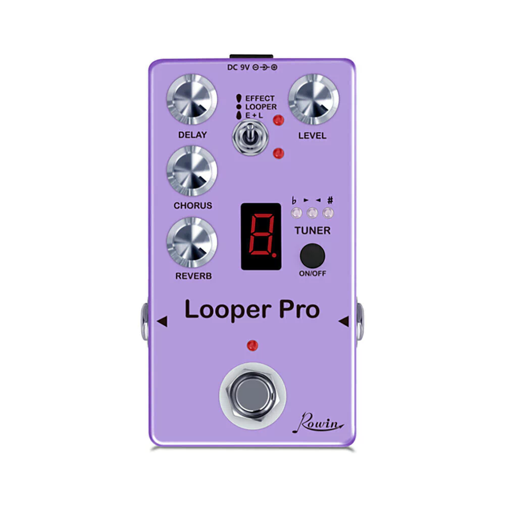

# ROWIN — multi-effects

[All guitar](../all-guitar.md) · [Repository](../README.md)

<!-- brand-index begins -->
**Model and section index — A–Z, natural numeric order**

- [RE-05 Looper Pro](#re-05-looper-pro)
<!-- brand-index ends -->

## RE-05 Looper Pro

<!-- firmware-pitch:ROWIN::RE-05 Looper Pro begins -->
### Firmware and pitch audit — ROWIN RE-05 Looper Pro

| Field | Sourced finding |
|---|---|
| Firmware / first hardware release | 2023-09-23 (public demo availability by proxy). Original exact-model demo metadata dates the RE-05 public demonstration September 23, 2023. This establishes availability by that date, not the global first-sale date; earlier distribution remains possible. Reverb seller year fields vary (2022/2023) and are not authenticated release dates. An August 2022 review syndicated on a RE-05 shop page explicitly concerns the different Nano Looper variant and is excluded. [launch 1](https://www.youtube.com/watch?v=4D6SRZre8n4) |
| Firmware / latest verification | Not verified — Unverified. No authenticated RE-05 firmware version/date or updater located. Official index names RE-05 Manual.pdf,907.95KB, but direct PDF/body not obtained. Desktop product returned502; English support route404. No release-to-update duration established; do not borrow LEF-332/Twin Looper firmware. [firmware 1](https://www.rowinmusic.com/pd.jsp?fromColId=168&id=243) [firmware 2](https://www.rowinmusic.com/cn/col.jsp?id=142&m602pageno=5) |
| Firmware / release date | Not verified (unknown precision) |
| Firmware / release-to-update duration | Not calculable from verified dates; observed release span, not continuous support or promised future updates. |
| Firmware / audit date | 2026-11-23; [firmware recap](../FIRMWARE-UPDATES.md). |
| Pitch / note handling | No pitch algorithm documented in checked sources. Manufacturer names reverb,chorus,delay,tuner and looper. No dedicated interval shifter,transpose,octave or harmonizer documented. Chorus modulation and tuner pitch detection are not proof of polyphonic pitch-shift processing. [pitch 1](https://www.rowinmusic.com/pd.jsp?fromColId=168&id=243) |
| Pitch / preset recall | Factory/user/total program memory and pitch-preset recall unverified. Forty-second loop recording with overdubbing is not a patch-memory count. |
| Pitch / DSP resources | No pitch-specific CPU/DSP figure located. Five named functions do not establish five freely assignable processing blocks or20% per function; no shared-DSP meter measurement made. |
| Pitch / qualifications | Exact Looper Pro name is shared with other brands; generated ASIN manuals,VSN/M-VAVE and sibling ROWIN instructions are not exact-model firmware evidence. |
| Pitch / comparison | [Polyphony, presets and DSP recap](../PITCH-SHIFTING.md). |

Sources checked:

- [ROWIN RE-05 Looper Pro manufacturer product page](https://www.rowinmusic.com/pd.jsp?fromColId=168&id=243) — Exact RE-05 name and chorus/delay/reverb/tuner/looper list;40-second recording/overdub wording. No dated launch,pitch or firmware release. (Manufacturer search-indexed body inspected; direct502).
- [ROWIN manufacturer support index — RE Series manuals](https://www.rowinmusic.com/cn/col.jsp?id=142&m602pageno=5) — RE-05 Manual.pdf907.95KB listed; this does not establish manual contents or a firmware version. (Manufacturer indexed original list inspected; PDF not retrieved).
- [Гитарная педаль Rowin RE-05 Looper Pro — Сергей](https://www.youtube.com/watch?v=4D6SRZre8n4) — Original YouTube video metadata: published 2023-09-23, exact Rowin RE-05 Looper Pro title, uploader Сергей. Used only as public-demo availability-by proxy; not a first-sale announcement or watched hardware test. (indexed_original_video_metadata_direct_fetch_failed).
- [RE-05 shop page with mixed-variant customer reviews](https://www.shopabunda.com/products/rowin-re-05-looper-pro-guitar-multi-effect-pedals-with-looper-delay-chorus-reverb-and-tuner-on-one-pedal-true-bypass) — August 20, 2022 Detman101 review explicitly marked Color: Nano Looper and describes a single-function thumb-sized looper. Excluded as evidence for four-knob multi-effect RE-05 introduction. (indexed_retailer_review_text).

<!-- firmware-pitch:ROWIN::RE-05 Looper Pro ends -->

<!-- model-images:ROWIN::RE-05 Looper Pro begins -->

Product pictures — top and rear ports

**ROWIN RE-05 Looper Pro overhead product image — powered-on state unverified**

[Image source](https://www.phmusicstore.com.br/produtos/pedal-de-loop-e-afinador-rowin-re-05-loop-pro-c-efeitos-pd1193/). Visually inspected ROWIN-branded purple Looper Pro image on exact RE-05 retailer listing: four knobs (Delay,Level,Chorus,Reverb), one footswitch, one separate tuner ON/OFF button and a mode toggle marked EFFECT/LOOPER/E+L. One seven-segment-style tuner digit plus separate indicator lenses depicted; not an LCD/touchscreen claim. This is a straight overhead product graphic with all digit segments visible, not independent proof of powered-on operation or installed revision. Side audio sockets partly visible; rear power socket not fully shown. Panel saysDC9V with center-negative symbol, but current/plug size are not inferred. Powered-on hardware photo and complete rear-port view remain pending. Seller dimensions/runtime and generated mirror manual claims are not adopted; manufacturer40-second wording retained.

**Rear view:** not yet verified.

<!-- model-images:ROWIN::RE-05 Looper Pro ends -->

Checked2026-10-18; partial. Manufacturer RE-05(Looper Pro) page matches the Shopee Looper Pro name and chorus/delay/reverb/tuner combination; seller title omits RE-05, so exact revision/label remains unconfirmed. Ownership,bass andvocal suitability unverified.

| Field | Evidence / qualification |
|---|---|
| Expression | Built-in,external andtoe support unverified; manufacturer control list does not describe anexpression pedal. [RWP] |
| Knobs / footswitches / buttons | Manufacturer states **4 rotary,1 footswitch**:LEVEL,DELAY,CHORUS,REVERB. Separate buttons andcomplete visual census unverified. Indicators are not counted as buttons. [RWP] |
| Display | Manufacturer lists two indicators andpower LED; screen presence,technology,diagonal,color andtouch unverified. [RWP] |
| Dimensions / mass | **112D×60W×45H mm;350g**, manufacturer specification,not measurement. [RWP] |
| Processing / categories | Independent delay,chorus,reverb controls plus tuner andlooper are documented. Manufacturer calls these five functions; this is not five freely assignable sound-processing blocks. Delay knob adjusts time,chorus depth,reverb wet/dry ratio. Simultaneous ceiling,routing order andalternative algorithm counts remain unverified. These distinct effect families establish multi-effects eligibility beyond looping alone. [RWP] |
| Factory / user memory | Factory-filled,user,total patch slots andinitial blank split unverified. Loop recording is not evidence of preset memory. |
| Synth / acoustic | Dedicated synthesis andelectric-to-acoustic simulation unverified. |
| I/O | Complete audio/control/data sockets,connector dimensions,levels,impedances,stereo/mono andheadphones unverified from readable primary text. |
| Power / battery / USB | Voltage,current,polarity,adapter inclusion,barrel size,battery andUSB power unverified. |
| IR / NAM / capture | UserIR,nativeNAM,convertedNAM andproprietary capture loading unverified. |
| Editor / software | Editor platforms,driver/updater support andUSB audio unverified. |
| Looper / live | Manufacturer states **up to40seconds** recording withunlimited overdubbing; not unlimited phrase length orverified persistent storage. True-bypass footswitch wording is published; bypass topology,effect tails,loop gestures,drums andscenes unverified. [RWP] |

### Separate IDR hardware evidence

| Field | Evidence / qualification |
|---|---|
| IDR verified used | Unknown. |
| IDR verified new | Unknown. |
| IDR condition-unverified sold-out offer | **Rp575.000;Habis**, MICKEY MOUSE SHOP,KotaJakartaPusat,shop19700013/item24253387970. [Exact Shopee item][RWS]. Checked2026-10-18;searchcachefive monthsold,directcachemiss. Title saysRowinLooperPro/Chorus/Delay/Reverb/Tuner;RE-05label/revision,condition,workingstate,selectedvariant,adapter/bundle,warranty/importregion,authenticity,voucher,shipping/tax andcheckouttotal unverified. Deliveryservice unavailable. Cached sold-out ask,not current stock orcompleted sale. |

Primary manufacturer indexed product body used;desktop reopening timed out. No generated mirror manual/FAQs accepted,no images visually audited,no files/dependencies downloaded orhardware/software operated. No sibling specs assigned.

[RWP]: https://www.rowinmusic.com/pd.jsp?fromColId=168&id=243
[RWS]: https://shopee.co.id/Efek-Gitar-Multi-Rowin-Looper-Pro-Chorus-Delay-Reverb-Tuner-Pedal-i.19700013.24253387970

### Manufacturer manual lead and evidence boundary

Checked2026-10-18: the [manufacturer English support index](https://rowinmusic.com/col.jsp?id=102) lists **RE-05 Manual.pdf,907.95KB** under RE Series Manual; the [Chinese support index](https://www.rowinmusic.com/cn/col.jsp?id=142&m602pageno=5) independently lists the same filename/size. Both reopened pages timed out; no direct PDF URL or document contents were retrieved. This establishes an exact-model manufacturer manual lead, not its revision or specifications.

The apparent PDF-brochure link on a retailer page resolves only to a brochure-icon GIF. Generated ASIN manuals and retailer prose were not accepted as original Rowin documentation. Their power,port,dimension andloop-mode assertions remain outside verified technical fields pending the original manual. No file downloaded,software installed ordevice operated.

### Scope recheck and alternate primary route

Checked 2026-10-18: indexed [manufacturer mobile product body](https://m.rowinmusic.com/pd.jsp?desc=true&mid=3&pid=243&sortName=name) independently repeats the exact RE-05 name and separate chorus/delay/reverb controls. Retain multi-effects eligibility; a looper-only classification would omit those processors. This does not establish simultaneous operation or algorithm alternatives. The mobile page’s $0.00 display is not a qualified hardware offer or an IDR price.

Desktop product/support reopening timed out; mobile support was inaccessible. The RE-05 PDF remains a filename-only lead. Secondary seller text was not promoted to verified power, socket, control or runtime specifications. No manual downloaded; physical model/revision and remaining technical gaps stay unresolved.

### RE-05 — expression eligibility and footprint

Checked2026-10-28 against indexed [exact manufacturer product text][RWP]. Existing active guitar multi-effects record,not a new admission. Manufacturer60W×112Dmm fits the preferred200W×140D rectangle. Four rotary controls andone footswitch are listed,but this is not a complete panel/socket census: no-treadle layout,analog EXP andheadphone support remain **unknown**. A physical LEVEL knob is not evidence of external expression orglobal assignment.

Preset memory andonboard preset down/up remain unverified;loop gestures do not establish preset navigation. Volume position,minimum/maximum,recall,bypass,headphone,tail andrecorded-loop attenuation remain unknown. Keep outside the main expression capability table pending exact original manual/panel evidence.

The manufacturer support index still exposes only the RE-05 Manual.pdf filename/907.95KB lead in readable results;direct pages timed out. Generated ASIN prose andVSN-branded material are not exact Rowin primary documentation. No new specifications imported from them. No local download ordevice test.
