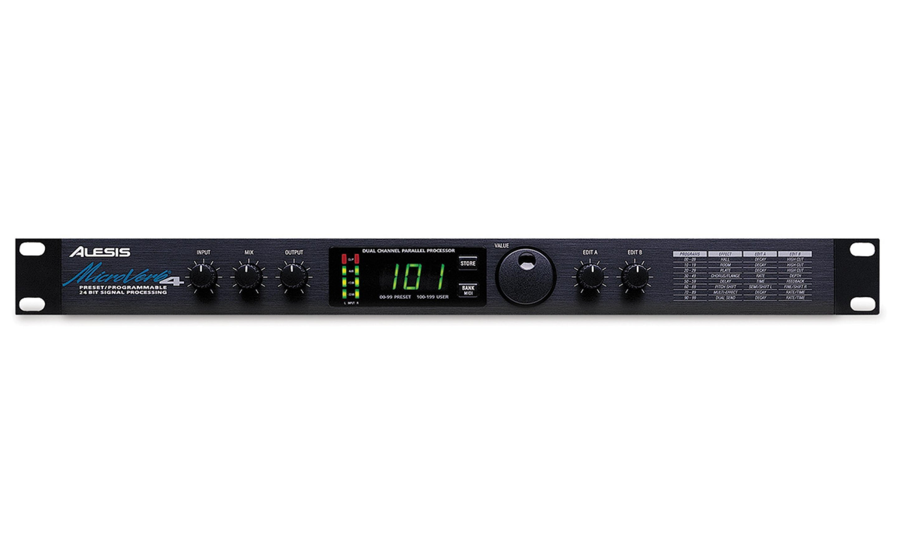
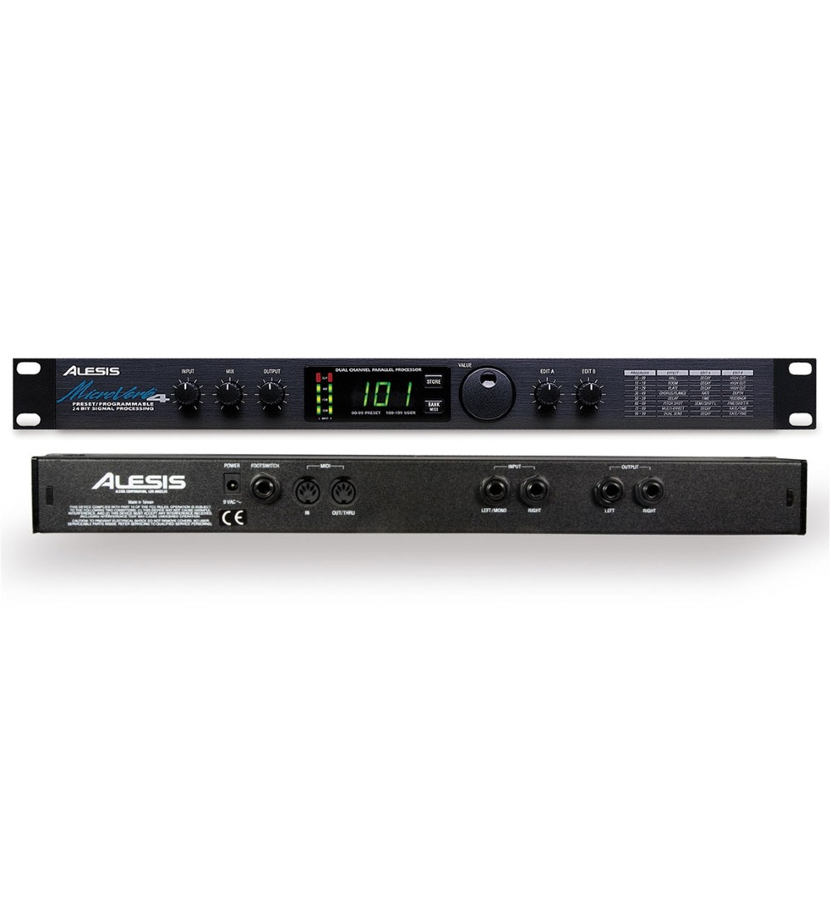
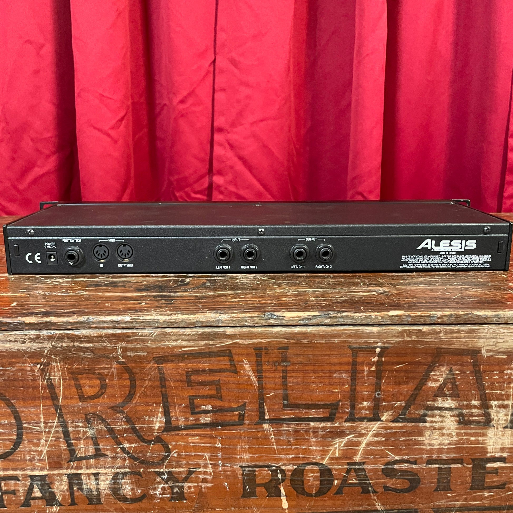

# Alesis product photos

[All photo galleries](../PHOTOS.md) · [Verification gaps](../RESEARCH-GAPS.md)

Click a thumbnail for the full archived image when available. Read the linked canonical record for source and inspection notes; powered status and camera angle are separate requirements.

| Model / evidence | Control face | Rear / connector edge |
|---|---|---|
| [Alesis MicroVerb 4](../brand/ALESIS.md#microverb-4) |  Powered; angle not verified perpendicular |  Unlit |
| [Alesis MIDIverb 4](../brand/ALESIS.md#midiverb-4) |  Powered; angle not verified perpendicular |  Unlit |
| [Alesis MIDIverb III](../brand/ALESIS.md#midiverb-iii) |  Powered; angle not verified perpendicular |  Unlit |
| [Alesis NanoVerb](../brand/ALESIS.md#nanoverb) |  Powered; angle not verified perpendicular |  Unlit |
