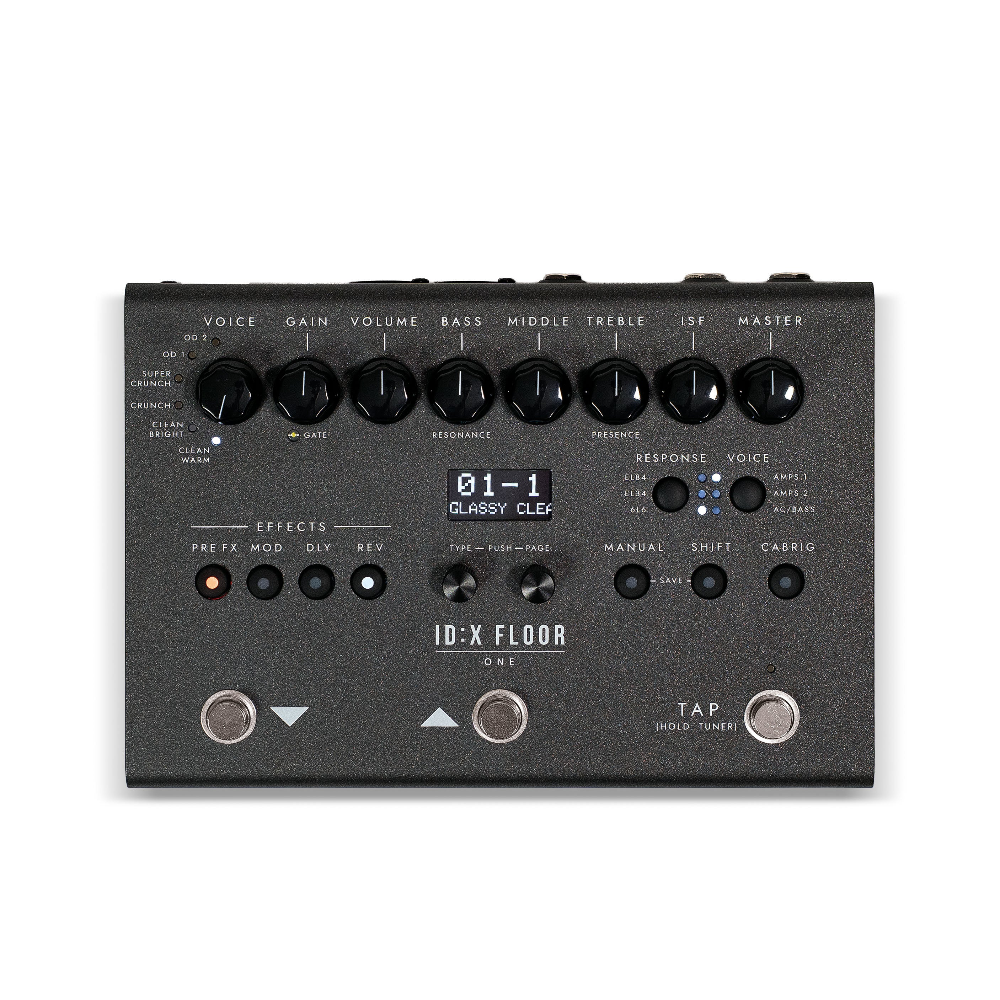
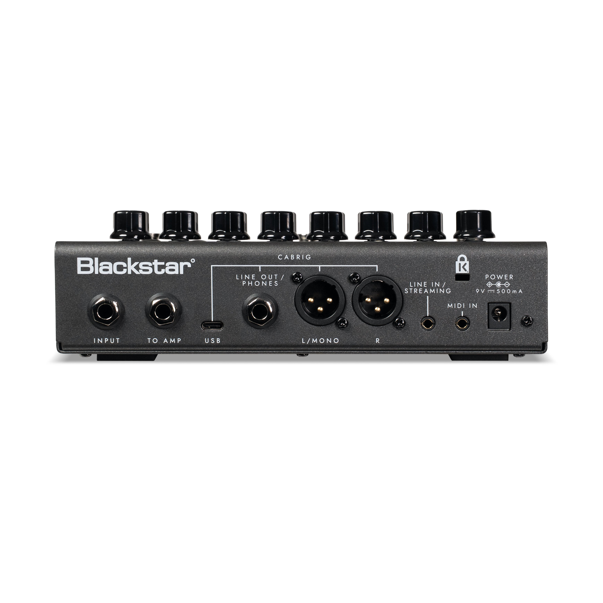
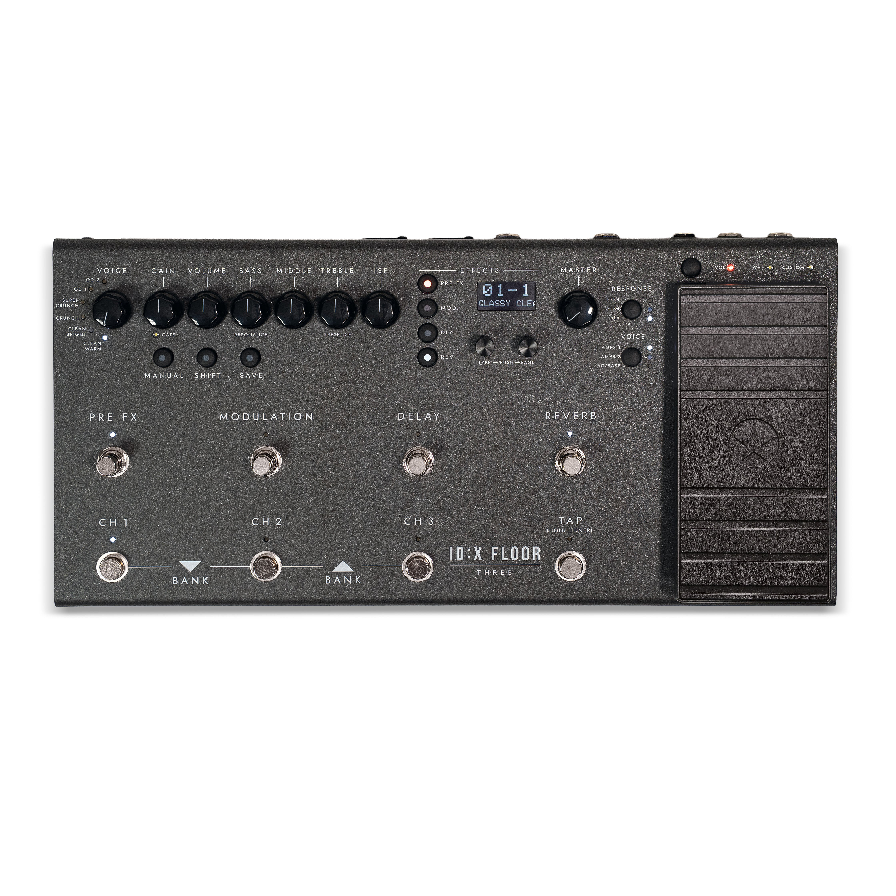
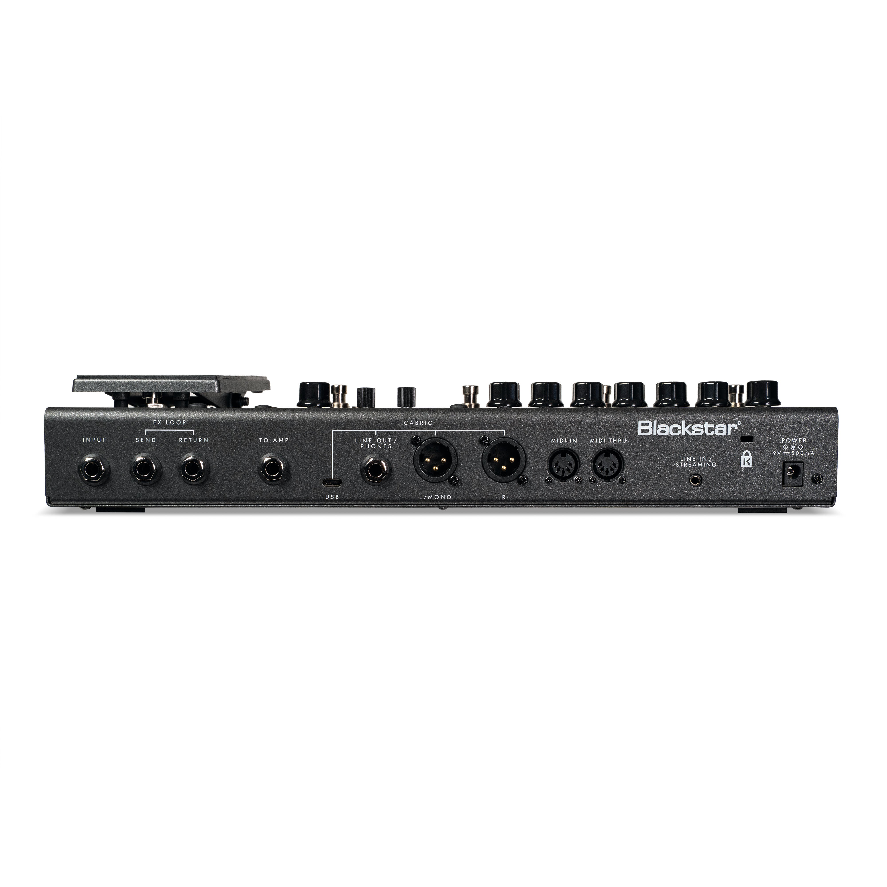

# Blackstar product photos

[All photo galleries](../PHOTOS.md) · [Verification gaps](../RESEARCH-GAPS.md)

Click a thumbnail for the full archived image when available. Read the linked canonical record for source and inspection notes; powered status and camera angle are separate requirements.

| Model / evidence | Control face | Rear / connector edge |
|---|---|---|
| [Blackstar ID:X Floor One](../brand/BLACKSTAR.md#idx-floor-one) |  Powered; perpendicular |  Unlit |
| [Blackstar ID:X Floor Three](../brand/BLACKSTAR.md#idx-floor-three) |  Powered; perpendicular |  Unlit |
