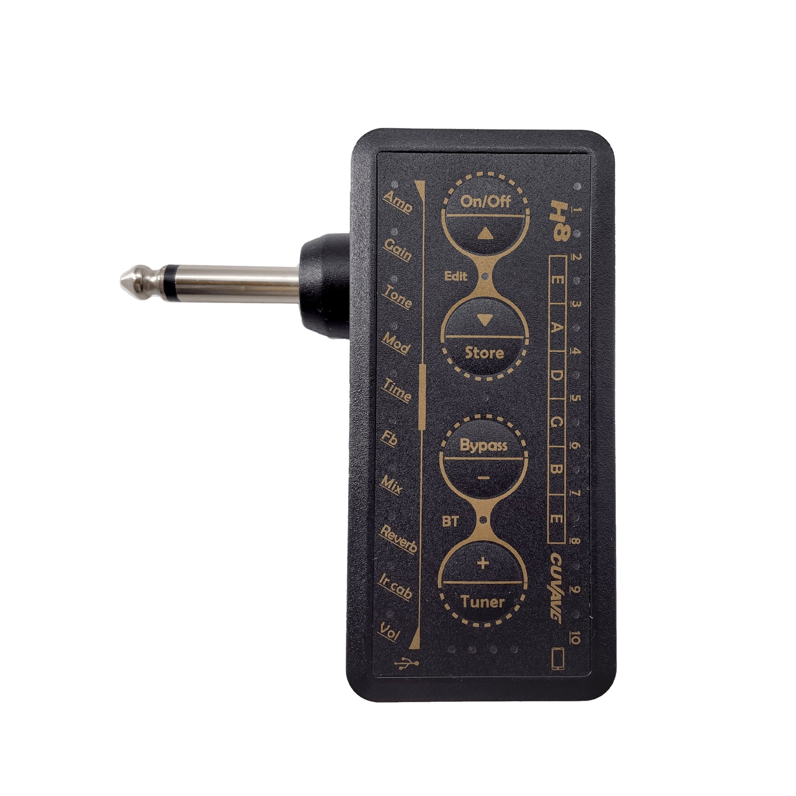
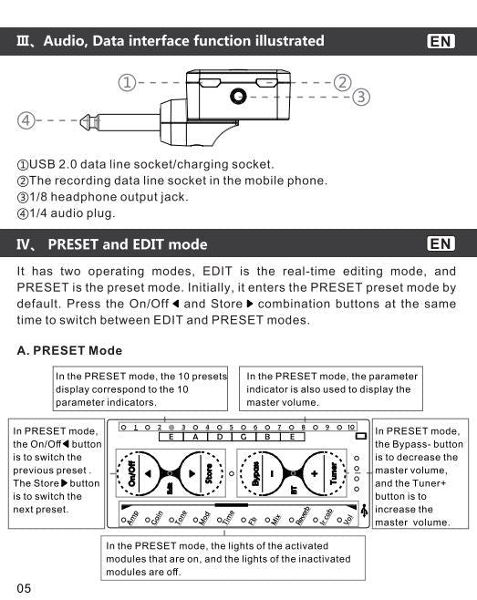

# CUVAVE product photos

[All photo galleries](../PHOTOS.md) · [Verification gaps](../RESEARCH-GAPS.md)

Click a thumbnail for the full archived image when available. Read the linked canonical record for source and inspection notes; powered status and camera angle are separate requirements.

| Model / evidence | Control face | Rear / connector edge |
|---|---|---|
| [CUVAVE H8](../brand/CUVAVE.md#h8) |  Unlit; perpendicular |  Power unverified / stock |
