# DigiTech product photos

[All photo galleries](../PHOTOS.md) · [Verification gaps](../RESEARCH-GAPS.md)

Click a thumbnail for the full archived image when available. Read the linked canonical record for source and inspection notes; powered status and camera angle are separate requirements.

| Model / evidence | Control face | Rear / connector edge |
|---|---|---|
| [DigiTech BP355](../brand/DIGITECH.md#bp355) |  Powered; angle not verified perpendicular |  Power unverified / stock |
| [DigiTech GNX3](../brand/DIGITECH.md#gnx3) |  Powered; angle not verified perpendicular |  Power unverified / stock |
| [DigiTech GNX4](../brand/DIGITECH.md#gnx4) |  Powered; angle not verified perpendicular |  Power unverified / stock |
| [DigiTech RP55](../brand/DIGITECH.md#rp55) |  Unlit; angle not verified perpendicular | <a href="../brand/images/digitech-rp55-rear-83e2c0448f55.jpg">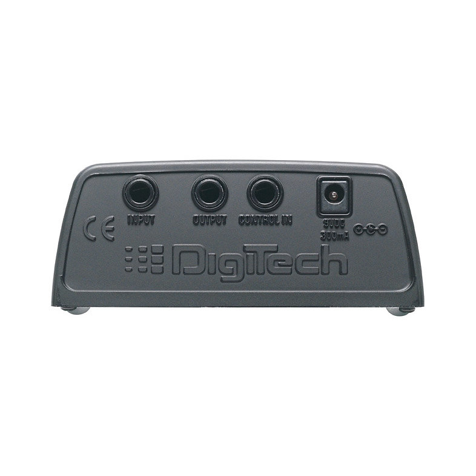</a> Power unverified / stock |
| [DigiTech RP70](../brand/DIGITECH.md#rp70) | <a href="../brand/images/digitech-rp70-top-112c170e0fba.jpg">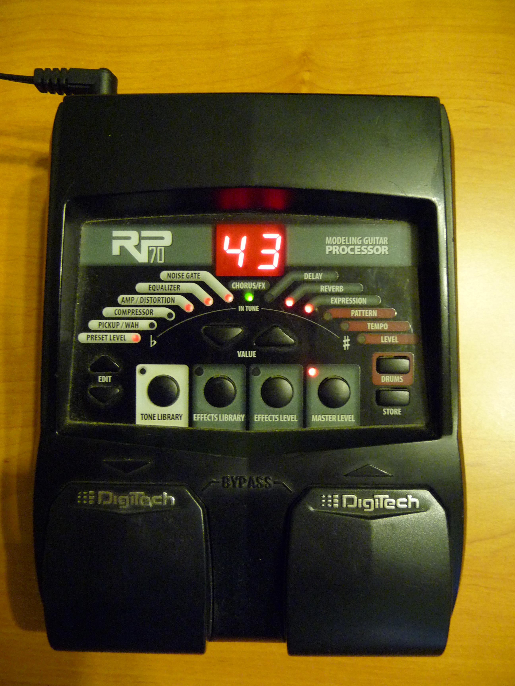</a> Powered; angle not verified perpendicular | <a href="../brand/images/digitech-rp70-rear-3e409f29aad8.webp">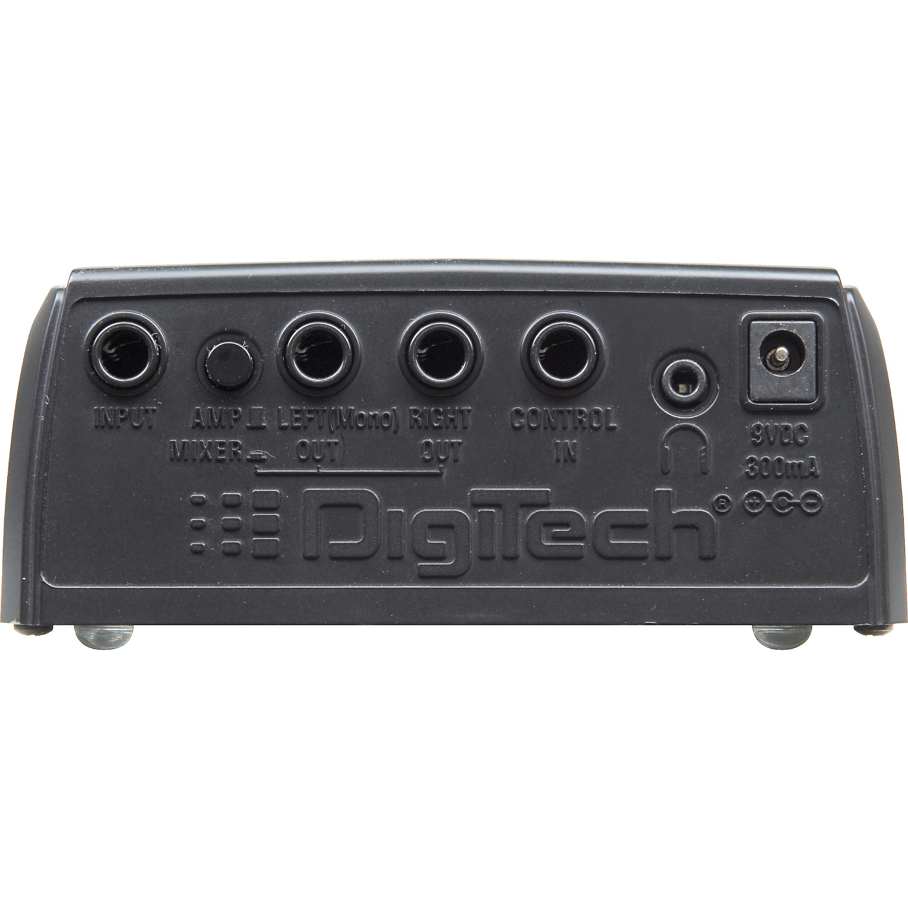</a> Power unverified / stock |
| [DigiTech RP80](../brand/DIGITECH.md#rp80) |  Powered; angle not verified perpendicular |  Power unverified / stock |
| [DigiTech RP90](../brand/DIGITECH.md#rp90) | <a href="../brand/images/digitech-rp90-top-12d21b8a7292.jpg">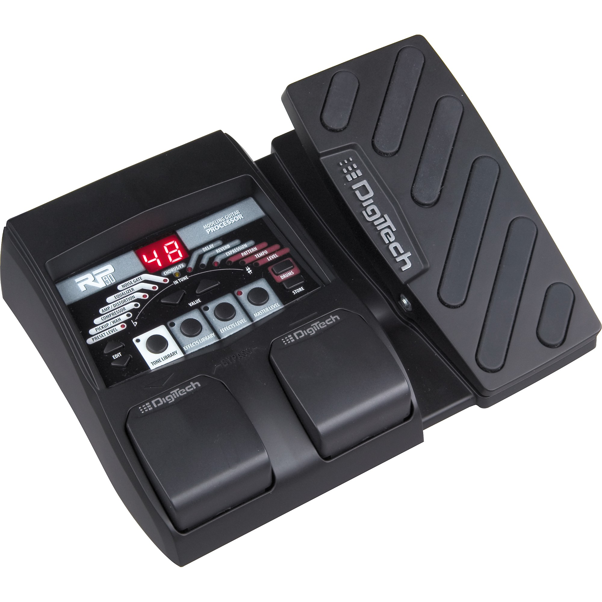</a> Powered; angle not verified perpendicular | <a href="../brand/images/digitech-rp90-rear-ae140445587a.jpg">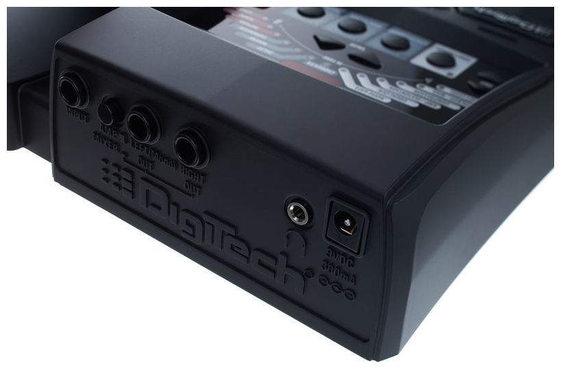</a> Power unverified / stock |
| [DigiTech RP150](../brand/DIGITECH.md#rp150) |  Powered; perpendicular |  Unlit |
| [DigiTech RP155](../brand/DIGITECH.md#rp155) |  Powered; angle not verified perpendicular |  Unlit |
| [DigiTech RP200](../brand/DIGITECH.md#rp200) |  Power unverified / stock; angle not verified perpendicular |  Power unverified / stock |
| [DigiTech RP250](../brand/DIGITECH.md#rp250) | <a href="../brand/images/digitech-rp250-top-334b90723bad.jpg">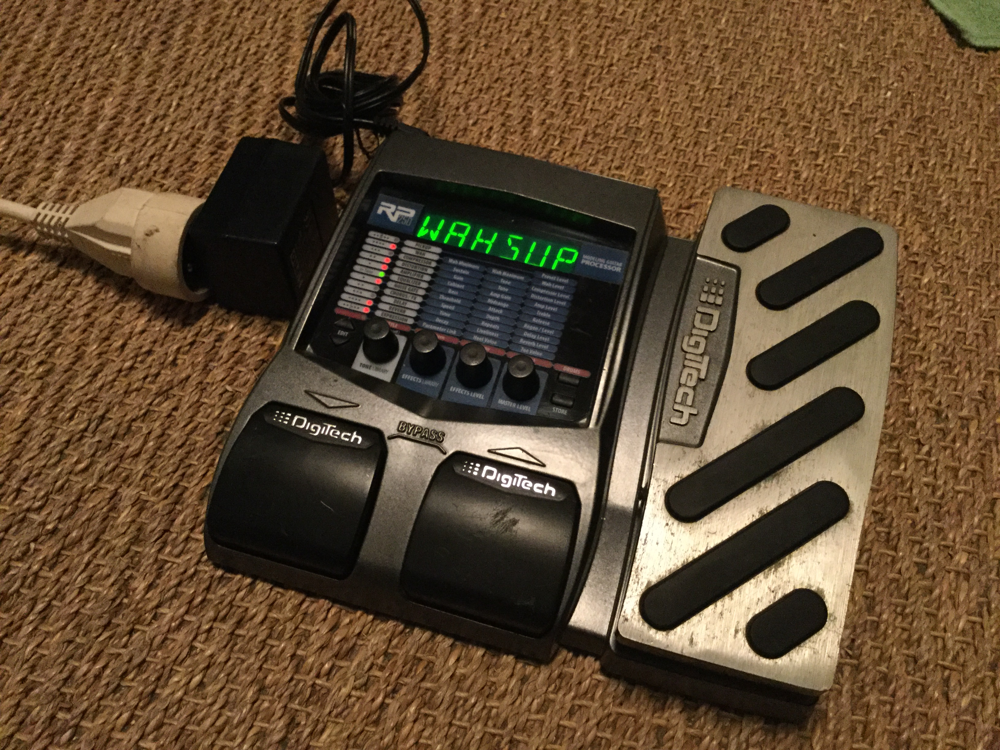</a> Powered; angle not verified perpendicular | <a href="../brand/images/digitech-rp250-rear-37310966f3ac.webp">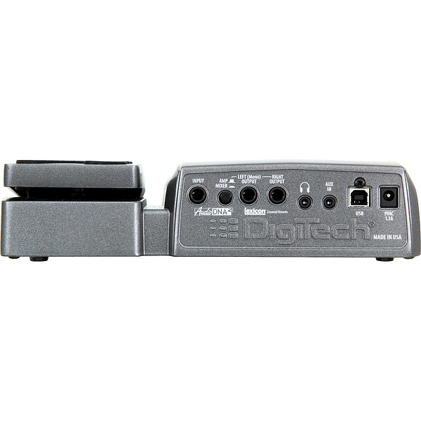</a> Power unverified / stock |
| [DigiTech RP255](../brand/DIGITECH.md#rp255) |  Powered; perpendicular | <a href="../brand/images/digitech-rp255-rear-1fc5b7f4c543.webp">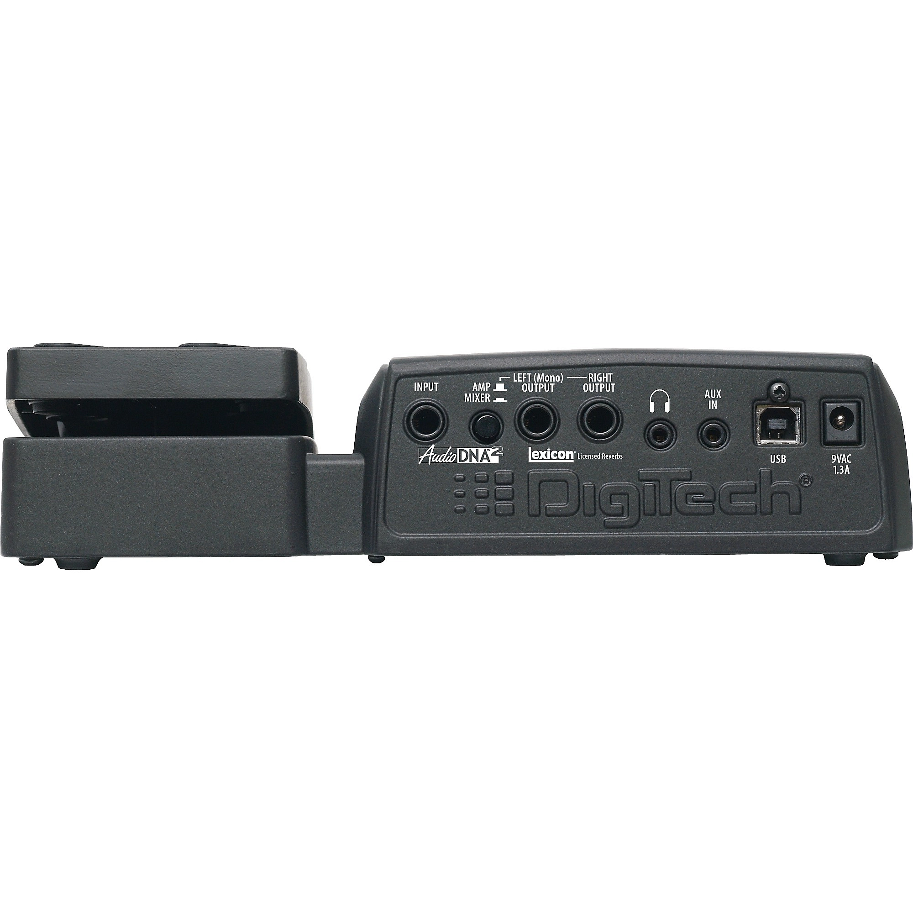</a> Power unverified / stock |
| [DigiTech RP350](../brand/DIGITECH.md#rp350) |  Powered; angle not verified perpendicular | <a href="../brand/images/digitech-rp350-rear-6b1b6f4344c5.jpg">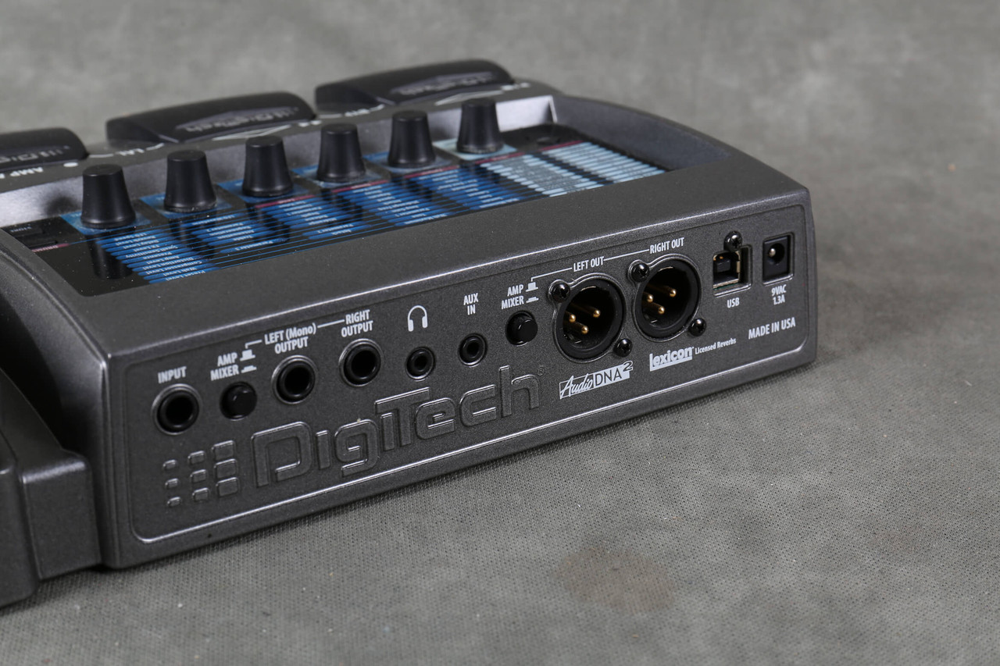</a> Power unverified / stock |
| [DigiTech RP355](../brand/DIGITECH.md#rp355) | <a href="../brand/images/digitech-rp355-top-236510aeb464.jpg">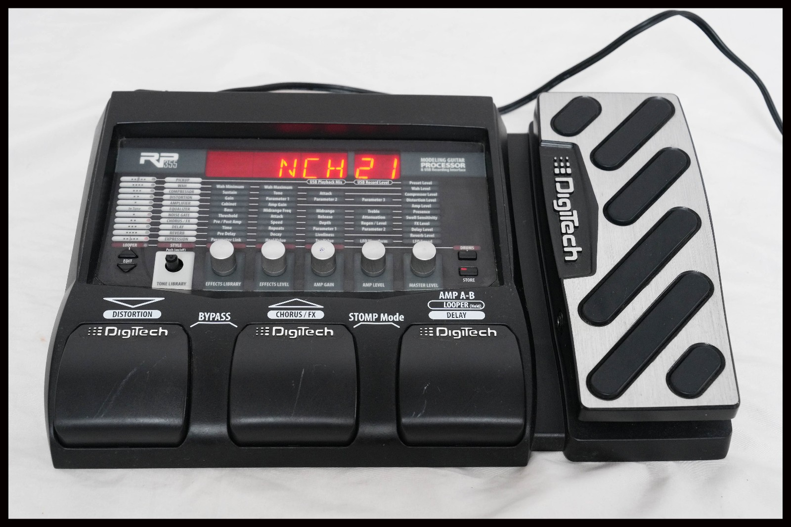</a> Powered; angle not verified perpendicular |  Power unverified / stock |
| [DigiTech RP360XP](../brand/DIGITECH.md#rp360xp) | <a href="../brand/images/digitech-rp360xp-top-38275558c418.jpg">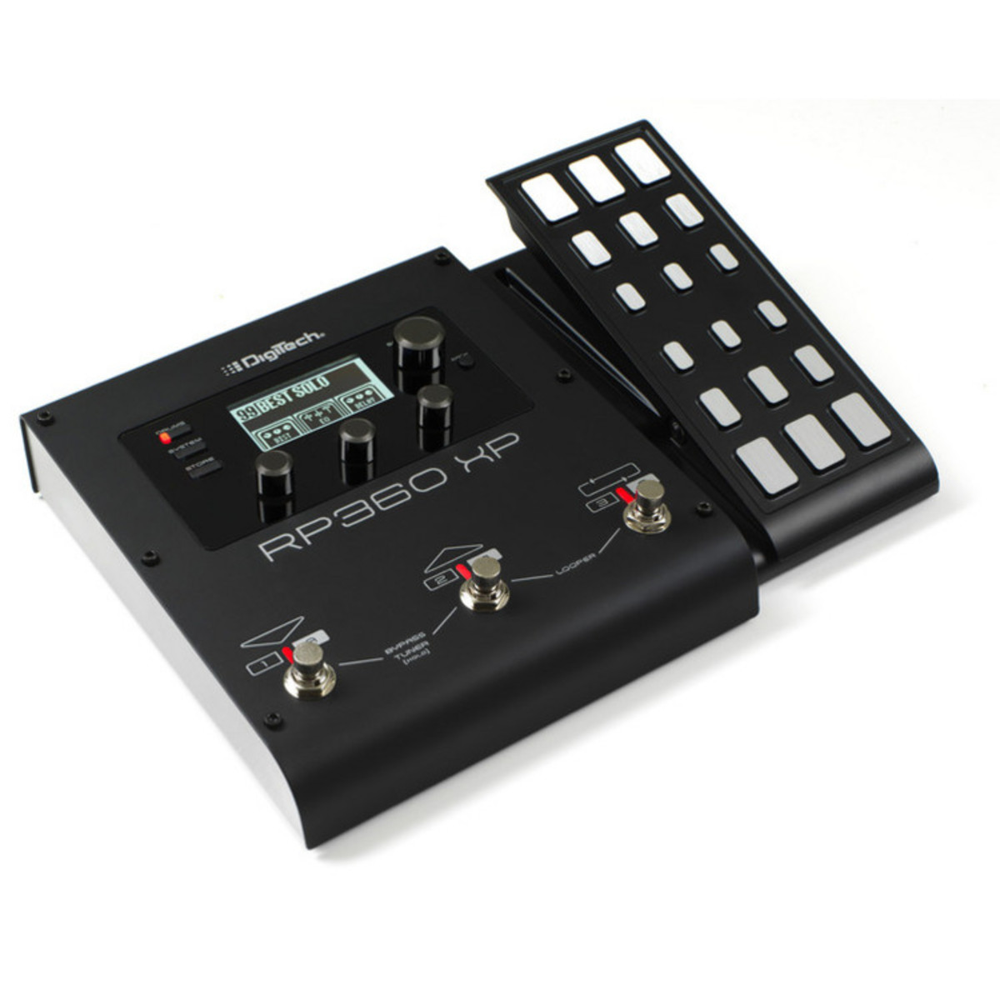</a> Powered; angle not verified perpendicular |  Power unverified / stock |
| [DigiTech RP500](../brand/DIGITECH.md#rp500) |  Powered; angle not verified perpendicular | <a href="../brand/images/digitech-rp500-rear-c35224ce10d9.jpg">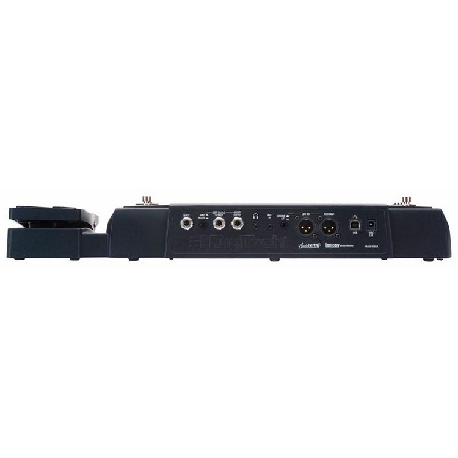</a> Power unverified / stock |
| [DigiTech RP1000](../brand/DIGITECH.md#rp1000) | <a href="../brand/images/digitech-rp1000-top-882bbcc4f77d.jpg">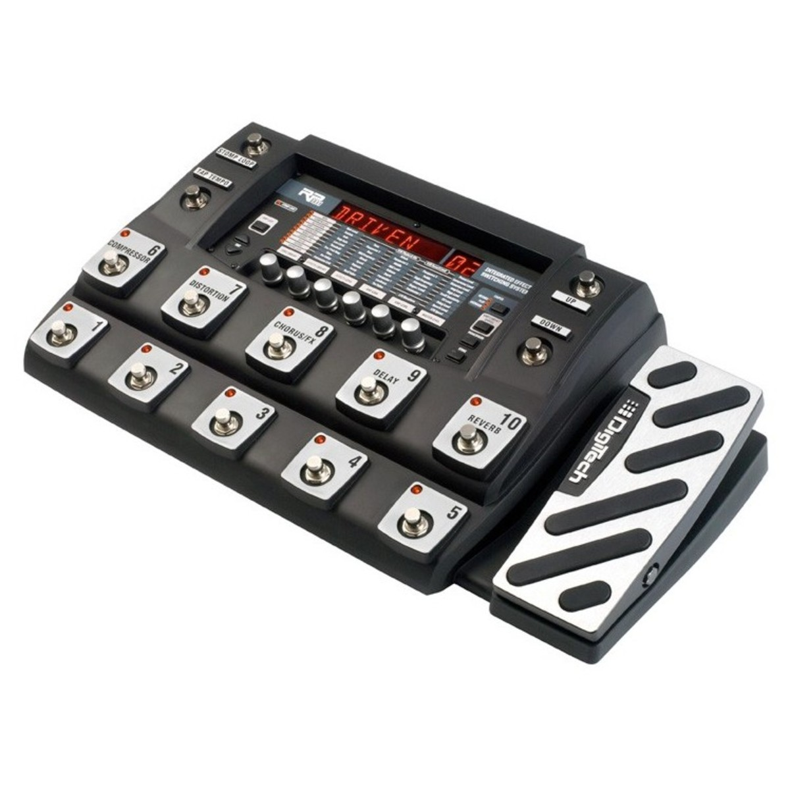</a> Powered; angle not verified perpendicular |  Power unverified / stock |
