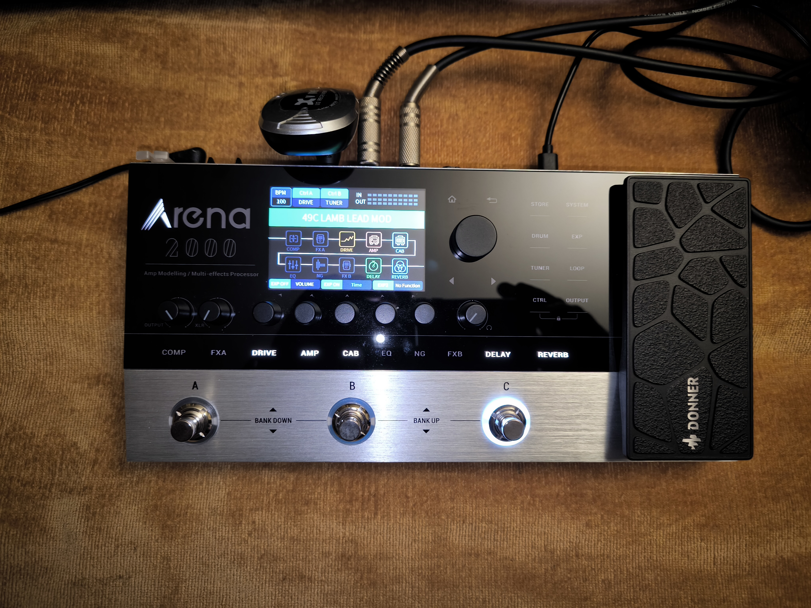
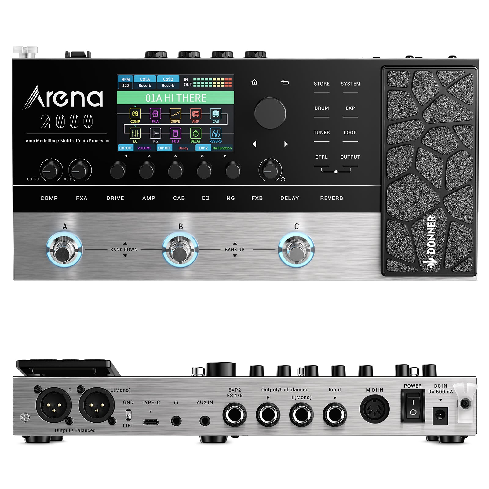
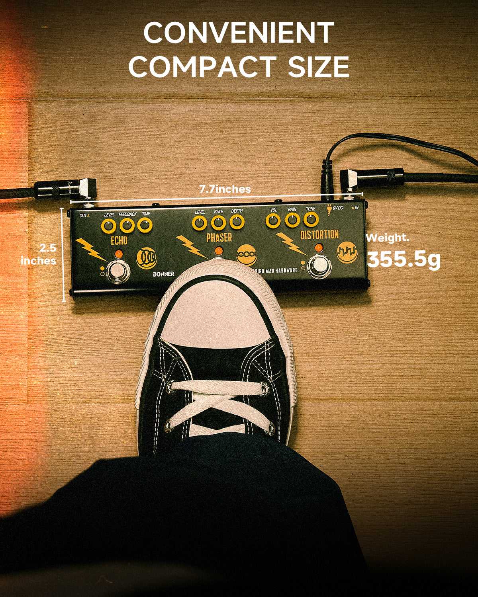
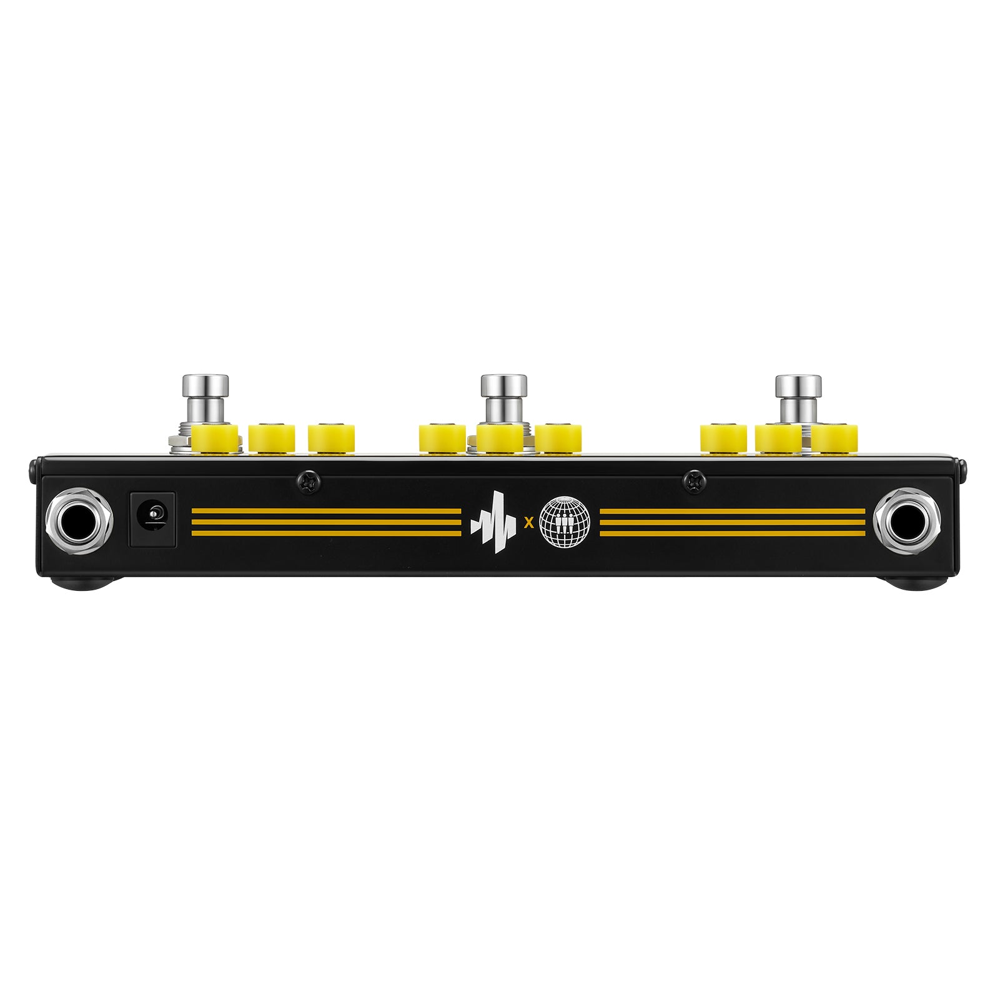

# Donner product photos

[All photo galleries](../PHOTOS.md) · [Verification gaps](../RESEARCH-GAPS.md)

Click a thumbnail for the full archived image when available. Read the linked canonical record for source and inspection notes; powered status and camera angle are separate requirements.

| Model / evidence | Control face | Rear / connector edge |
|---|---|---|
| [Donner Arena2000](../brand/DONNER.md#arena2000) |  Powered; angle not verified perpendicular |  Power unverified / stock |
| [Donner Triple Threat](../brand/DONNER.md#triple-threat) |  Powered; angle not verified perpendicular |  Power unverified / stock |
