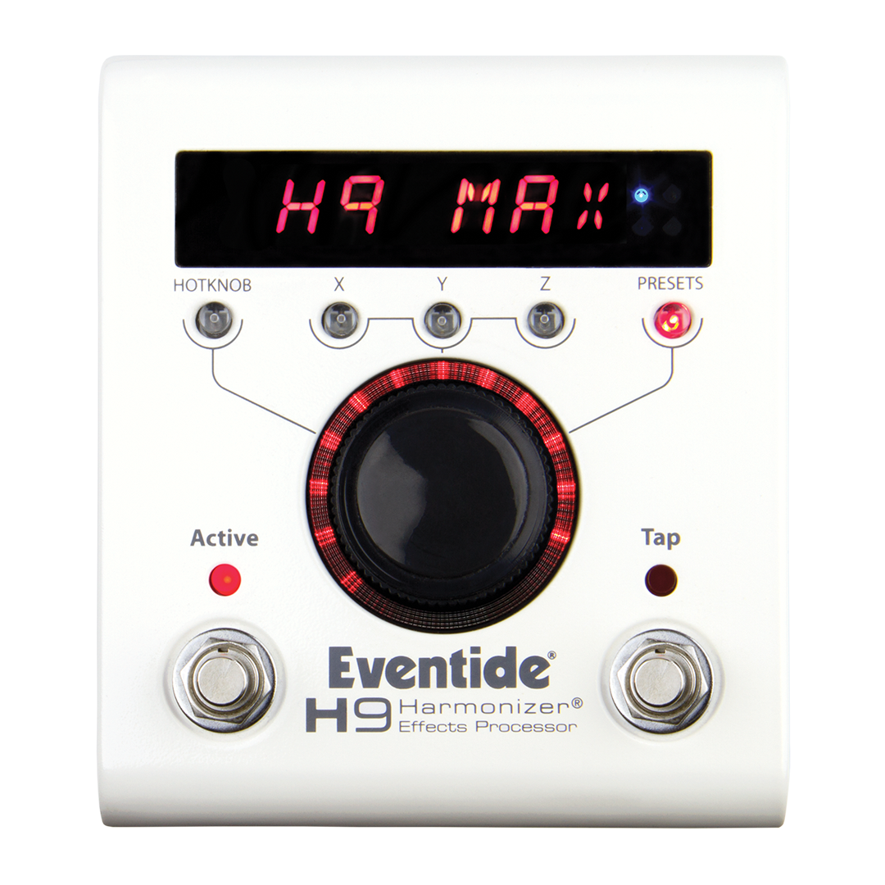
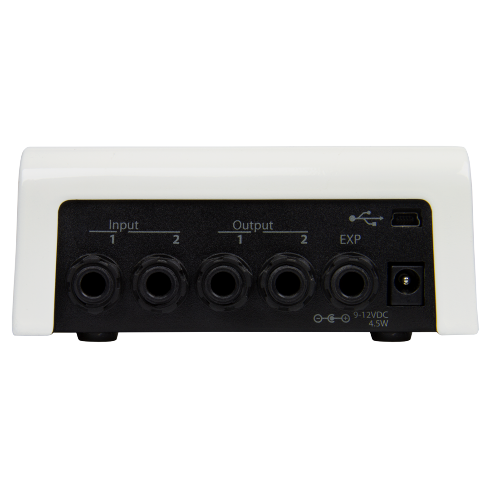
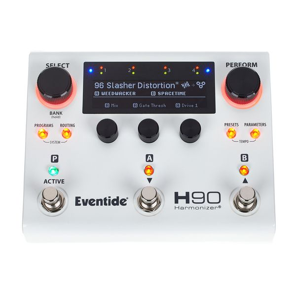
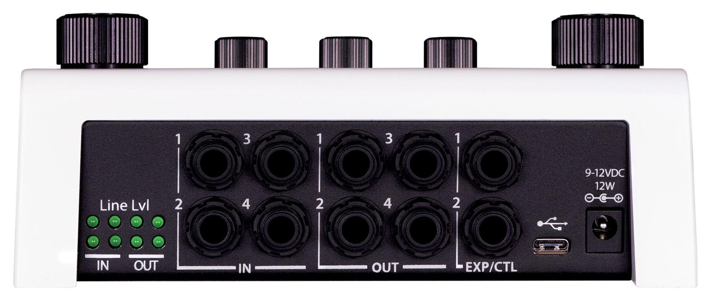

# Eventide product photos

[All photo galleries](../PHOTOS.md) · [Verification gaps](../RESEARCH-GAPS.md)

Click a thumbnail for the full archived image when available. Read the linked canonical record for source and inspection notes; powered status and camera angle are separate requirements.

| Model / evidence | Control face | Rear / connector edge |
|---|---|---|
| [Eventide H9 Max](../brand/EVENTIDE.md#h9-max) |  Powered; perpendicular |  Power unverified / stock |
| [Eventide H90](../brand/EVENTIDE.md#h90) |  Powered; angle not verified perpendicular |  Power unverified / stock |
