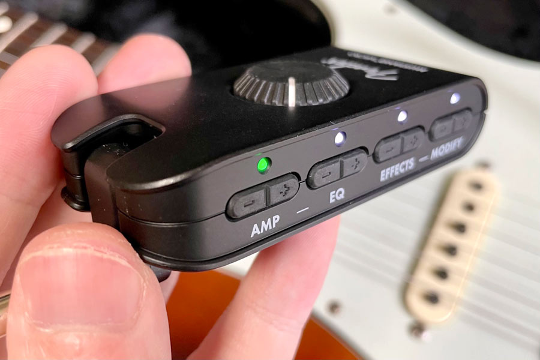
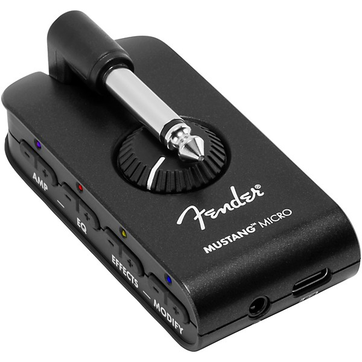
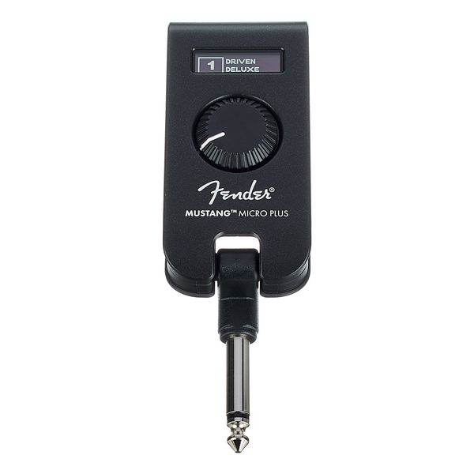
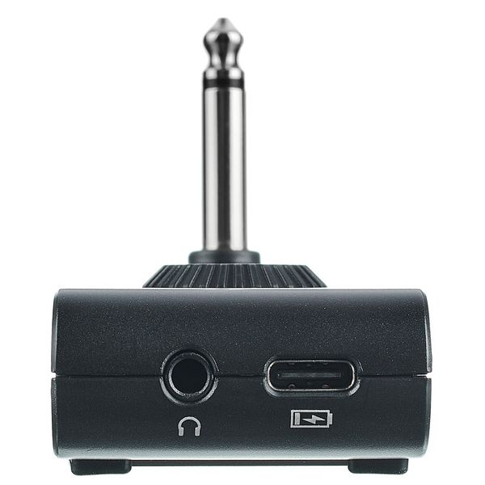
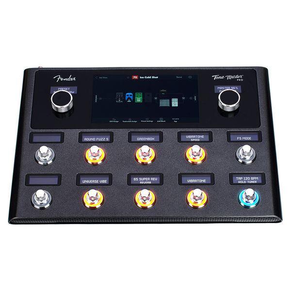
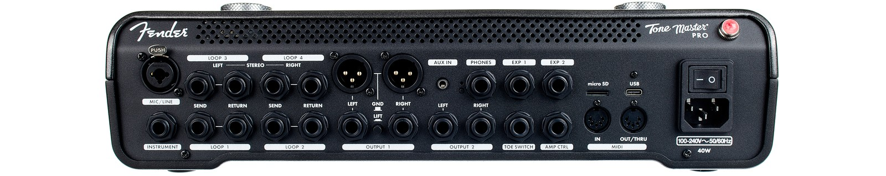

# Fender product photos

[All photo galleries](../PHOTOS.md) · [Verification gaps](../RESEARCH-GAPS.md)

Click a thumbnail for the full archived image when available. Read the linked canonical record for source and inspection notes; powered status and camera angle are separate requirements.

| Model / evidence | Control face | Rear / connector edge |
|---|---|---|
| [Fender Mustang Micro](../brand/FENDER.md#mustang-micro) |  Powered; angle not verified perpendicular |  Power unverified / stock |
| [Fender Mustang Micro Plus](../brand/FENDER.md#mustang-micro-plus) |  Powered; perpendicular |  Power unverified / stock |
| [Fender Tone Master Pro](../brand/FENDER.md#tone-master-pro) |  Powered; angle not verified perpendicular |  Power unverified / stock |
