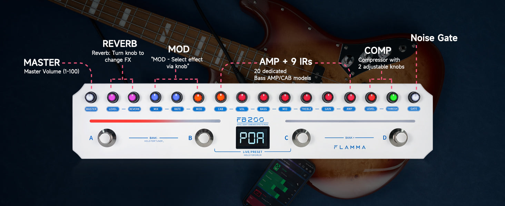
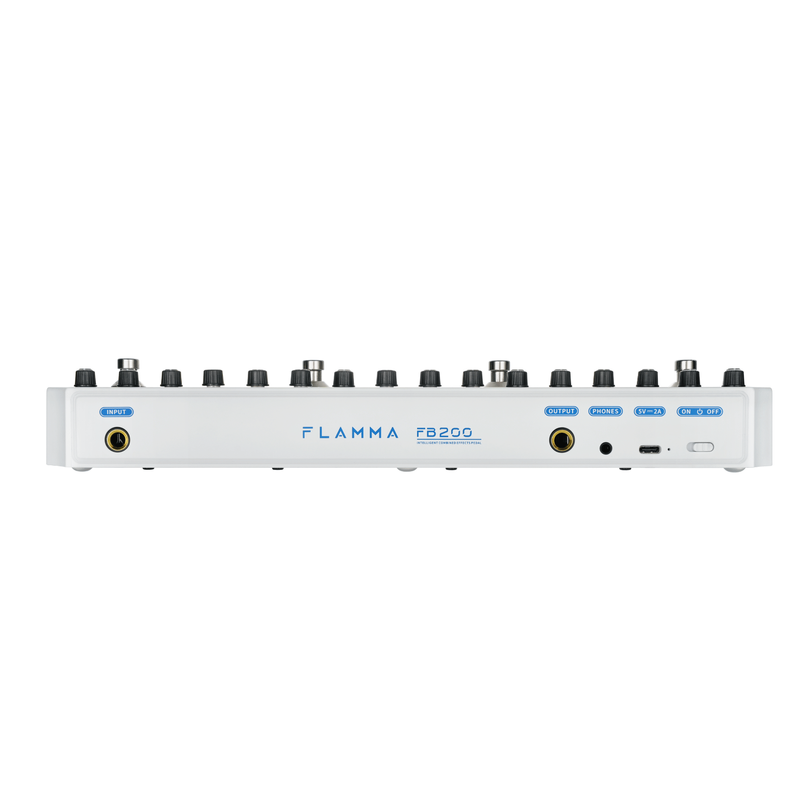
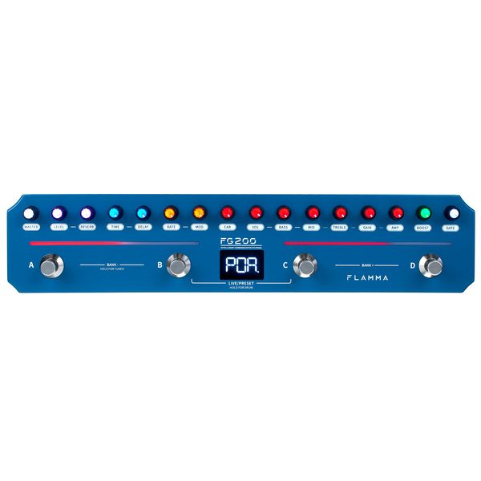
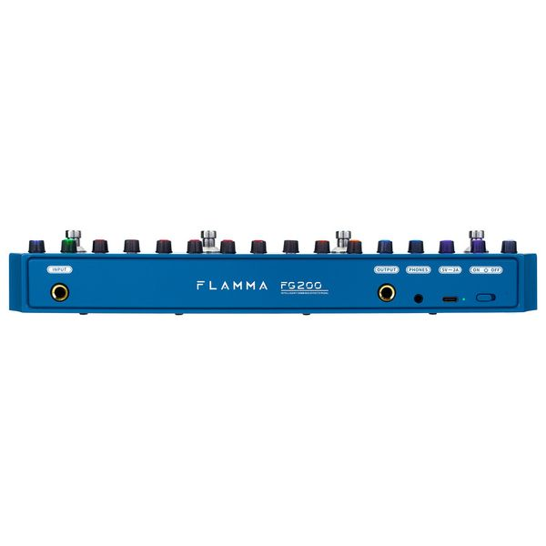
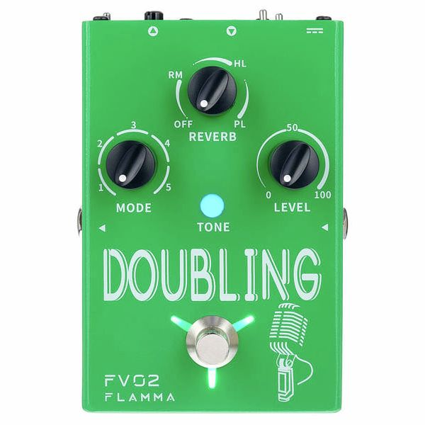
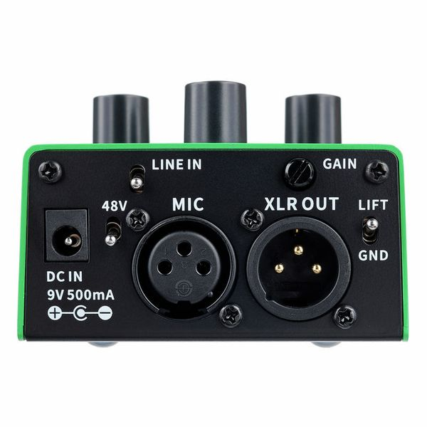

# Flamma product photos

[All photo galleries](../PHOTOS.md) · [Verification gaps](../RESEARCH-GAPS.md)

Click a thumbnail for the full archived image when available. Read the linked canonical record for source and inspection notes; powered status and camera angle are separate requirements.

| Model / evidence | Control face | Rear / connector edge |
|---|---|---|
| [Flamma FB200](../brand/FLAMMA.md#fb200) |  Power unverified / stock; perpendicular |  Power unverified / stock |
| [Flamma FG200](../brand/FLAMMA.md#fg200) |  Powered; perpendicular |  Power unverified / stock |
| [Flamma FV02 Doubling](../brand/FLAMMA.md#fv02-doubling) |  Powered; perpendicular |  Power unverified / stock |
| [Flamma FV03 Character](../brand/FLAMMA.md#fv03-character) |  Powered; perpendicular |  Power unverified / stock |
| [Flamma FV04 Harmony](../brand/FLAMMA.md#fv04-harmony) |  Powered; perpendicular |  Power unverified / stock |
| [Flamma FV05 Recorder](../brand/FLAMMA.md#fv05-recorder) |  Power unverified / stock; perpendicular |  Power unverified / stock |
| [Flamma FX20](../brand/FLAMMA.md#fx20) |  Power unverified / stock; angle not verified perpendicular |  Power unverified / stock |
| [Flamma FX50](../brand/FLAMMA.md#fx50) |  Powered; perpendicular |  Power unverified / stock |
| [Flamma FX100](../brand/FLAMMA.md#fx100) |  Powered; perpendicular |  Power unverified / stock |
| [Flamma FX150](../brand/FLAMMA.md#fx150) |  Powered; perpendicular |  Power unverified / stock |
| [Flamma FX150b](../brand/FLAMMA.md#fx150b) |  Powered; perpendicular |  Power unverified / stock |
| [Flamma FX200](../brand/FLAMMA.md#fx200) |  Powered; perpendicular |  Power unverified / stock |
