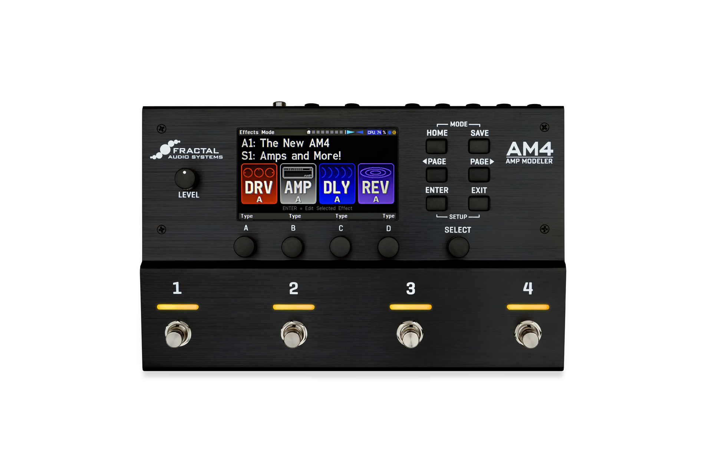
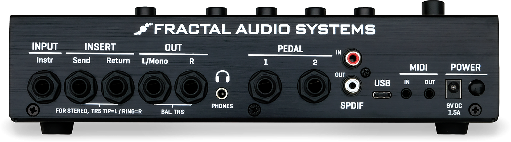
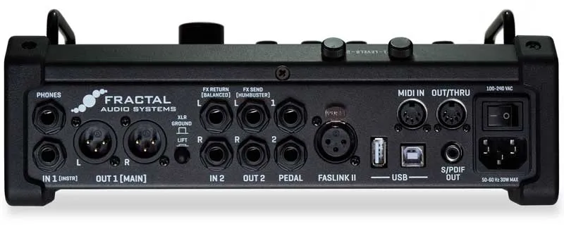
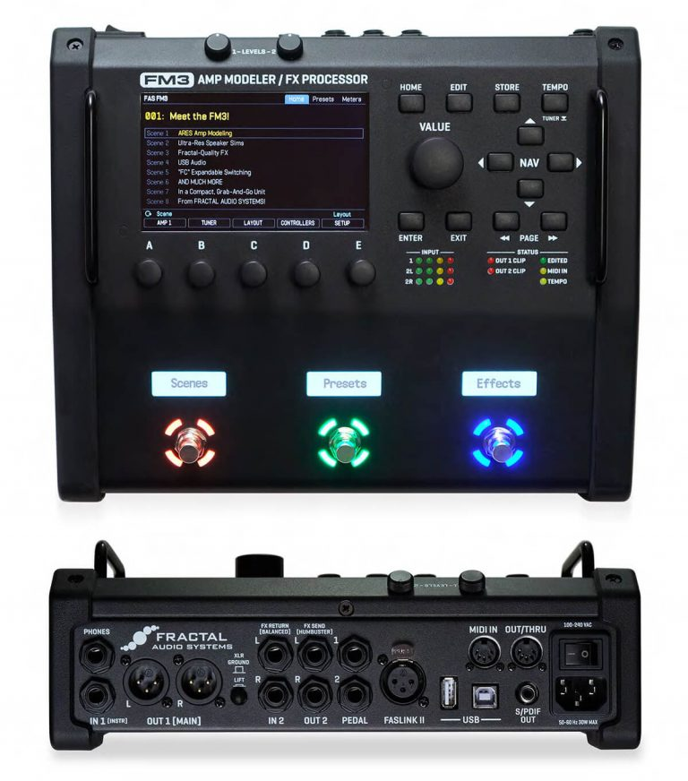
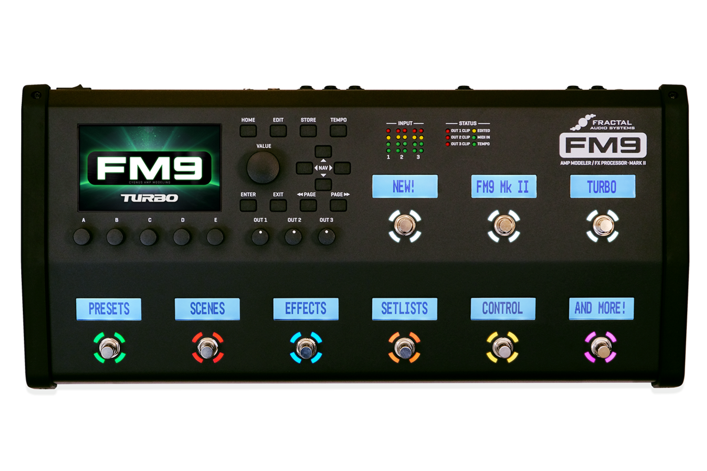
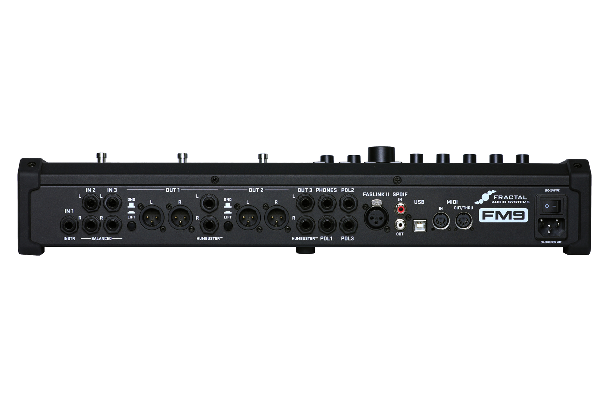
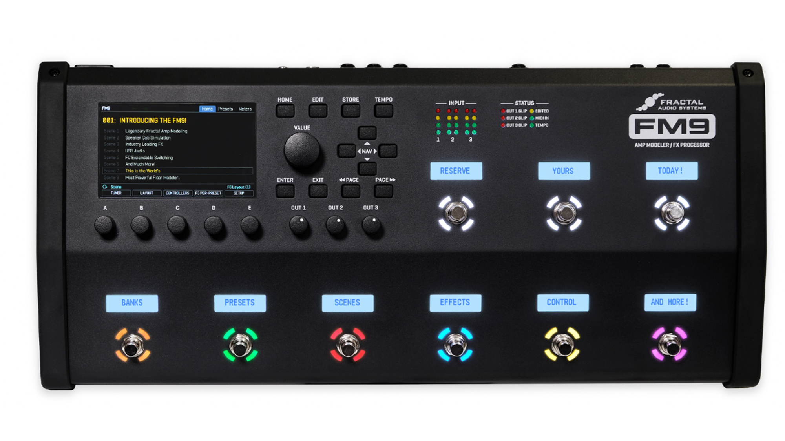
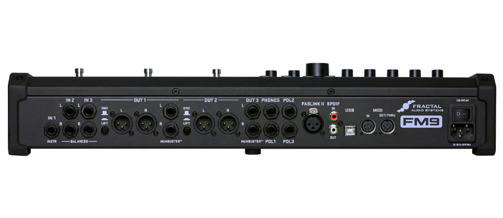
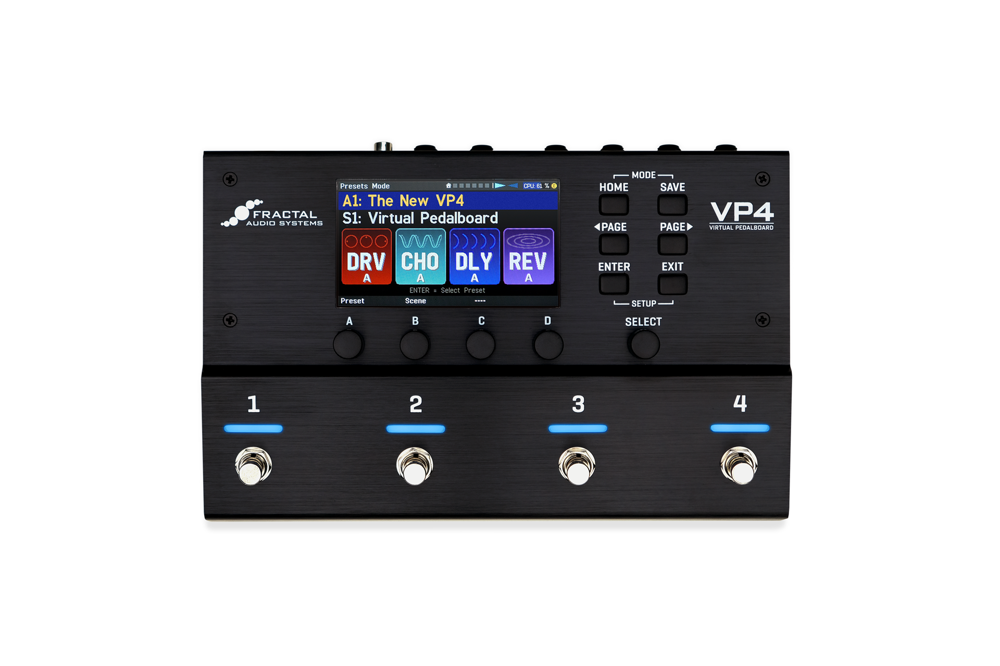
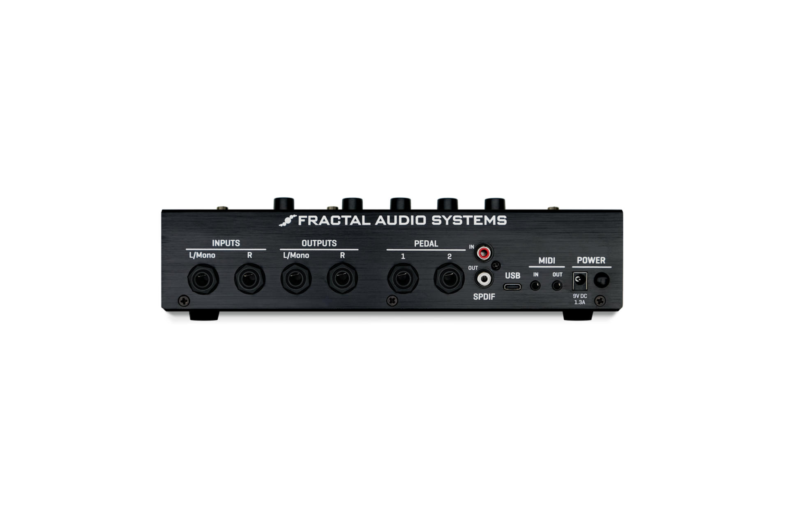

# Fractal Audio product photos

[All photo galleries](../PHOTOS.md) · [Verification gaps](../RESEARCH-GAPS.md)

Click a thumbnail for the full archived image when available. Read the linked canonical record for source and inspection notes; powered status and camera angle are separate requirements.

| Model / evidence | Control face | Rear / connector edge |
|---|---|---|
| [Fractal Audio AM4](../brand/FRACTAL-AUDIO.md#am4) |  Powered; perpendicular |  Power unverified / stock |
| [Fractal Audio FM3 MKII Turbo](../brand/FRACTAL-AUDIO.md#fm3-mkii-turbo) |  Powered; perpendicular |  Power unverified / stock |
| [Fractal Audio FM3 original](../brand/FRACTAL-AUDIO.md#fm3-original) |  Powered; angle not verified perpendicular |  Power unverified / stock |
| [Fractal Audio FM9 MKII Turbo](../brand/FRACTAL-AUDIO.md#fm9-mkii-turbo) |  Powered; perpendicular |  Power unverified / stock |
| [Fractal Audio FM9 original](../brand/FRACTAL-AUDIO.md#fm9-original) |  Powered; perpendicular |  Power unverified / stock |
| [Fractal Audio FM9 Turbo](../brand/FRACTAL-AUDIO.md#fm9-turbo) |  Powered; angle not verified perpendicular |  Power unverified / stock |
| [Fractal Audio VP4](../brand/FRACTAL-AUDIO.md#vp4) |  Powered; perpendicular |  Power unverified / stock |
