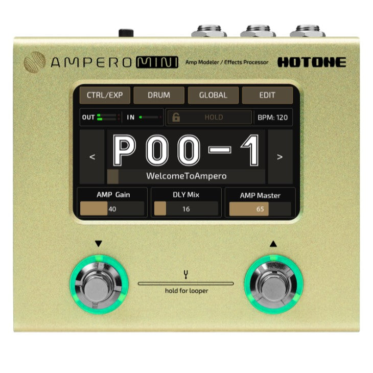

# Hotone product photos

[All photo galleries](../PHOTOS.md) · [Verification gaps](../RESEARCH-GAPS.md)

Click a thumbnail for the full archived image when available. Read the linked canonical record for source and inspection notes; powered status and camera angle are separate requirements.

| Model / evidence | Control face | Rear / connector edge |
|---|---|---|
| [Hotone Ampero II MP-350](../brand/HOTONE.md#ampero-ii-mp-350) |  Powered; perpendicular |  Unlit |
| [Hotone Ampero II Stage MP-380](../brand/HOTONE.md#ampero-ii-stage-mp-380) |  Powered; perpendicular |  Unlit |
| [Hotone Ampero II Stomp MP-300](../brand/HOTONE.md#ampero-ii-stomp-mp-300) |  Powered; perpendicular |  Unlit |
| [Hotone Ampero Mini MP-50](../brand/HOTONE.md#ampero-mini-mp-50) |  Powered; perpendicular |  Unlit |
| [Hotone Ampero MP-100](../brand/HOTONE.md#ampero-mp-100) |  Powered; perpendicular |  Unlit |
| [Hotone Ampero One MP-80](../brand/HOTONE.md#ampero-one-mp-80) |  Powered; perpendicular |  Unlit |
