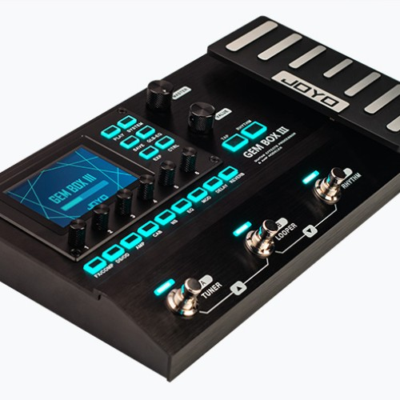
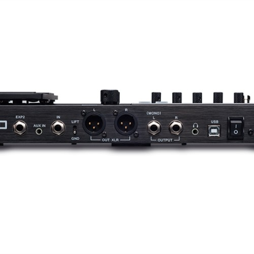
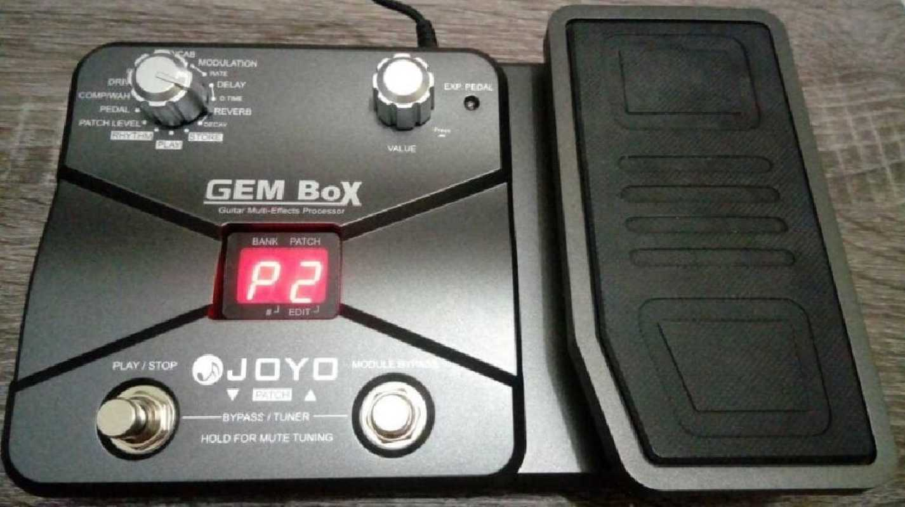
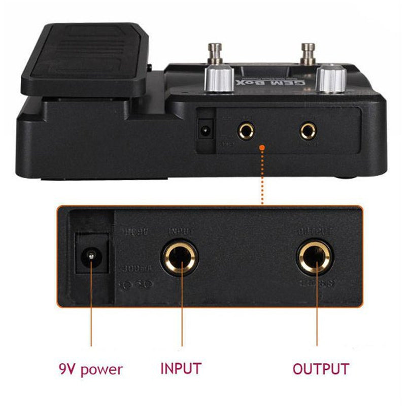
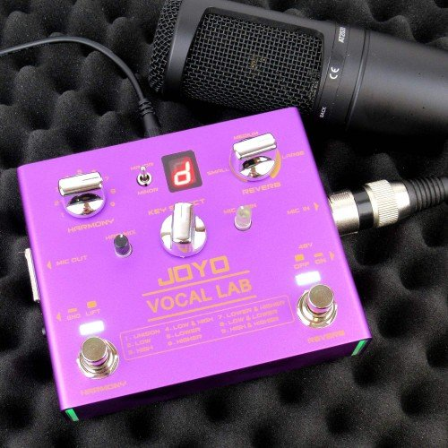
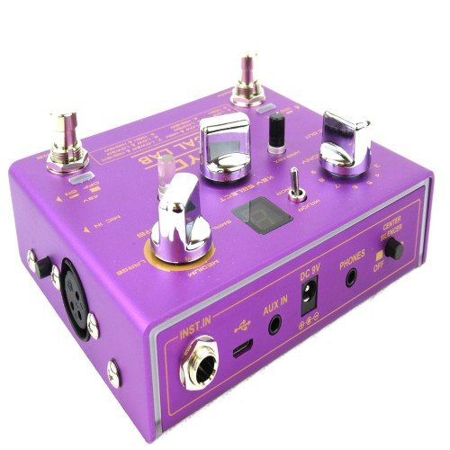
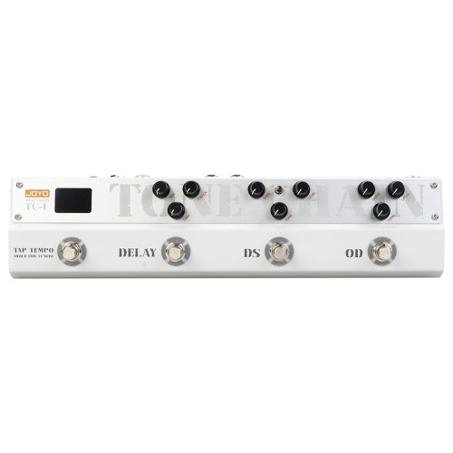
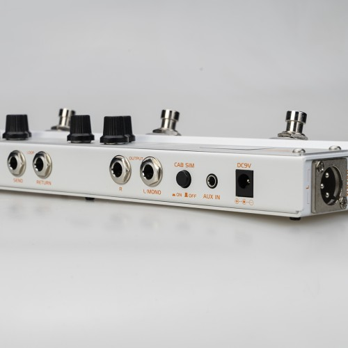
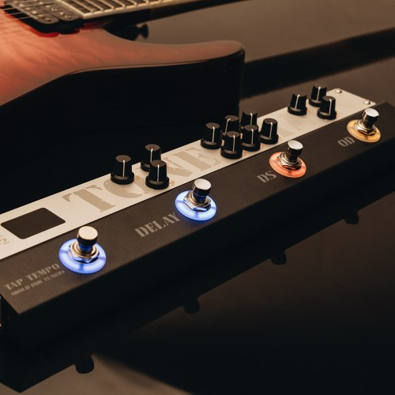
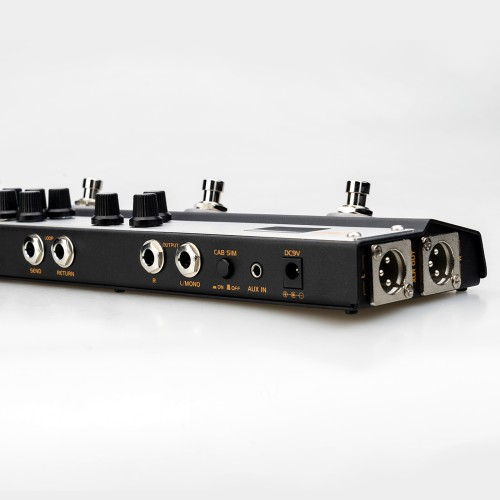

# JOYO product photos

[All photo galleries](../PHOTOS.md) · [Verification gaps](../RESEARCH-GAPS.md)

Click a thumbnail for the full archived image when available. Read the linked canonical record for source and inspection notes; powered status and camera angle are separate requirements.

| Model / evidence | Control face | Rear / connector edge |
|---|---|---|
| [JOYO GEM BOX II](../brand/JOYO.md#gem-box-ii) |  Unlit; perpendicular |  Power unverified / stock |
| [JOYO GEM BOX III](../brand/JOYO.md#gem-box-iii) |  Powered; angle not verified perpendicular |  Power unverified / stock |
| [JOYO GEM BOX original](../brand/JOYO.md#gem-box-original) |  Powered; angle not verified perpendicular |  Unlit |
| [JOYO R-16 Vocal Lab](../brand/JOYO.md#r-16-vocal-lab) |  Powered; angle not verified perpendicular |  Power unverified / stock |
| [JOYO Tone Chain TC-1](../brand/JOYO.md#tone-chain-tc-1) |  Unlit; angle not verified perpendicular |  Power unverified / stock |
| [JOYO Tone Chain TC-2](../brand/JOYO.md#tone-chain-tc-2) |  Powered; angle not verified perpendicular |  Power unverified / stock |
