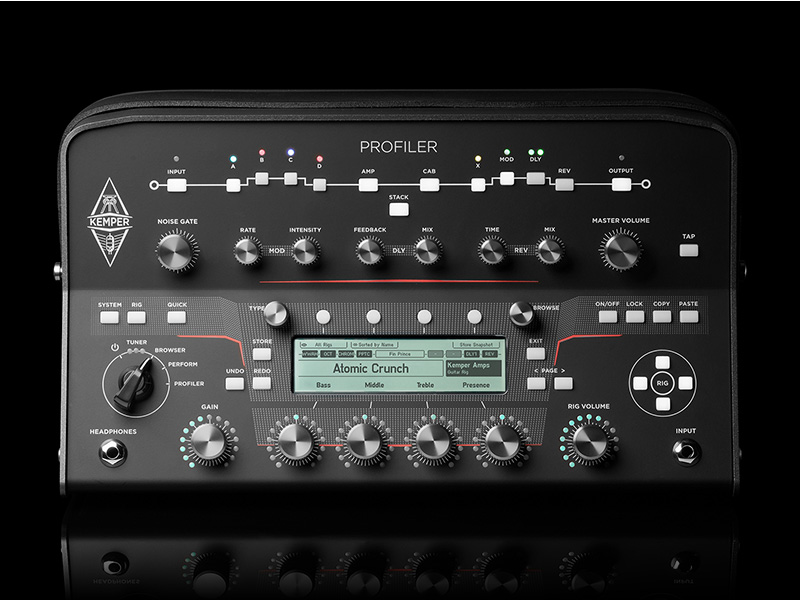
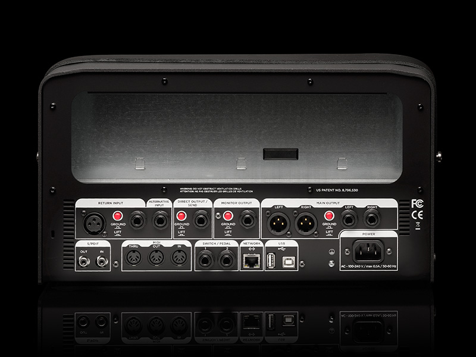
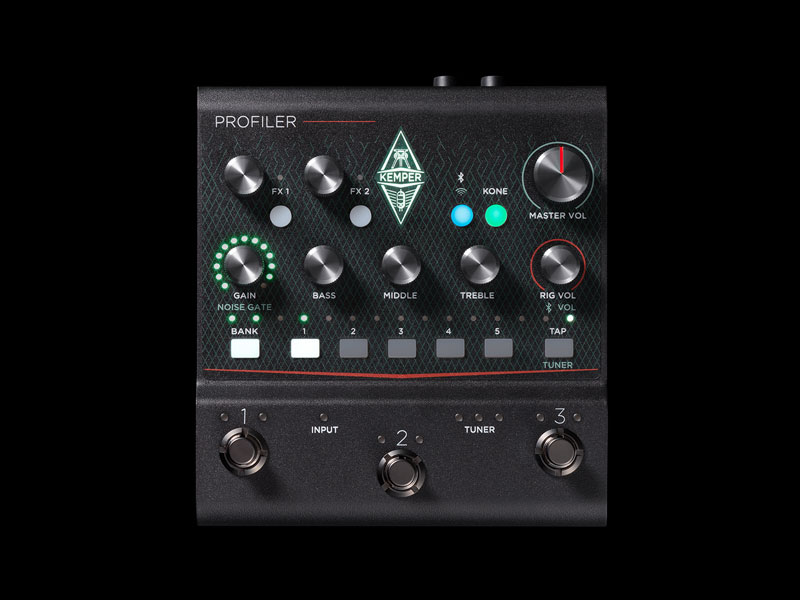
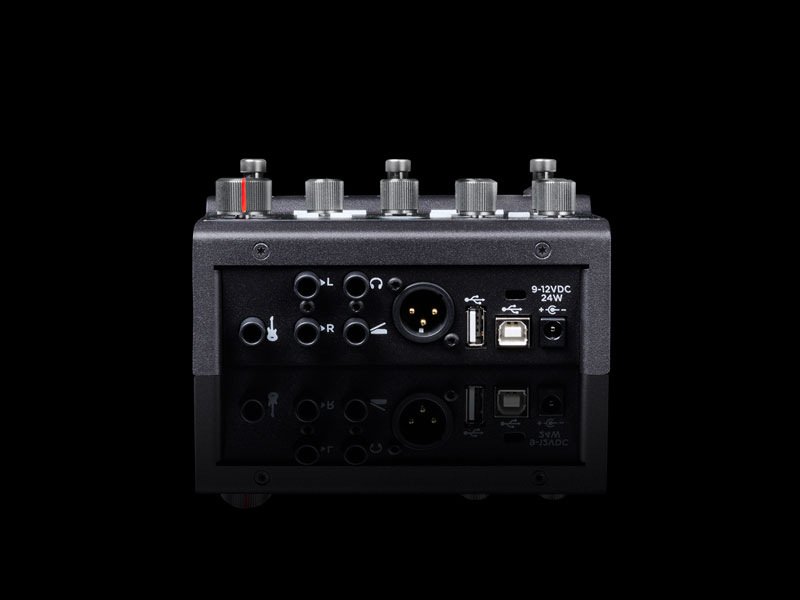
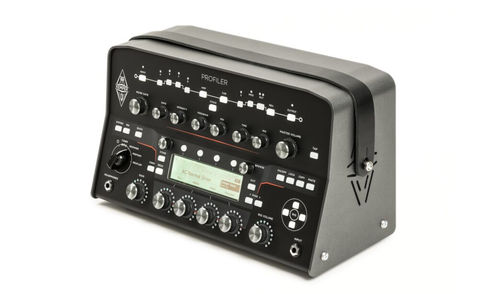
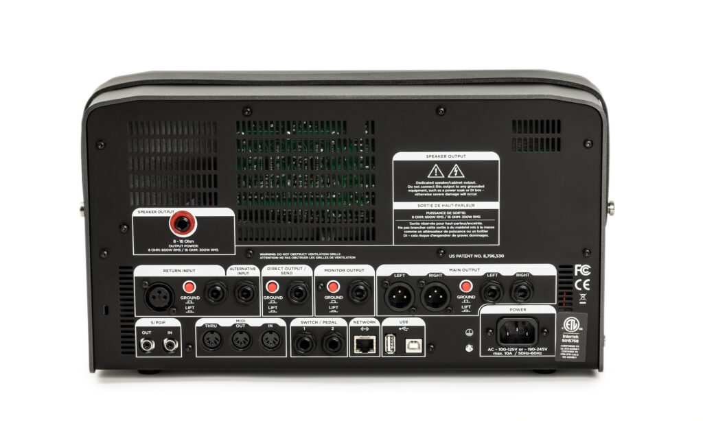
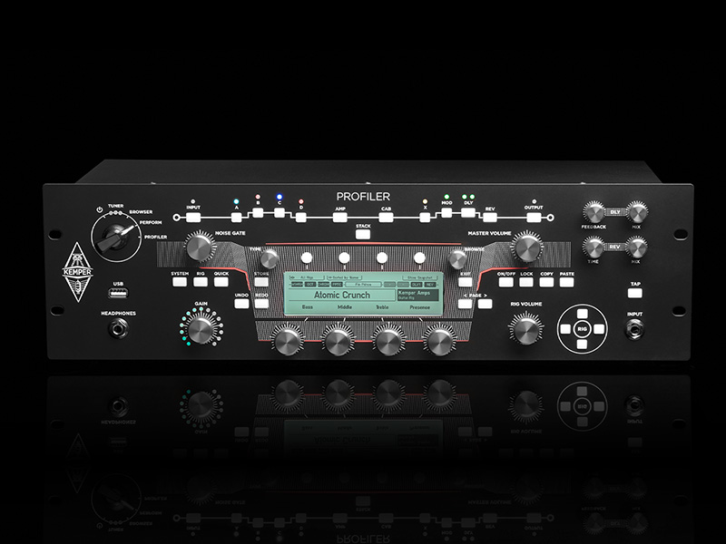
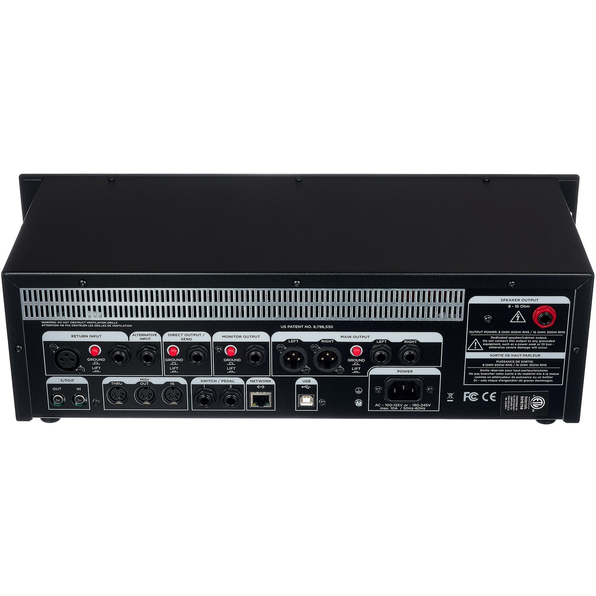

# Kemper product photos

[All photo galleries](../PHOTOS.md) · [Verification gaps](../RESEARCH-GAPS.md)

Click a thumbnail for the full archived image when available. Read the linked canonical record for source and inspection notes; powered status and camera angle are separate requirements.

| Model / evidence | Control face | Rear / connector edge |
|---|---|---|
| [Kemper PROFILER Head MK2](../brand/KEMPER.md#profiler-head-mk2) |  Powered; angle not verified perpendicular |  Power unverified / stock |
| [Kemper PROFILER Player](../brand/KEMPER.md#profiler-player) |  Powered; perpendicular |  Power unverified / stock |
| [Kemper PROFILER PowerHead MK2](../brand/KEMPER.md#profiler-powerhead-mk2) |  Powered; angle not verified perpendicular |  Power unverified / stock |
| [Kemper PROFILER PowerRack MK2](../brand/KEMPER.md#profiler-powerrack-mk2) |  Powered; angle not verified perpendicular |  Power unverified / stock |
| [Kemper PROFILER Rack MK2](../brand/KEMPER.md#profiler-rack-mk2) |  Powered; angle not verified perpendicular |  Power unverified / stock |
| [Kemper PROFILER Stage MK2](../brand/KEMPER.md#profiler-stage-mk2) |  Powered; perpendicular |  Power unverified / stock |
