# Korg product photos

[All photo galleries](../PHOTOS.md) · [Verification gaps](../RESEARCH-GAPS.md)

Click a thumbnail for the full archived image when available. Read the linked canonical record for source and inspection notes; powered status and camera angle are separate requirements.

| Model / evidence | Control face | Rear / connector edge |
|---|---|---|
| [Korg AX3B](../brand/KORG.md#ax3b) | <a href="../brand/images/korg-ax3b-top-204ccdd9e6b5.jpg">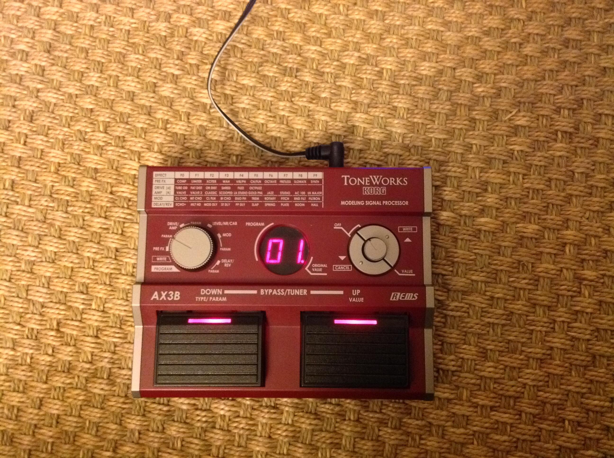</a> Powered; angle not verified perpendicular | <a href="../brand/images/korg-ax3b-rear-691820c98c5d.jpg">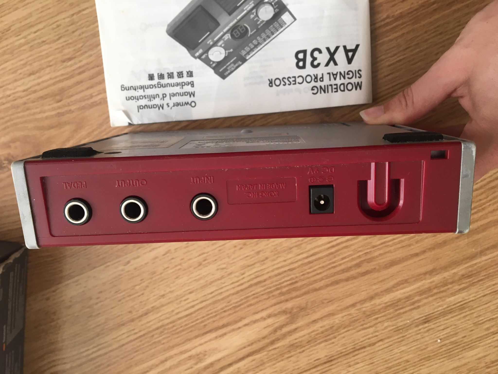</a> Power unverified / stock |
| [Korg AX3G](../brand/KORG.md#ax3g) |  Powered; perpendicular |  Power unverified / stock |
| [Korg AX5B](../brand/KORG.md#ax5b) |  Powered; angle not verified perpendicular |  Power unverified / stock |
| [Korg AX5G](../brand/KORG.md#ax5g) |  Powered; angle not verified perpendicular |  Unlit |
| [Korg AX10B](../brand/KORG.md#ax10b) | <a href="../brand/images/korg-ax10b-top-e0bf30743429.jpg">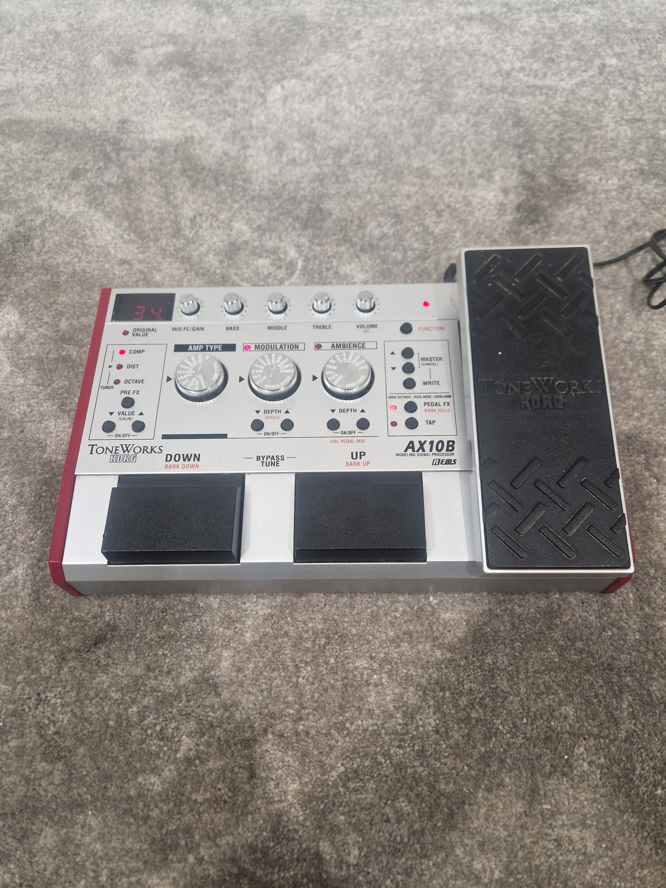</a> Powered; angle not verified perpendicular | <a href="../brand/images/korg-ax10b-rear.png">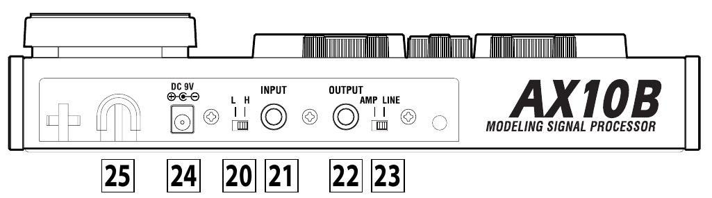</a> Power unverified / stock |
| [Korg AX10G](../brand/KORG.md#ax10g) | <a href="../brand/images/korg-ax10g-top-118e536cda81.jpg">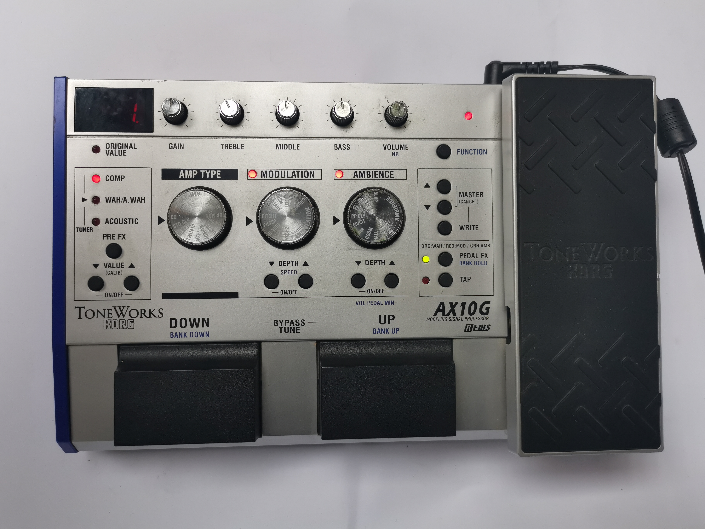</a> Powered; angle not verified perpendicular | <a href="../brand/images/korg-ax10g-rear-e1f1bbcbf7bf.jpg">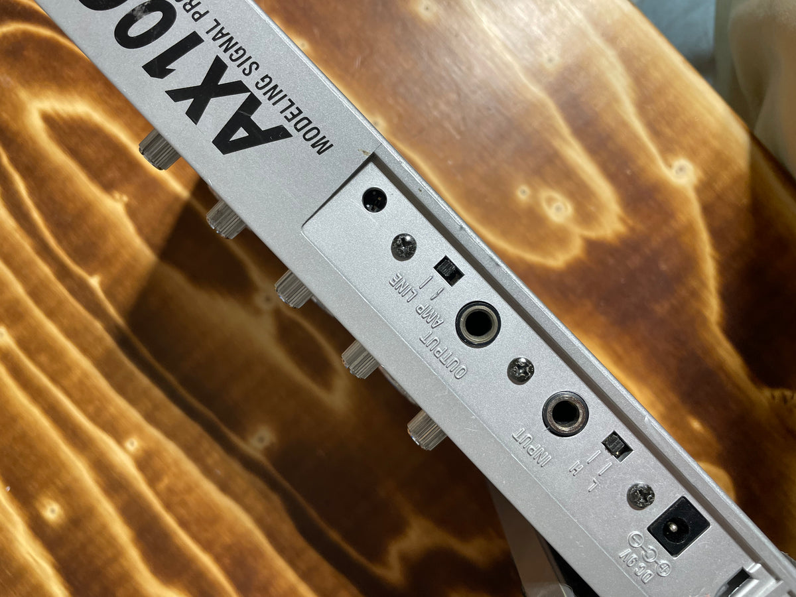</a> Power unverified / stock |
| [Korg AX30G](../brand/KORG.md#ax30g) |  Unlit; angle not verified perpendicular |  Unlit |
| [Korg AX100G](../brand/KORG.md#ax100g) | <a href="../brand/images/korg-ax100g-top-1133d4ecf72b.jpg">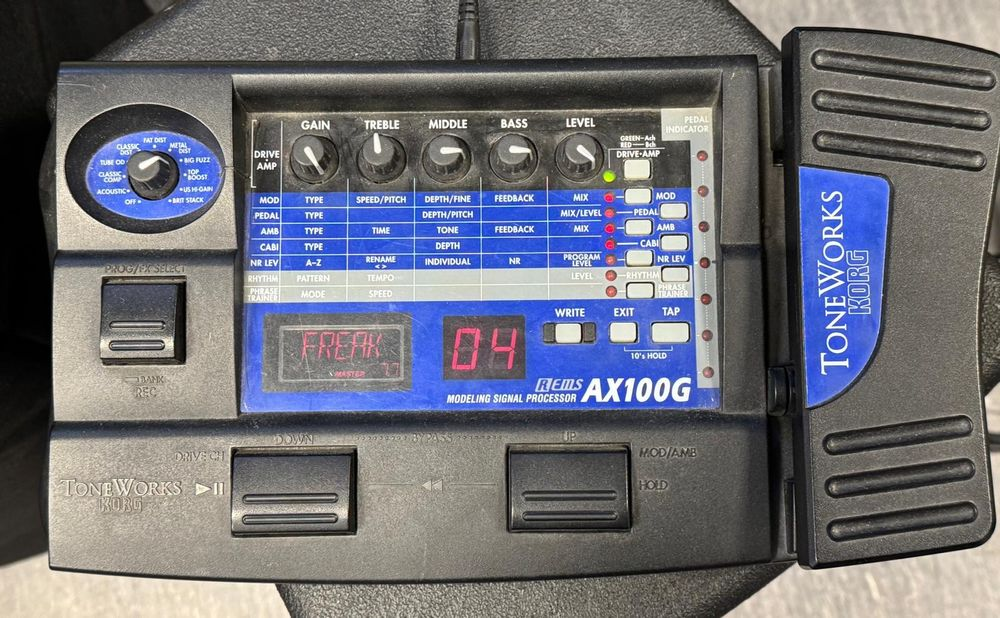</a> Powered; angle not verified perpendicular | <a href="../brand/images/korg-ax100g-rear-5bbda6af1ce9.jpg">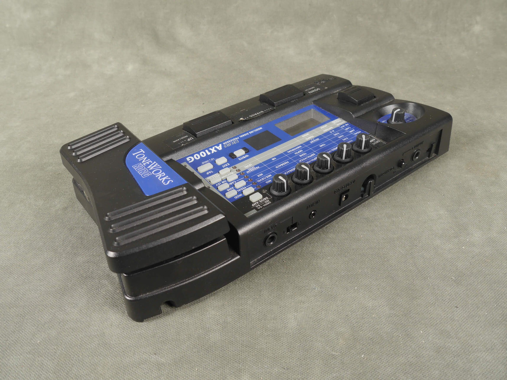</a> Power unverified / stock |
| [Korg AX1000G](../brand/KORG.md#ax1000g) | <a href="../brand/images/korg-ax1000g-top-3871f1536c71.jpg">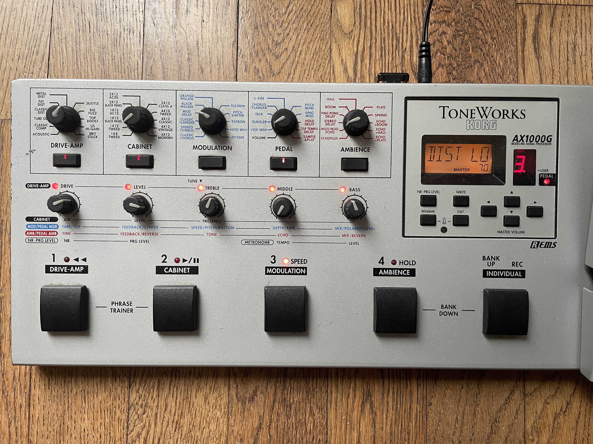</a> Powered; perpendicular | <a href="../brand/images/korg-ax1000g-rear-c6d0401b4d53.jpg">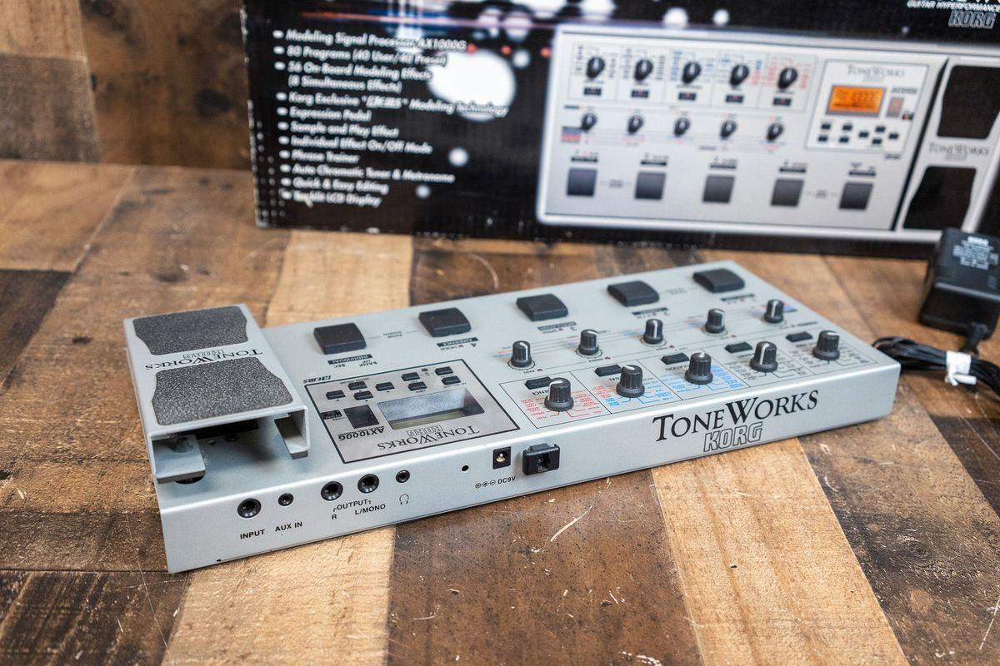</a> Power unverified / stock |
| [Korg AX1500G](../brand/KORG.md#ax1500g) |  Powered; angle not verified perpendicular |  Power unverified / stock |
| [Korg AX3000B](../brand/KORG.md#ax3000b) |  Powered; angle not verified perpendicular | <a href="../brand/images/korg-ax3000b-rear.png">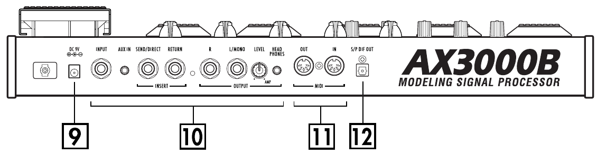</a> Power unverified / stock |
| [Korg AX3000G](../brand/KORG.md#ax3000g) |  Powered; angle not verified perpendicular |  Power unverified / stock |
| [Korg PANDORA stomp](../brand/KORG.md#pandora-stomp) |  Powered; angle not verified perpendicular |  Power unverified / stock |
