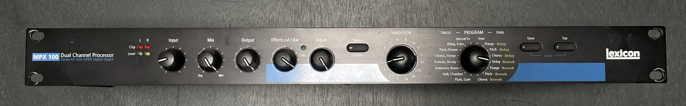
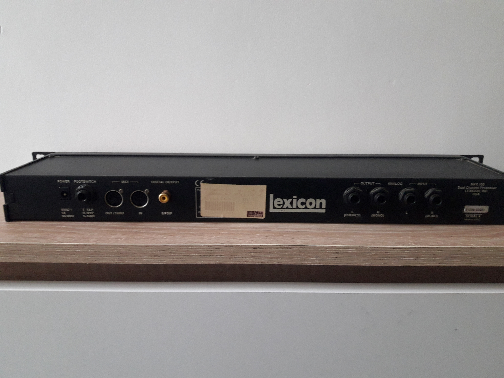
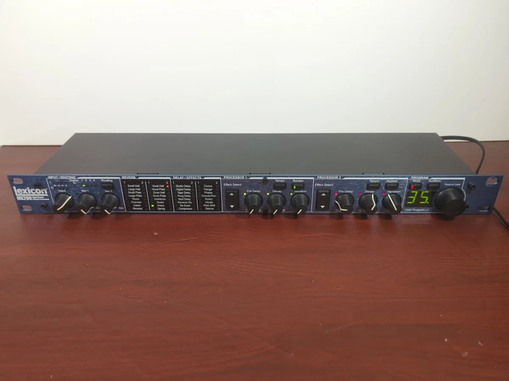
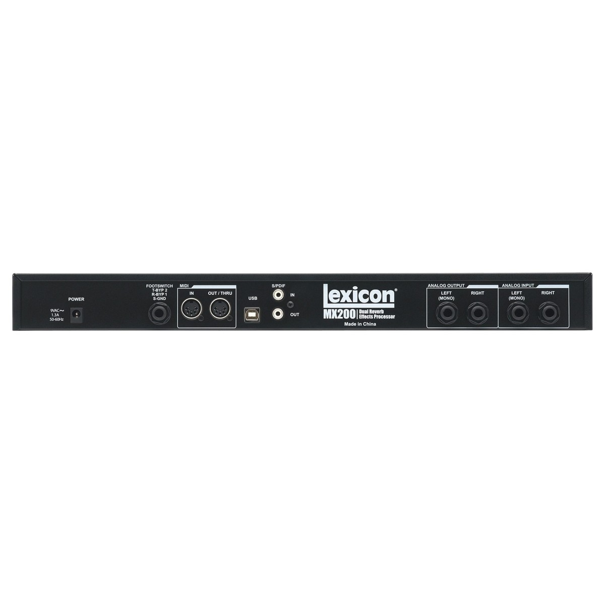
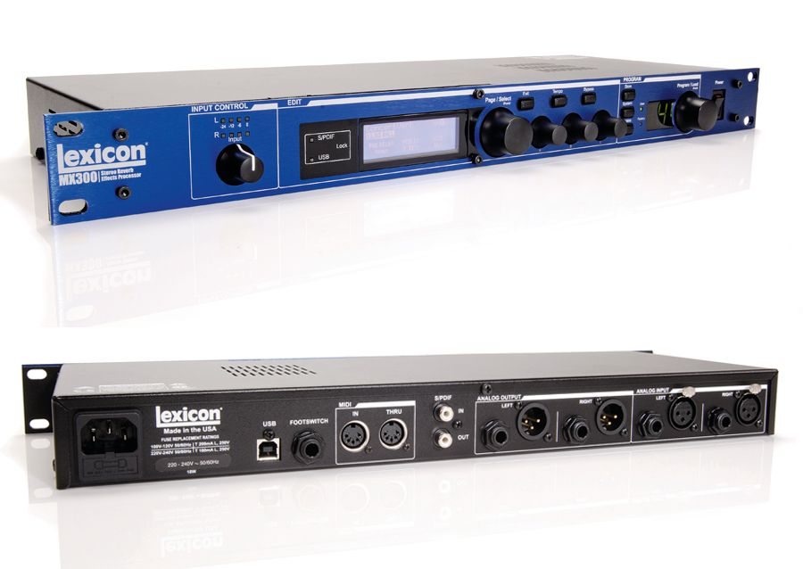
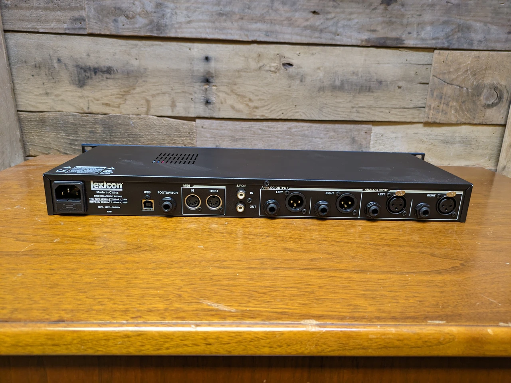
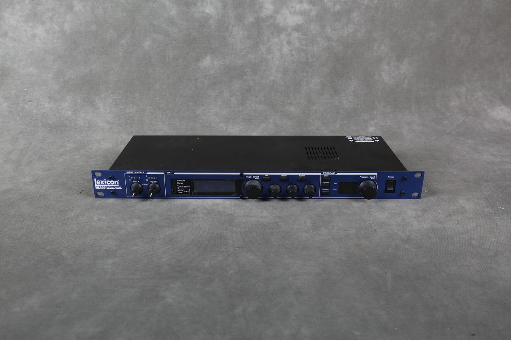
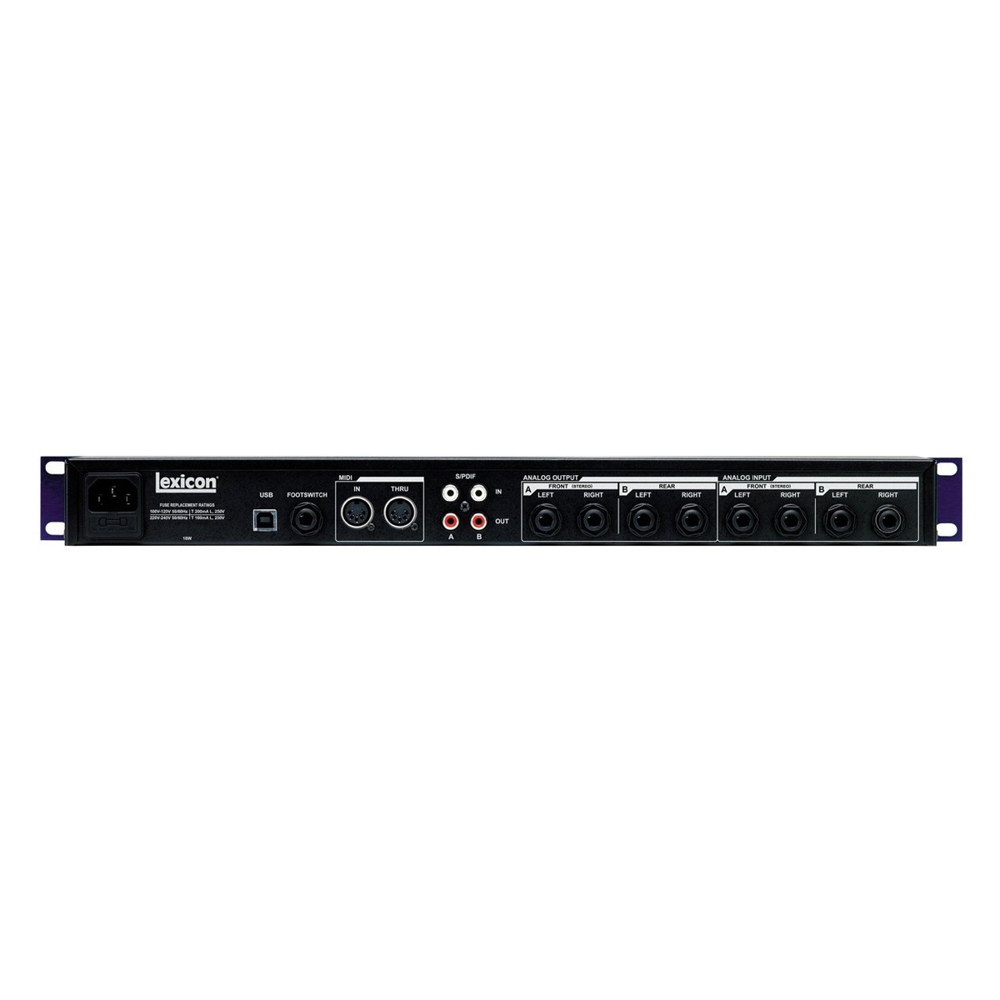

# Lexicon product photos

[All photo galleries](../PHOTOS.md) · [Verification gaps](../RESEARCH-GAPS.md)

Click a thumbnail for the full archived image when available. Read the linked canonical record for source and inspection notes; powered status and camera angle are separate requirements.

| Model / evidence | Control face | Rear / connector edge |
|---|---|---|
| [Lexicon MPX100](../brand/LEXICON.md#mpx100) |  Power unverified / stock; angle not verified perpendicular |  Unlit |
| [Lexicon MX200](../brand/LEXICON.md#mx200) |  Powered; angle not verified perpendicular |  Unlit |
| [Lexicon MX300](../brand/LEXICON.md#mx300) |  Powered; angle not verified perpendicular |  Unlit |
| [Lexicon MX400](../brand/LEXICON.md#mx400) |  Unlit; angle not verified perpendicular |  Unlit |
