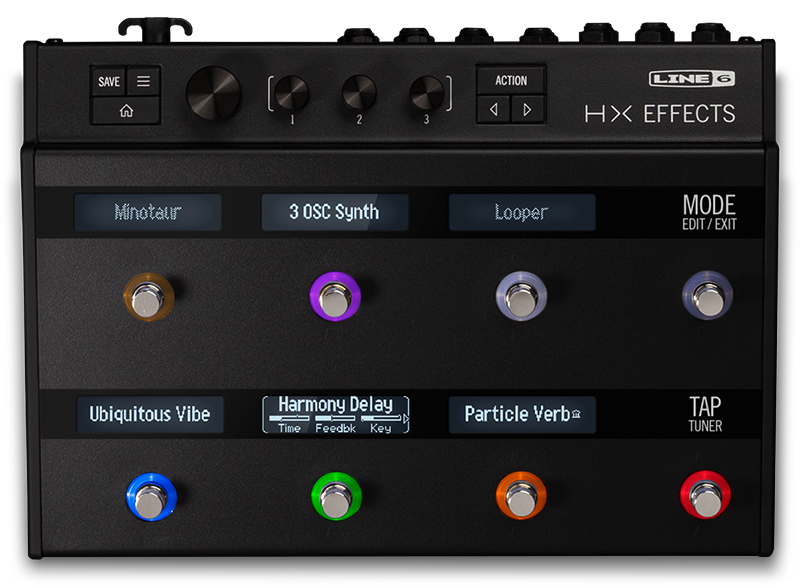
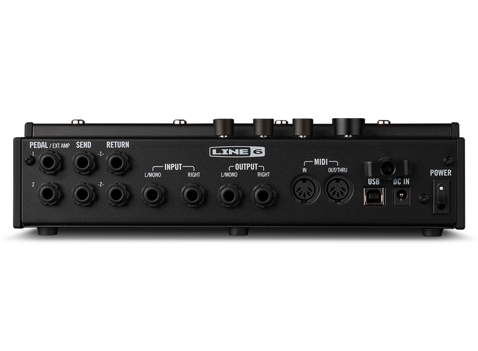
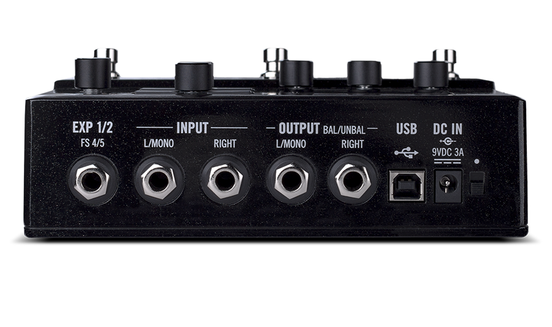
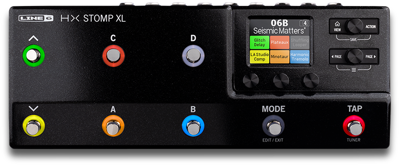
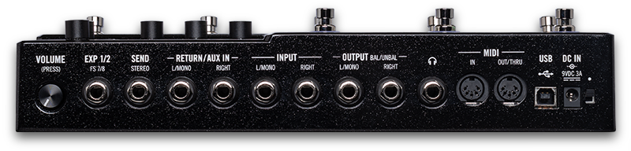
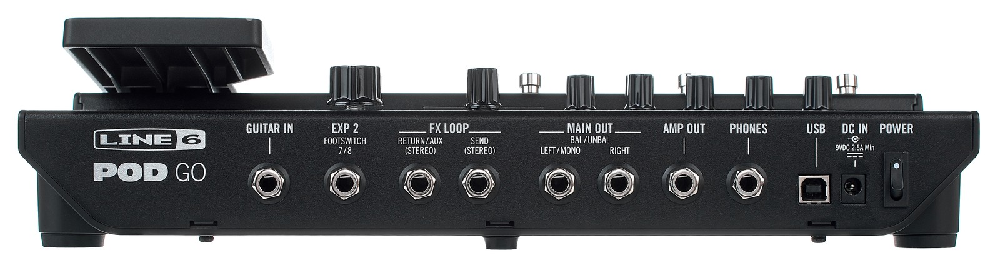
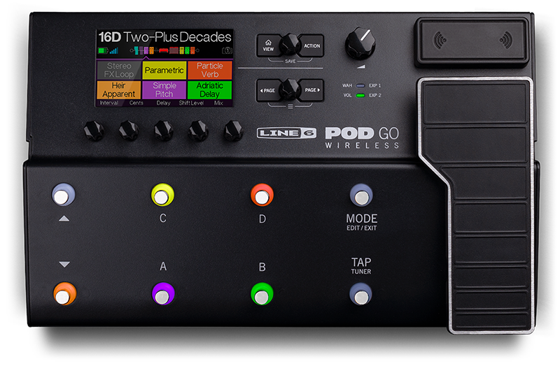
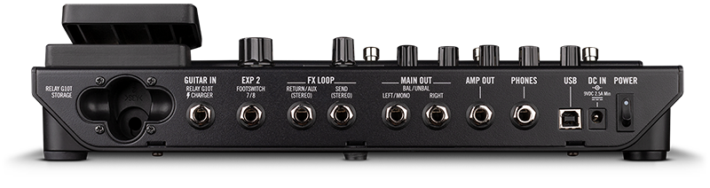

# Line 6 product photos

[All photo galleries](../PHOTOS.md) · [Verification gaps](../RESEARCH-GAPS.md)

Click a thumbnail for the full archived image when available. Read the linked canonical record for source and inspection notes; powered status and camera angle are separate requirements.

| Model / evidence | Control face | Rear / connector edge |
|---|---|---|
| [Line 6 AMPLIFi FX100](../brand/LINE6.md#amplifi-fx100) |  Powered; angle not verified perpendicular |  Power unverified / stock |
| [Line 6 Floor POD Plus](../brand/LINE6.md#floor-pod-plus) |  Powered; perpendicular |  Power unverified / stock |
| [Line 6 Helix Floor](../brand/LINE6.md#helix-floor) |  Powered; perpendicular |  Power unverified / stock |
| [Line 6 Helix LT](../brand/LINE6.md#helix-lt) |  Powered; perpendicular |  Power unverified / stock |
| [Line 6 Helix Stadium XL Floor](../brand/LINE6.md#helix-stadium-xl-floor) |  Powered; perpendicular |  Power unverified / stock |
| [Line 6 HX Effects](../brand/LINE6.md#hx-effects) |  Powered; perpendicular |  Power unverified / stock |
| [Line 6 HX One](../brand/LINE6.md#hx-one) |  Powered; perpendicular |  Power unverified / stock |
| [Line 6 HX Stomp](../brand/LINE6.md#hx-stomp) |  Powered; perpendicular |  Power unverified / stock |
| [Line 6 HX Stomp XL](../brand/LINE6.md#hx-stomp-xl) |  Powered; perpendicular |  Power unverified / stock |
| [Line 6 M5](../brand/LINE6.md#m5) |  Powered; angle not verified perpendicular |  Power unverified / stock |
| [Line 6 M9](../brand/LINE6.md#m9) |  Powered; angle not verified perpendicular |  Power unverified / stock |
| [Line 6 M13](../brand/LINE6.md#m13) |  Powered; angle not verified perpendicular |  Power unverified / stock |
| [Line 6 Pocket POD](../brand/LINE6.md#pocket-pod) |  Powered; perpendicular |  Power unverified / stock |
| [Line 6 POD Express Bass](../brand/LINE6.md#pod-express-bass) |  Powered; perpendicular |  Power unverified / stock |
| [Line 6 POD Express Guitar](../brand/LINE6.md#pod-express-guitar) |  Powered; perpendicular |  Power unverified / stock |
| [Line 6 POD Go](../brand/LINE6.md#pod-go-and-pod-go-wireless) |  Powered; perpendicular |  Power unverified / stock |
| [Line 6 POD Go Wireless](../brand/LINE6.md#pod-go-and-pod-go-wireless) |  Powered; perpendicular |  Power unverified / stock |
| [Line 6 POD HD300](../brand/LINE6.md#pod-hd300) |  Powered; angle not verified perpendicular |  Power unverified / stock |
| [Line 6 POD HD400](../brand/LINE6.md#pod-hd400) |  Powered; angle not verified perpendicular |  Power unverified / stock |
| [Line 6 POD HD500](../brand/LINE6.md#pod-hd500) |  Powered; angle not verified perpendicular |  Power unverified / stock |
| [Line 6 POD HD500X](../brand/LINE6.md#pod-hd500x) |  Powered; angle not verified perpendicular |  Power unverified / stock |
| [Line 6 POD X3 Live](../brand/LINE6.md#pod-x3-live) |  Powered; perpendicular |  Power unverified / stock |
| [Line 6 POD XT Live](../brand/LINE6.md#pod-xt-live) |  Powered; perpendicular |  Power unverified / stock |
