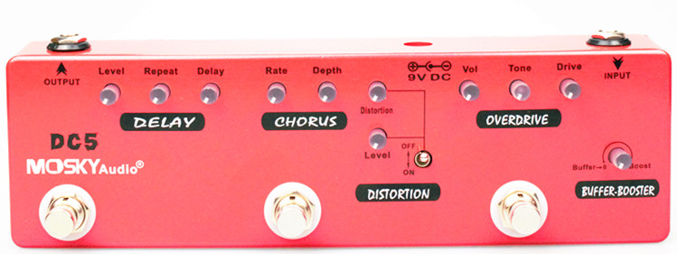
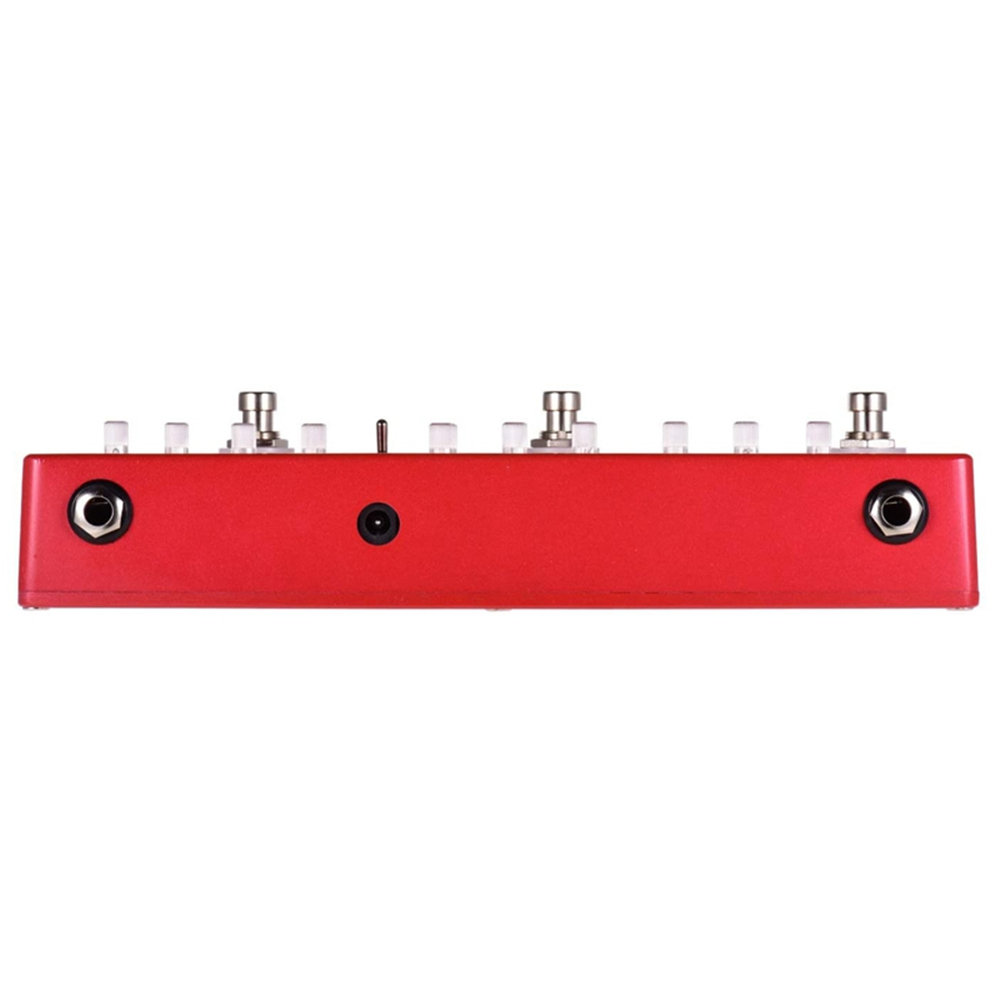
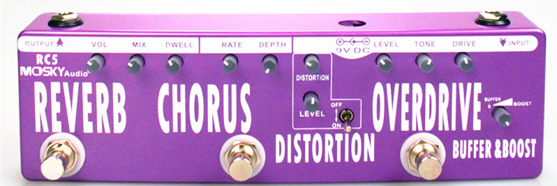
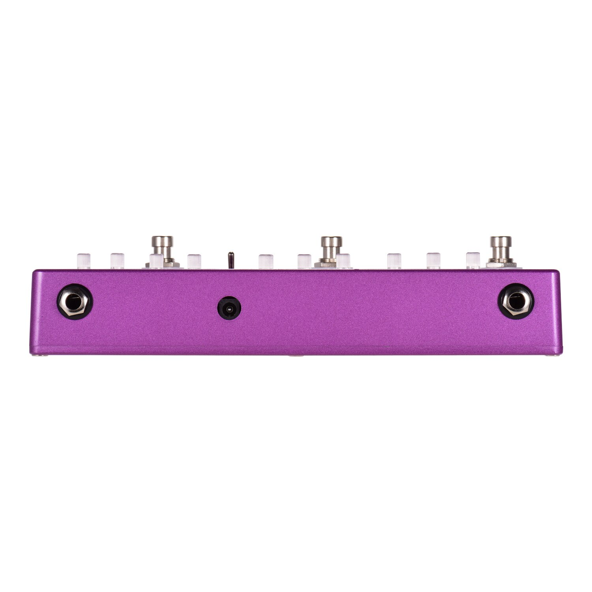
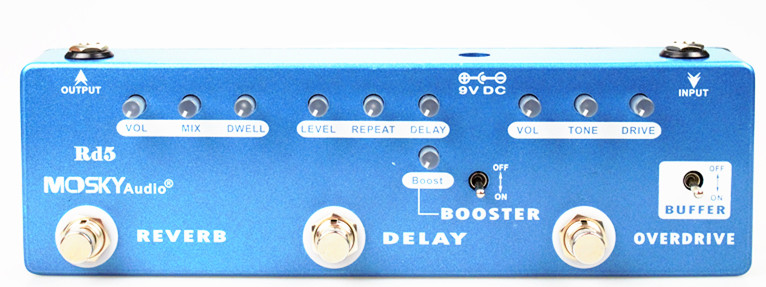
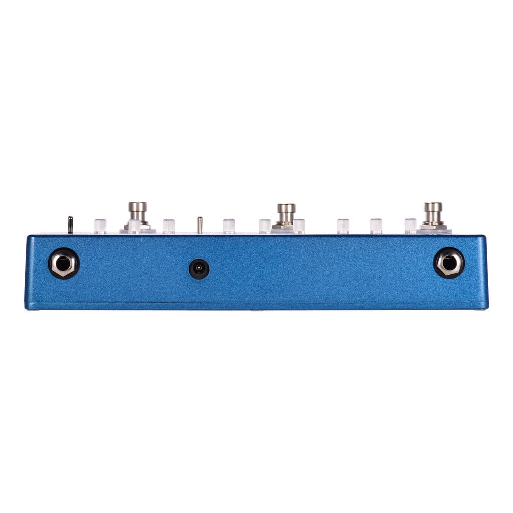

# Mosky product photos

[All photo galleries](../PHOTOS.md) · [Verification gaps](../RESEARCH-GAPS.md)

Click a thumbnail for the full archived image when available. Read the linked canonical record for source and inspection notes; powered status and camera angle are separate requirements.

| Model / evidence | Control face | Rear / connector edge |
|---|---|---|
| [Mosky DC5](../brand/MOSKY.md#dc5) |  Power unverified / stock; angle not verified perpendicular |  Unlit |
| [Mosky RC5](../brand/MOSKY.md#rc5) |  Power unverified / stock; angle not verified perpendicular |  Unlit |
| [Mosky RD5](../brand/MOSKY.md#rd5) |  Power unverified / stock; angle not verified perpendicular |  Unlit |
| [Mosky SOL918](../brand/MOSKY.md#sol918) |  Unlit; angle not verified perpendicular |  Unlit |
