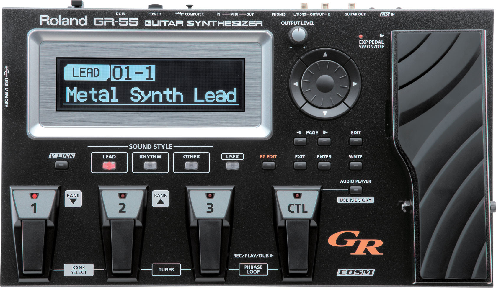
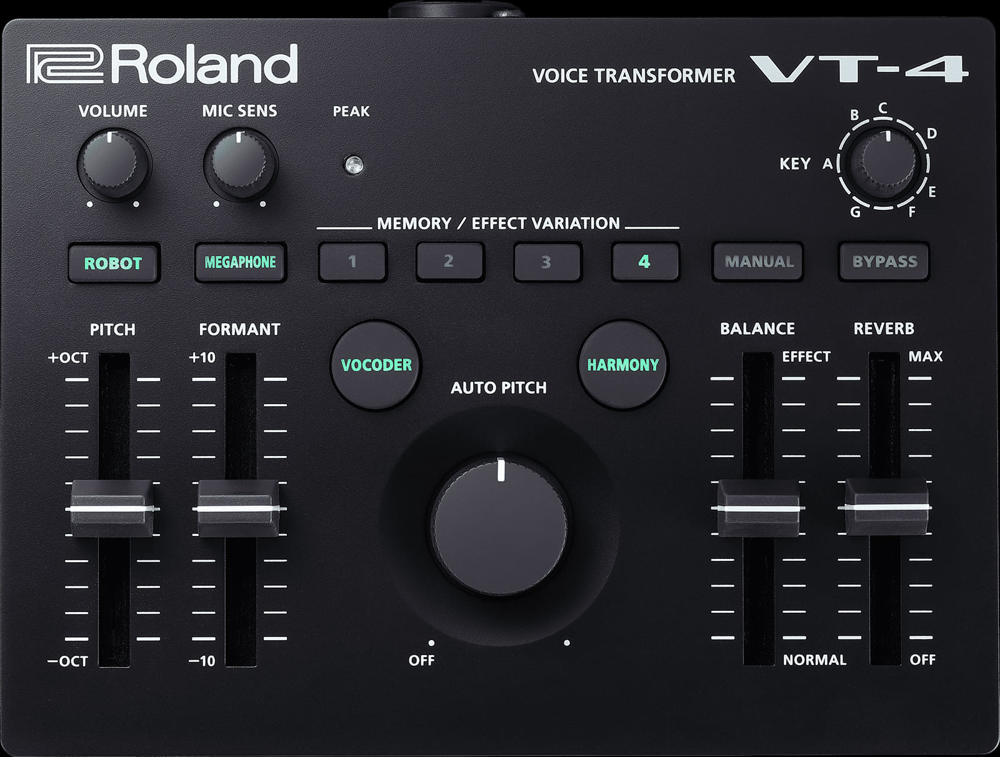
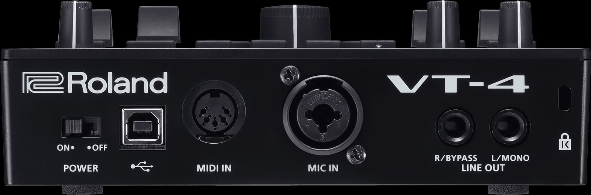

# Roland product photos

[All photo galleries](../PHOTOS.md) · [Verification gaps](../RESEARCH-GAPS.md)

Click a thumbnail for the full archived image when available. Read the linked canonical record for source and inspection notes; powered status and camera angle are separate requirements.

| Model / evidence | Control face | Rear / connector edge |
|---|---|---|
| [Roland GR-55](../brand/ROLAND.md#gr-55) |  Powered; perpendicular |  Unlit |
| [Roland VT-4](../brand/ROLAND.md#vt-4) |  Powered; perpendicular |  Power unverified / stock |
