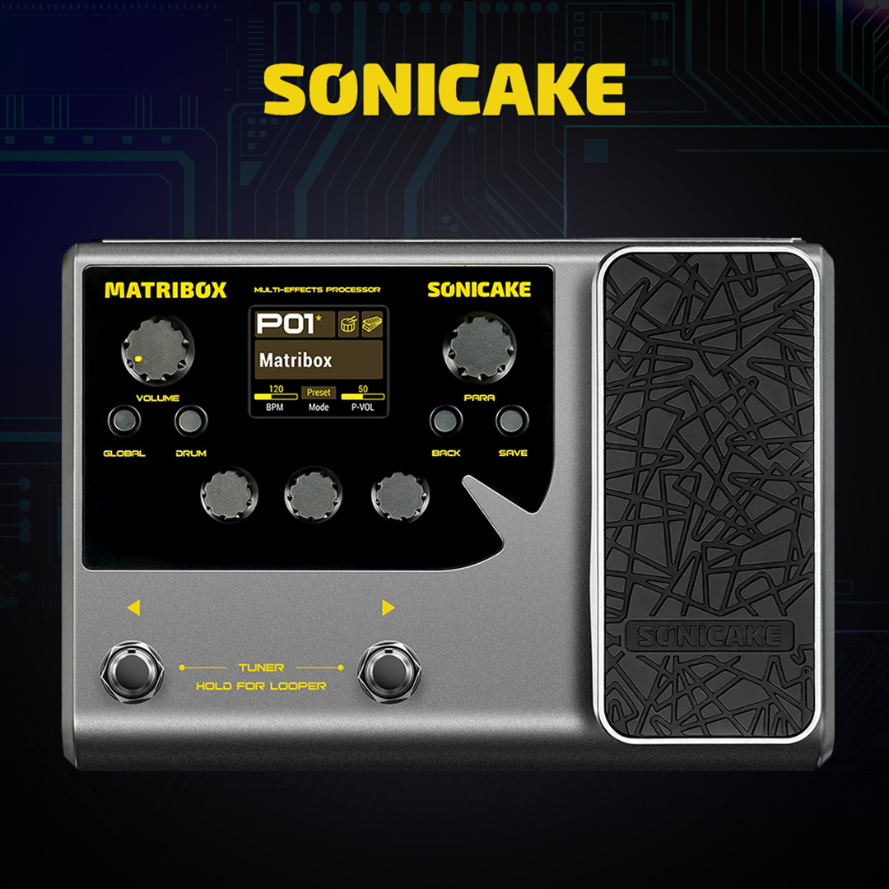
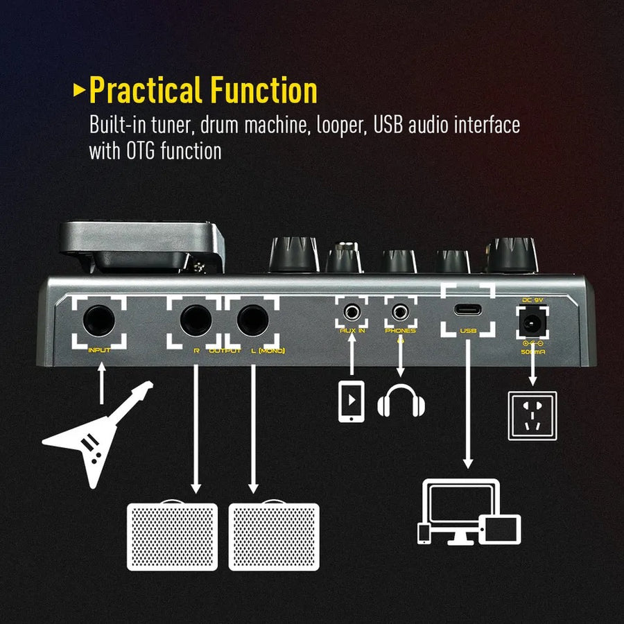

# Sonicake product photos

[All photo galleries](../PHOTOS.md) · [Verification gaps](../RESEARCH-GAPS.md)

Click a thumbnail for the full archived image when available. Read the linked canonical record for source and inspection notes; powered status and camera angle are separate requirements.

| Model / evidence | Control face | Rear / connector edge |
|---|---|---|
| [Sonicake A Factory QDS-04](../brand/SONICAKE.md#a-factory-qds-04) |  Powered; angle not verified perpendicular |  Power unverified / stock |
| [Sonicake B Factory QDS-05](../brand/SONICAKE.md#b-factory-qds-05) |  Powered; angle not verified perpendicular |  Power unverified / stock |
| [Sonicake Black Hammer QCE-30](../brand/SONICAKE.md#black-hammer-qce-30) |  Powered; perpendicular |  Power unverified / stock |
| [Sonicake Levitate QDS-02](../brand/SONICAKE.md#levitate-qds-02) |  Powered; angle not verified perpendicular |  Unlit |
| [Sonicake Matribox II Pro QME-200](../brand/SONICAKE.md#matribox-ii-pro-qme-200) |  Powered; perpendicular |  Power unverified / stock |
| [Sonicake Matribox II QME-100](../brand/SONICAKE.md#matribox-ii-qme-100) |  Powered; perpendicular |  Power unverified / stock |
| [Sonicake Matribox QME-50](../brand/SONICAKE.md#matribox-qme-50) |  Powered; angle not verified perpendicular |  Power unverified / stock |
| [Sonicake Pocket Master QME-10](../brand/SONICAKE.md#pocket-master-qme-10) |  Powered; angle not verified perpendicular |  Power unverified / stock |
| [Sonicake RockStage QCE-10](../brand/SONICAKE.md#rockstage-qce-10) |  Powered; angle not verified perpendicular |  Power unverified / stock |
| [Sonicake Smart Box QME-20](../brand/SONICAKE.md#smart-box-qme-20) |  Powered; perpendicular |  Power unverified / stock |
| [Sonicake Sonic Wood QCE-50](../brand/SONICAKE.md#sonic-wood-qce-50) |  Powered; perpendicular |  Power unverified / stock |
