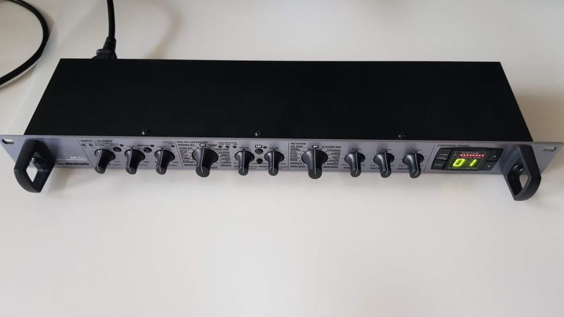
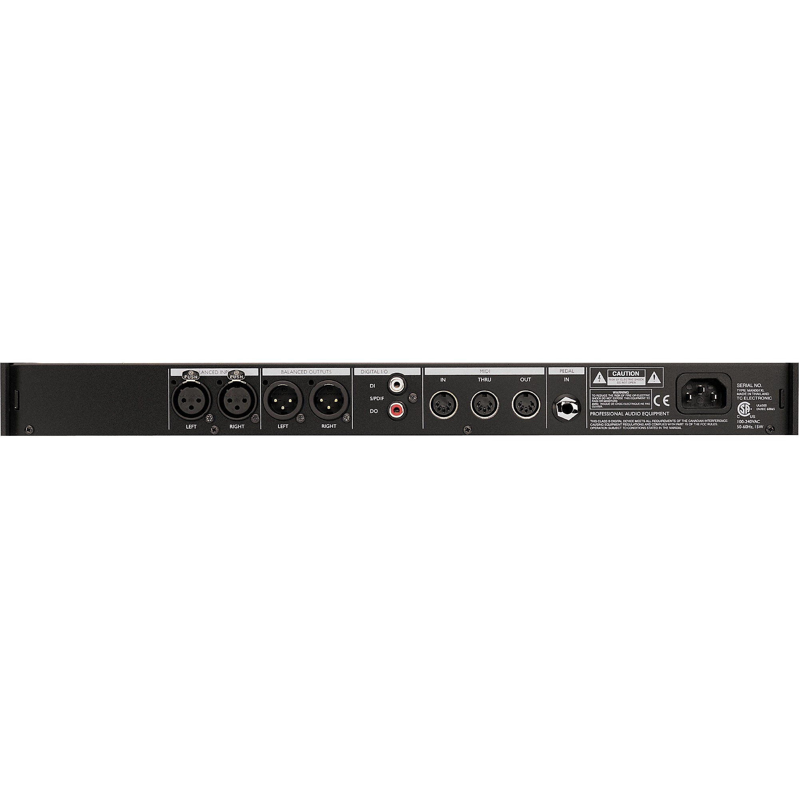
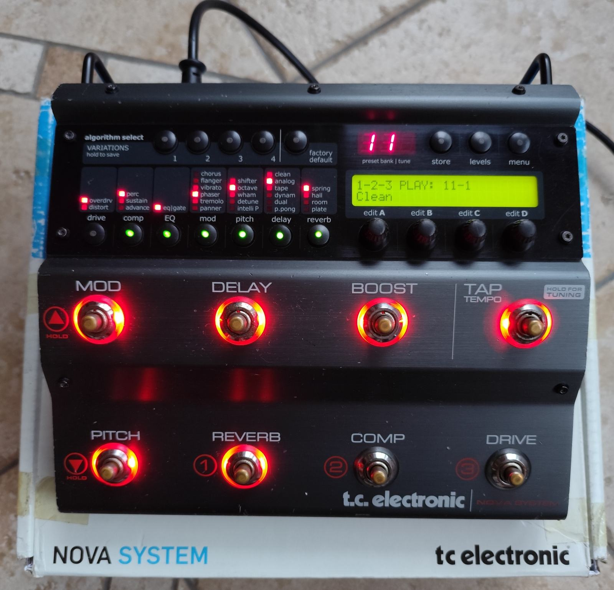
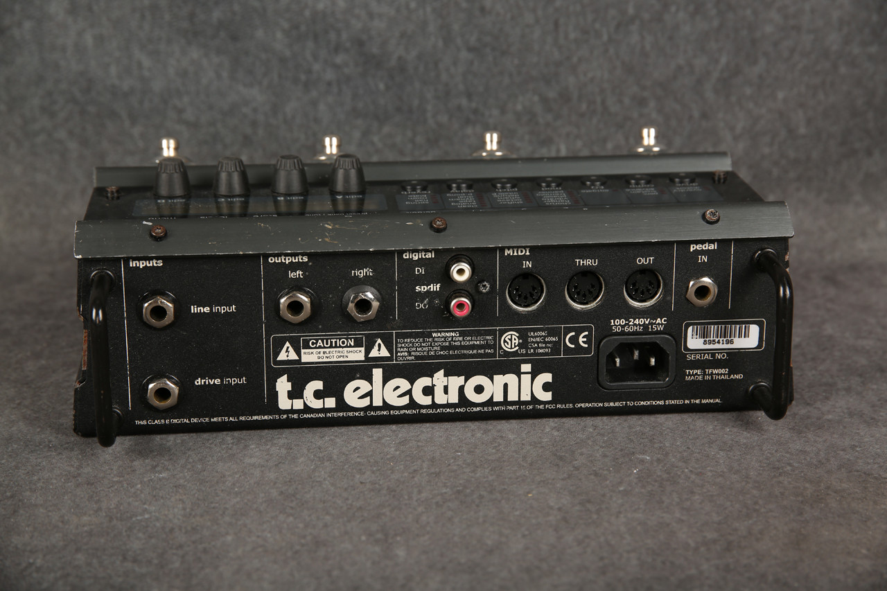
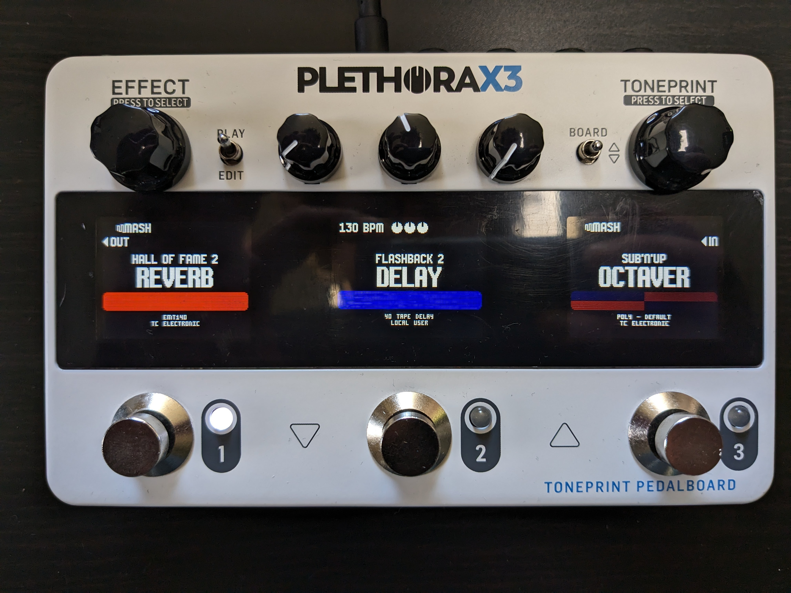
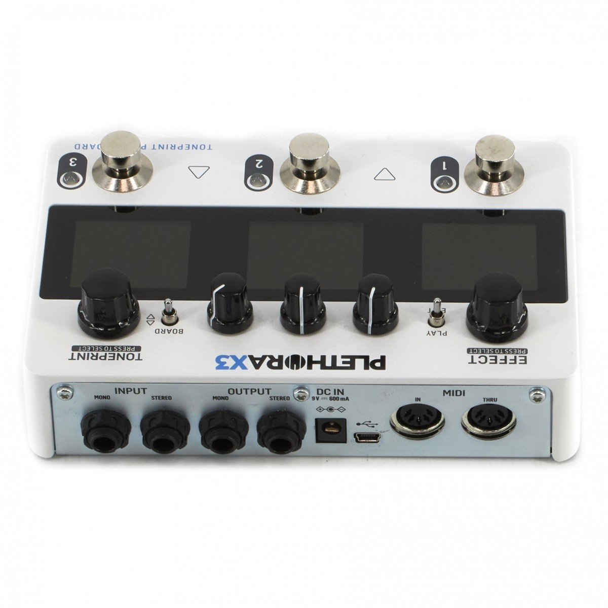
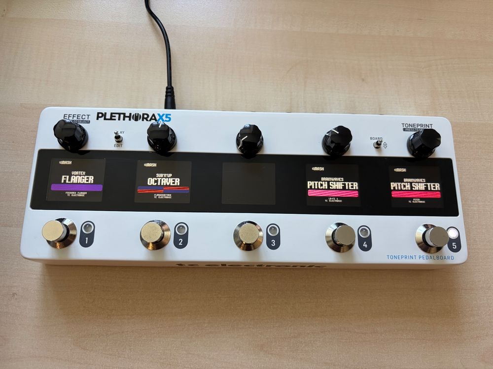
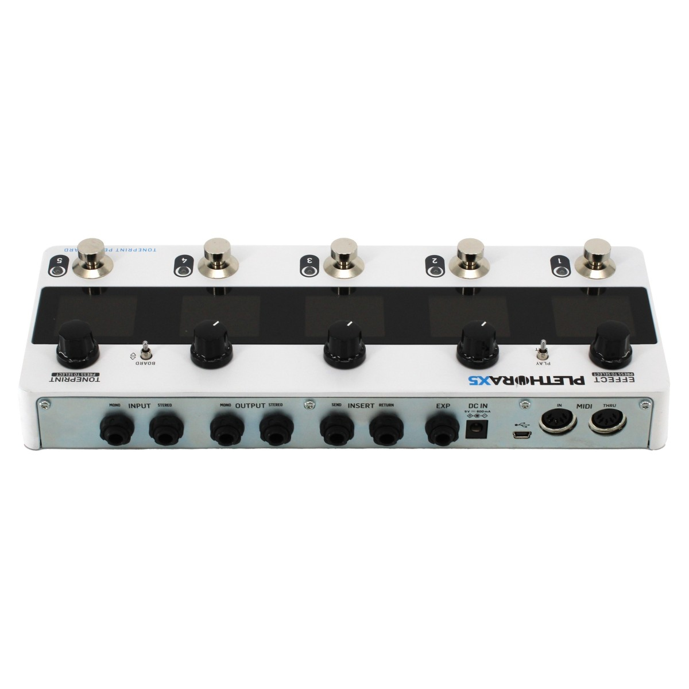

# TC Electronic product photos

[All photo galleries](../PHOTOS.md) · [Verification gaps](../RESEARCH-GAPS.md)

Click a thumbnail for the full archived image when available. Read the linked canonical record for source and inspection notes; powered status and camera angle are separate requirements.

| Model / evidence | Control face | Rear / connector edge |
|---|---|---|
| [TC Electronic M100](../brand/TC-ELECTRONIC.md#m100) |  Power unverified / stock; angle not verified perpendicular |  Power unverified / stock |
| [TC Electronic M350](../brand/TC-ELECTRONIC.md#m350) |  Powered; angle not verified perpendicular |  Power unverified / stock |
| [TC Electronic M-One XL](../brand/TC-ELECTRONIC.md#m-one-xl) |  Powered; angle not verified perpendicular |  Power unverified / stock |
| [TC Electronic NOVA System](../brand/TC-ELECTRONIC.md#nova-system) |  Powered; perpendicular |  Unlit |
| [TC Electronic PLETHORA X3](../brand/TC-ELECTRONIC.md#plethora-x3) |  Powered; perpendicular |  Unlit |
| [TC Electronic PLETHORA X5](../brand/TC-ELECTRONIC.md#plethora-x5) |  Powered; angle not verified perpendicular |  Unlit |
