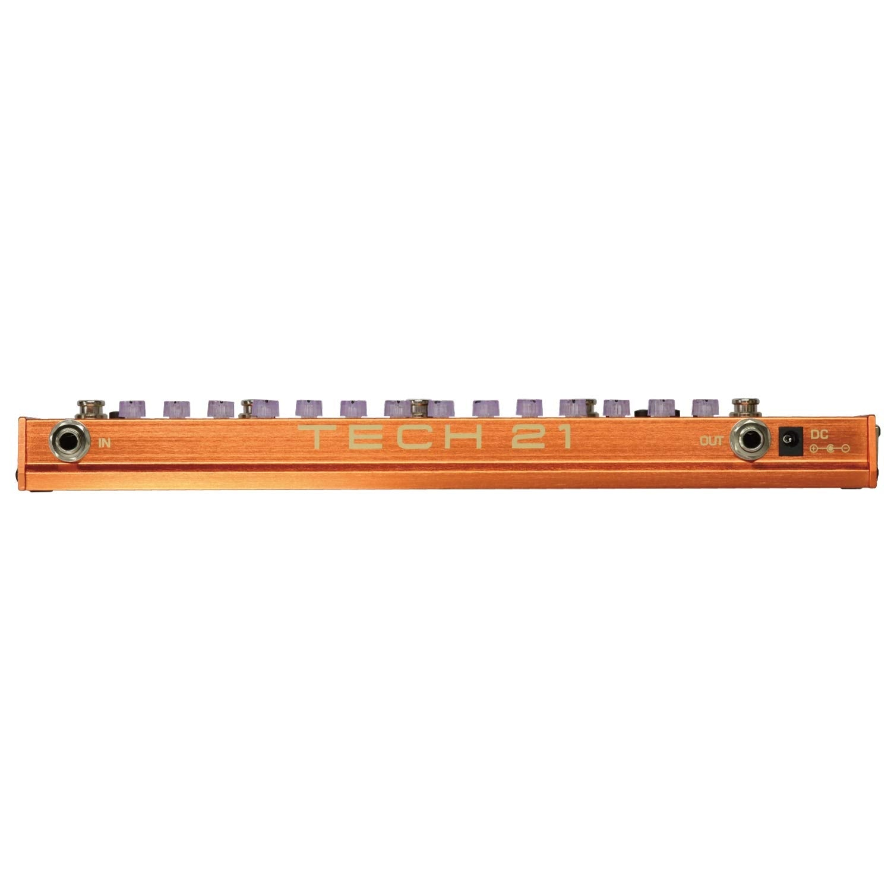
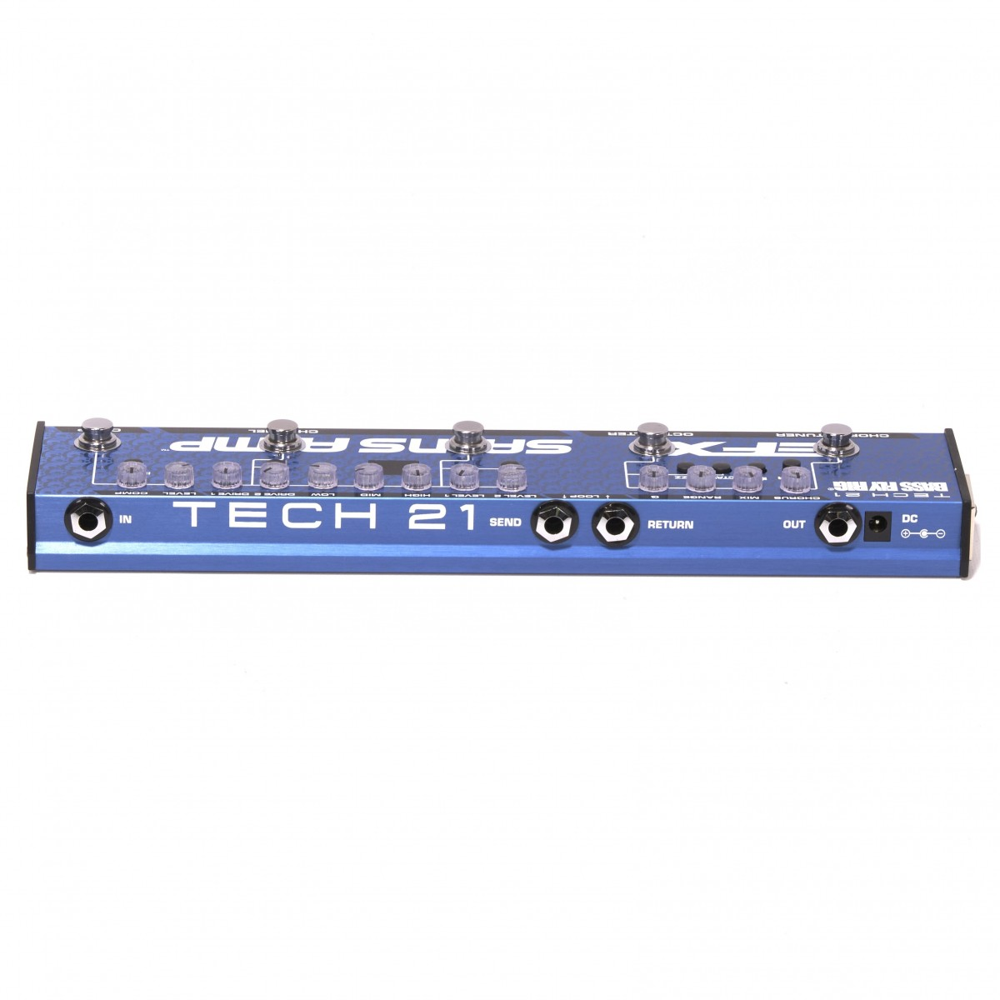

# Tech 21 product photos

[All photo galleries](../PHOTOS.md) · [Verification gaps](../RESEARCH-GAPS.md)

Click a thumbnail for the full archived image when available. Read the linked canonical record for source and inspection notes; powered status and camera angle are separate requirements.

| Model / evidence | Control face | Rear / connector edge |
|---|---|---|
| [Tech 21 Acoustic Fly Rig](../brand/TECH21.md#acoustic-fly-rig) |  Power unverified / stock; angle not verified perpendicular |  Unlit |
| [Tech 21 Bass Fly Rig v2](../brand/TECH21.md#bass-fly-rig-v2) |  Power unverified / stock; angle not verified perpendicular |  Unlit |
| [Tech 21 Fly Rig 5 v2](../brand/TECH21.md#fly-rig-5-v2) |  Power unverified / stock; angle not verified perpendicular |  Unlit |
