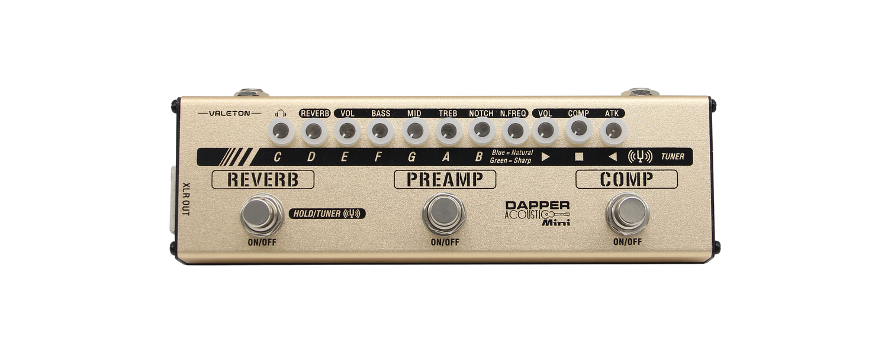
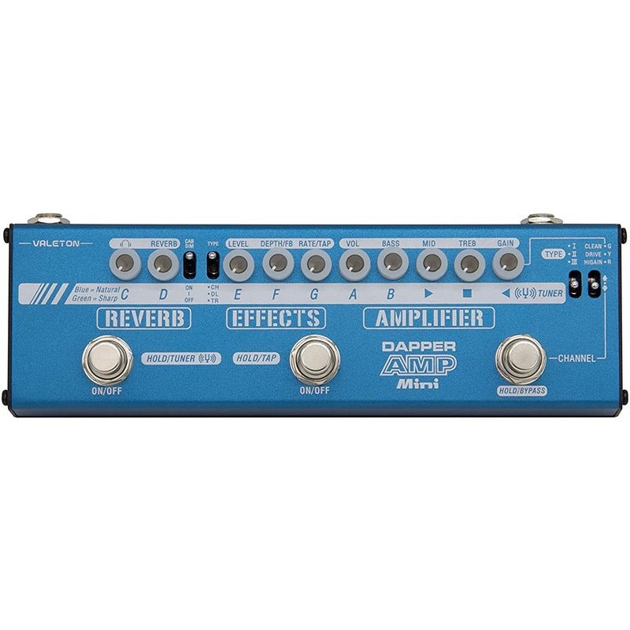
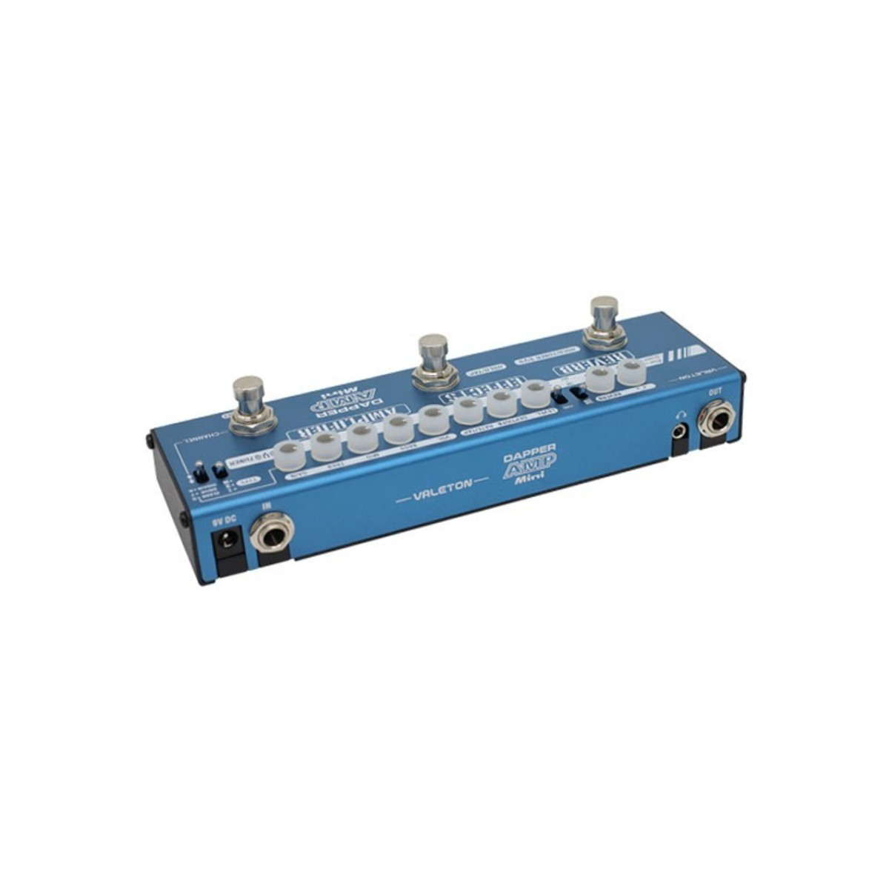
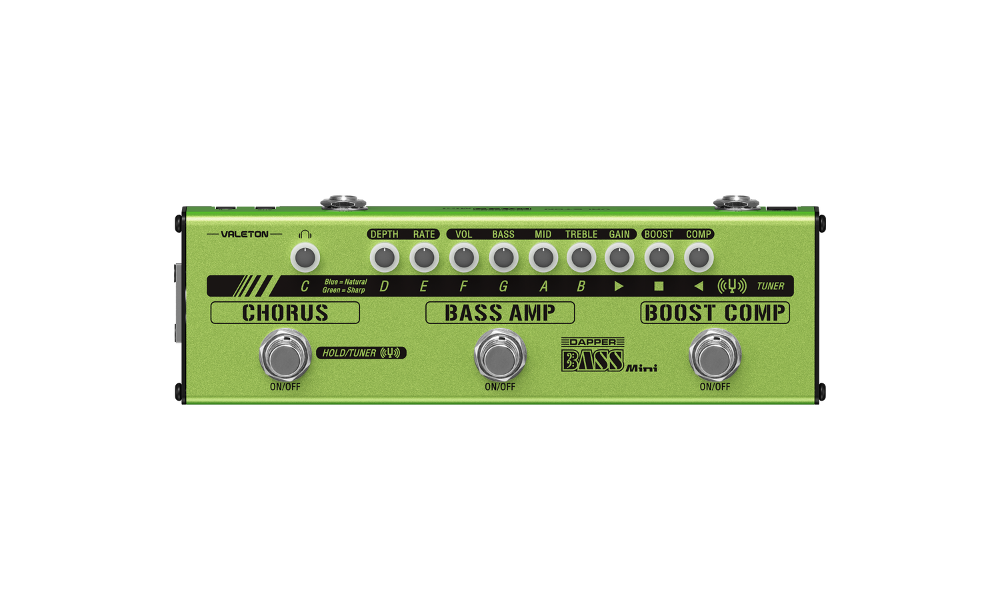
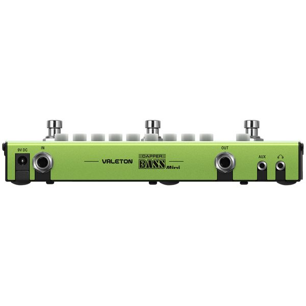
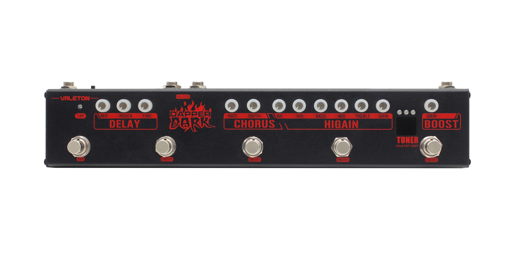
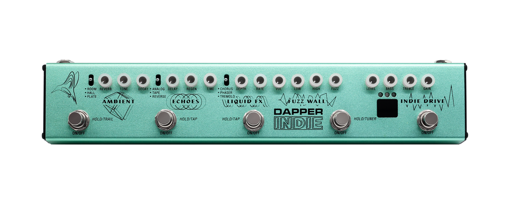
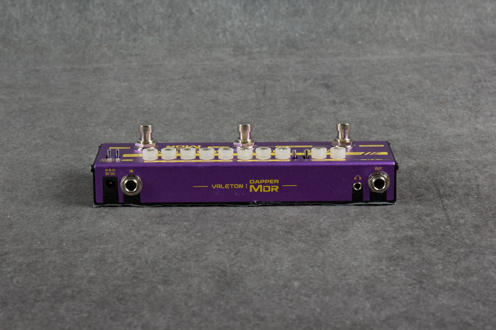

# Valeton product photos

[All photo galleries](../PHOTOS.md) · [Verification gaps](../RESEARCH-GAPS.md)

Click a thumbnail for the full archived image when available. Read the linked canonical record for source and inspection notes; powered status and camera angle are separate requirements.

| Model / evidence | Control face | Rear / connector edge |
|---|---|---|
| [Valeton Dapper Acoustic Mini](../brand/VALETON.md#dapper-acoustic-mini) |  Unlit; angle not verified perpendicular |  Unlit |
| [Valeton Dapper Amp Mini](../brand/VALETON.md#dapper-amp-mini) |  Unlit; angle not verified perpendicular |  Unlit |
| [Valeton Dapper Bass Mini MES-2](../brand/VALETON.md#dapper-bass-mini-mes-2) |  Unlit; angle not verified perpendicular |  Unlit |
| [Valeton Dapper Bass VES-2](../brand/VALETON.md#dapper-bass-ves-2) |  Unlit; angle not verified perpendicular |  Unlit |
| [Valeton Dapper Dark Mini](../brand/VALETON.md#dapper-dark-mini) |  Unlit; angle not verified perpendicular |  Power unverified / stock |
| [Valeton Dapper Dark VES-3](../brand/VALETON.md#dapper-dark-ves-3) |  Unlit; angle not verified perpendicular |  Unlit |
| [Valeton Dapper Indie](../brand/VALETON.md#dapper-indie) |  Unlit; angle not verified perpendicular |  Unlit |
| [Valeton Dapper MDR](../brand/VALETON.md#dapper-mdr) |  Unlit; angle not verified perpendicular |  Unlit |
| [Valeton Dapper Mini MES-1](../brand/VALETON.md#dapper-mini-mes-1) |  Unlit; angle not verified perpendicular |  Unlit |
| [Valeton Dapper VES-1](../brand/VALETON.md#dapper-ves-1) |  Unlit; angle not verified perpendicular |  Unlit |
| [Valeton GP-5](../brand/VALETON.md#gp-5) |  Powered; angle not verified perpendicular |  Power unverified / stock |
| [Valeton GP-50](../brand/VALETON.md#gp-50) |  Powered; angle not verified perpendicular |  Power unverified / stock |
| [Valeton GP-100](../brand/VALETON.md#gp-100) |  Powered; angle not verified perpendicular |  Unlit |
| [Valeton GP-150](../brand/VALETON.md#gp-150) |  Powered; angle not verified perpendicular |  Power unverified / stock |
| [Valeton GP-180](../brand/VALETON.md#gp-180) |  Powered; angle not verified perpendicular |  Power unverified / stock |
| [Valeton GP-200](../brand/VALETON.md#gp-200) |  Powered; angle not verified perpendicular |  Power unverified / stock |
| [Valeton GP-200JR](../brand/VALETON.md#gp-200jr) |  Power unverified / stock; angle not verified perpendicular |  Power unverified / stock |
| [Valeton GP-200LT](../brand/VALETON.md#gp-200lt) |  Powered; angle not verified perpendicular |  Power unverified / stock |
| [Valeton Rushead Max Bass RH-101](../brand/VALETON.md#rushead-max-bass-rh-101) |  Power unverified / stock; angle not verified perpendicular |  Power unverified / stock |
| [Valeton Rushead Max RH-100](../brand/VALETON.md#rushead-max-rh-100) |  Power unverified / stock; angle not verified perpendicular |  Power unverified / stock |
