# Zoom product photos

[All photo galleries](../PHOTOS.md) · [Verification gaps](../RESEARCH-GAPS.md)

Click a thumbnail for the full archived image when available. Read the linked canonical record for source and inspection notes; powered status and camera angle are separate requirements.

| Model / evidence | Control face | Rear / connector edge |
|---|---|---|
| [Zoom 505 original](../brand/ZOOM.md#505-original) |  Powered; perpendicular |  Unlit |
| [Zoom 505II](../brand/ZOOM.md#505ii) |  Powered; perpendicular | <a href="../brand/images/zoom-505ii-rear-535807d83919.jpg">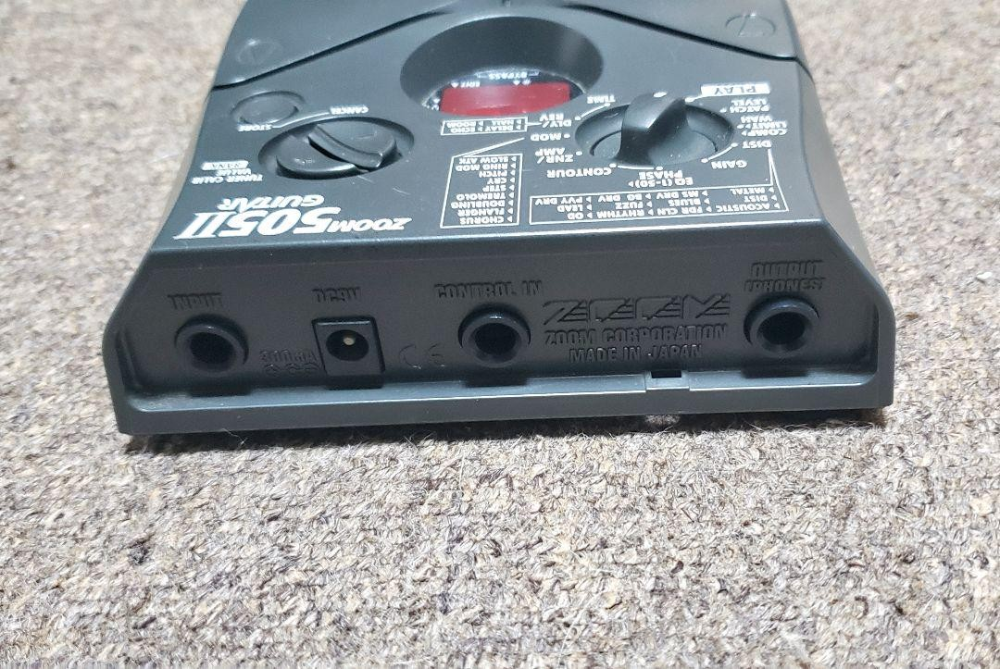</a> Unlit |
| [Zoom 506II](../brand/ZOOM.md#506ii) | <a href="../brand/images/zoom-506ii-top-28b442483cc5.jpg">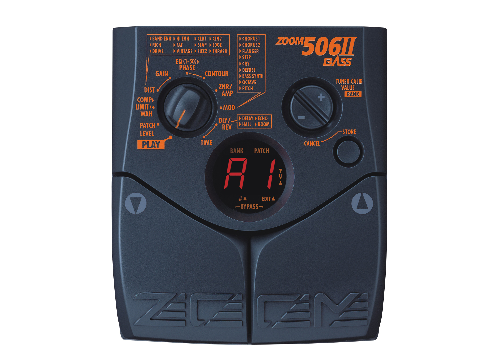</a> Unlit; perpendicular |  Unlit |
| [Zoom 606](../brand/ZOOM.md#606) |  Powered; perpendicular |  Unlit |
| [Zoom 607](../brand/ZOOM.md#607) |  Unlit; perpendicular | <a href="../brand/images/zoom-607-rear-28106262693a.jpg">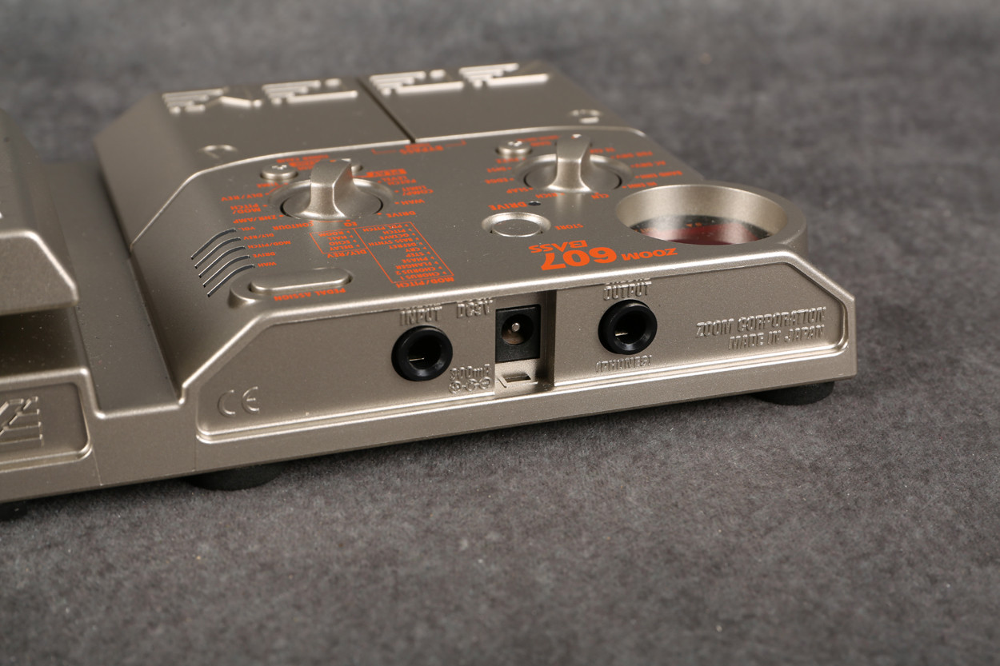</a> Unlit |
| [Zoom 707II](../brand/ZOOM.md#707ii) | <a href="../brand/images/zoom-707ii-top-18d6efa0a392.jpg">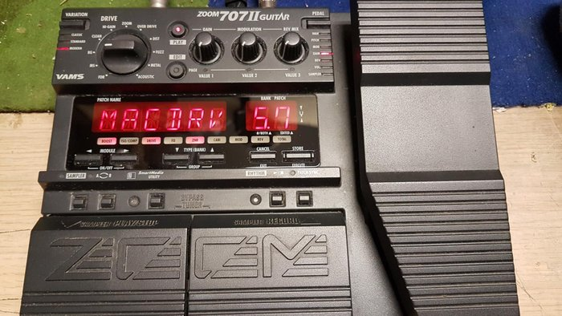</a> Powered; angle not verified perpendicular |  Unlit |
| [Zoom 708II](../brand/ZOOM.md#708ii) | <a href="../brand/images/zoom-708ii-top-5bc344a53369.jpg">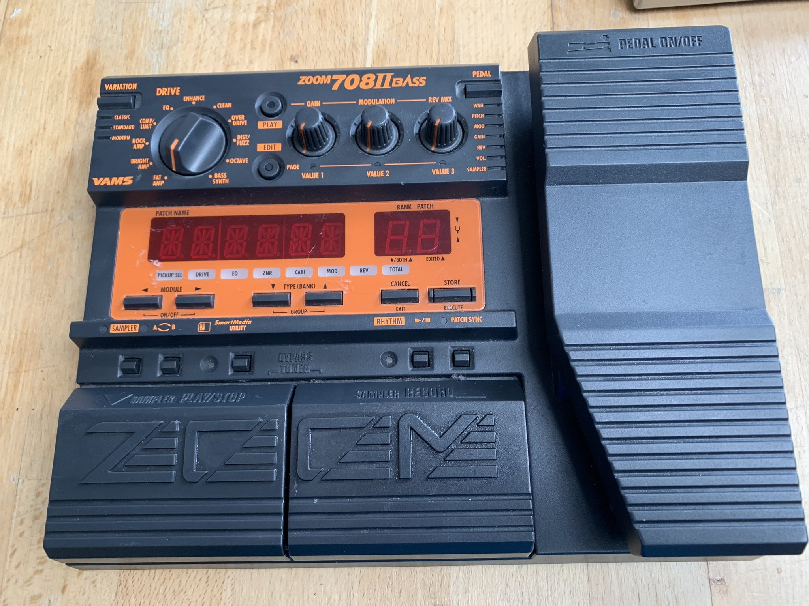</a> Unlit; perpendicular |  Unlit |
| [Zoom 1201](../brand/ZOOM.md#1201) | <a href="../brand/images/zoom-1201-top-857d443d2881.webp">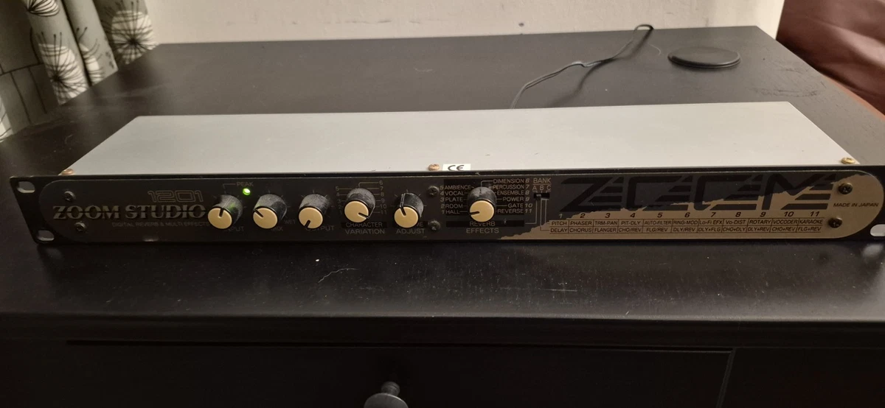</a> Powered; angle not verified perpendicular |  Unlit |
| [Zoom A1 FOUR](../brand/ZOOM.md#a1-four) |  Powered; perpendicular | <a href="../brand/images/zoom-a1-four-rear-d253937f5a83.jpg">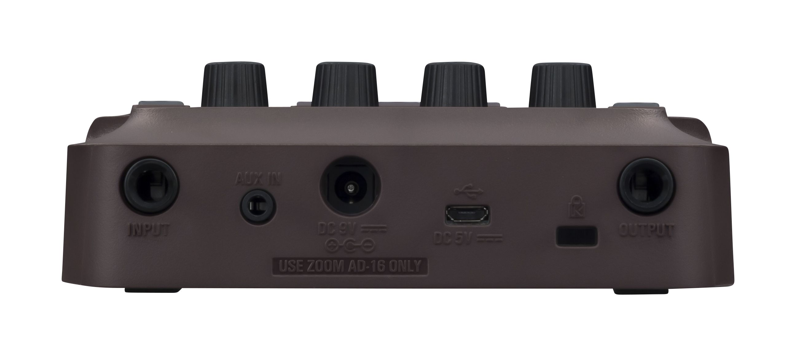</a> Unlit |
| [Zoom A1X FOUR](../brand/ZOOM.md#a1x-four) |  Powered; perpendicular |  Unlit |
| [Zoom A2](../brand/ZOOM.md#a2) | <a href="../brand/images/zoom-a2-top-d0ca3bcb6b08.jpg">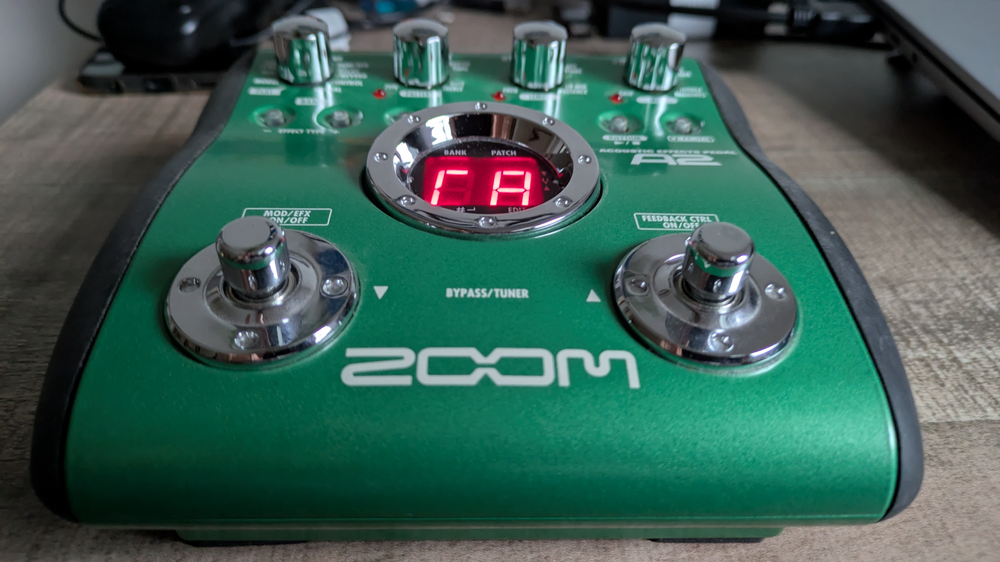</a> Powered; angle not verified perpendicular |  Unlit |
| [Zoom A3](../brand/ZOOM.md#a3) |  Powered; angle not verified perpendicular | <a href="../brand/images/zoom-a3-rear-3a1309d1fb0f.jpg">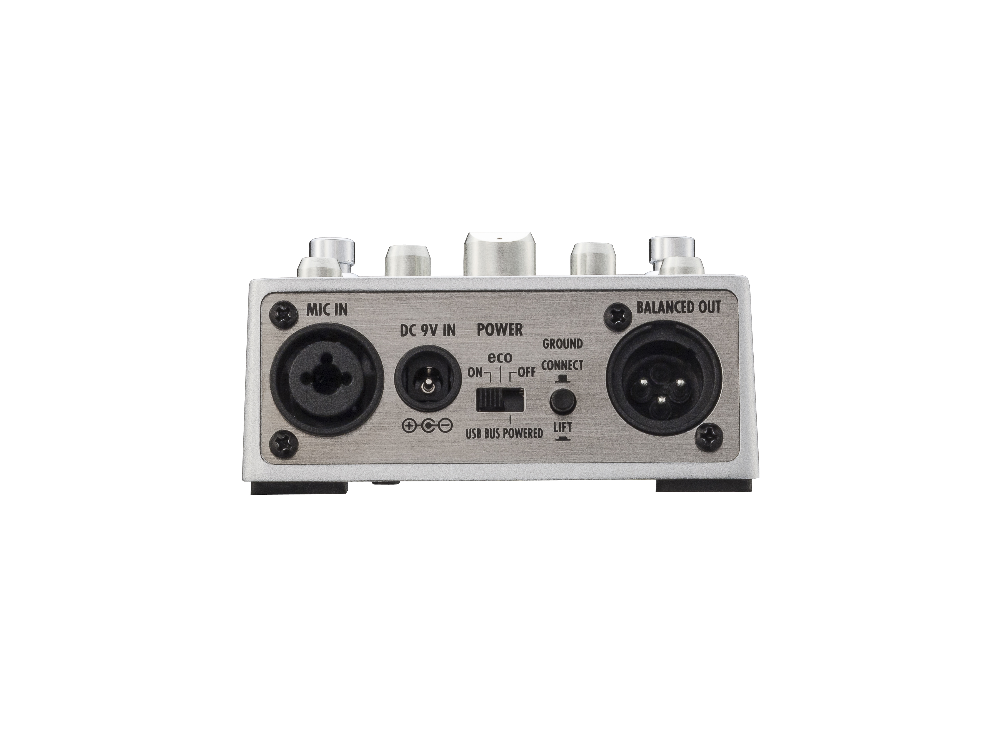</a> Unlit |
| [Zoom B1 FOUR](../brand/ZOOM.md#b1-four) |  Powered; perpendicular |  Unlit |
| [Zoom B1on](../brand/ZOOM.md#b1on) |  Unlit; perpendicular | <a href="../brand/images/zoom-b1on-rear-3a83e8e8a63f.jpg">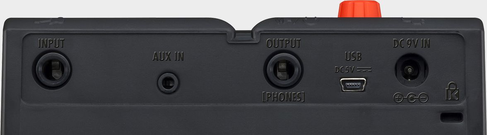</a> Unlit |
| [Zoom B1X FOUR](../brand/ZOOM.md#b1x-four) |  Powered; perpendicular |  Unlit |
| [Zoom B1X original](../brand/ZOOM.md#b1x-original) |  Unlit; perpendicular |  Unlit |
| [Zoom B1Xon](../brand/ZOOM.md#b1xon) |  Unlit; perpendicular | <a href="../brand/images/zoom-b1xon-rear-5d77da7917b9.jpg">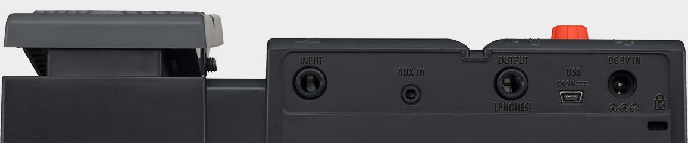</a> Unlit |
| [Zoom B2](../brand/ZOOM.md#b2) |  Powered; angle not verified perpendicular | <a href="../brand/images/zoom-b2-rear-6a19ad1f3fca.jpg">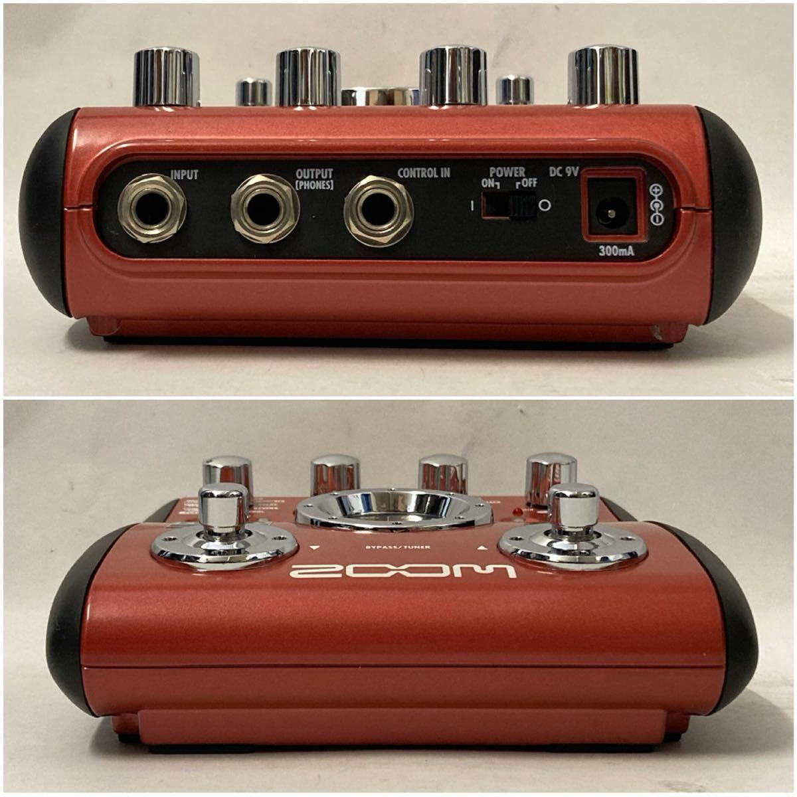</a> Unlit |
| [Zoom B2 FOUR](../brand/ZOOM.md#b2-four) |  Powered; perpendicular |  Powered |
| [Zoom B2.1u](../brand/ZOOM.md#b21u) |  Unlit; perpendicular |  Unlit |
| [Zoom B3](../brand/ZOOM.md#b3) | <a href="../brand/images/zoom-b3-top-6ef03f92d57e.png">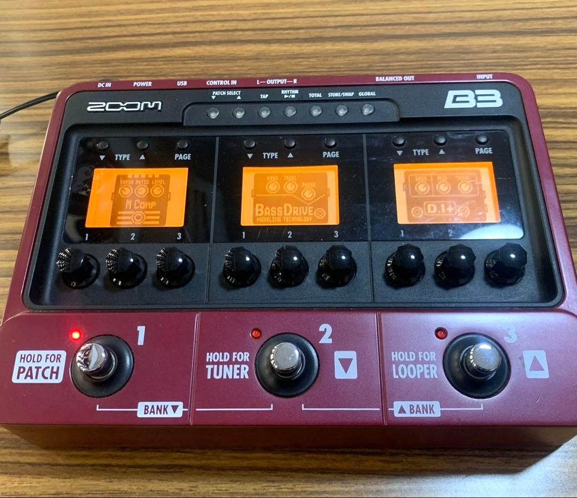</a> Powered; angle not verified perpendicular |  Powered |
| [Zoom B3n](../brand/ZOOM.md#b3n) | <a href="../brand/images/zoom-b3n-top-cdca84aeeda1.jpg">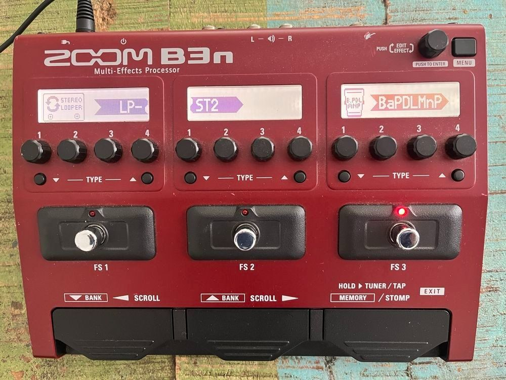</a> Powered; perpendicular | <a href="../brand/images/zoom-b3n-rear-40abd4a010bd.png">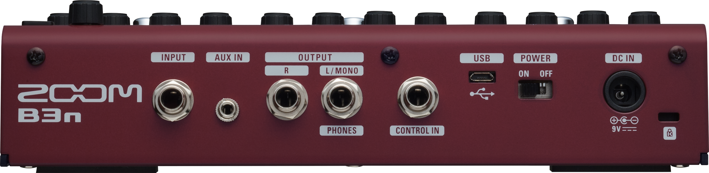</a> Unlit |
| [Zoom B6](../brand/ZOOM.md#b6) |  Powered; angle not verified perpendicular | <a href="../brand/images/zoom-b6-rear-31c41385025d.jpg">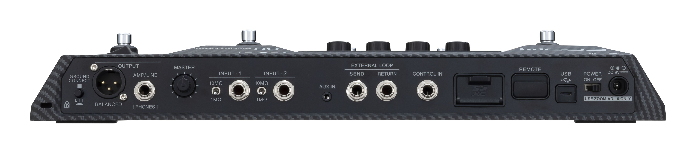</a> Unlit |
| [Zoom G1 FOUR](../brand/ZOOM.md#g1-four) |  Powered; angle not verified perpendicular | <a href="../brand/images/zoom-g1-four-rear-29b2e94b96c7.jpg">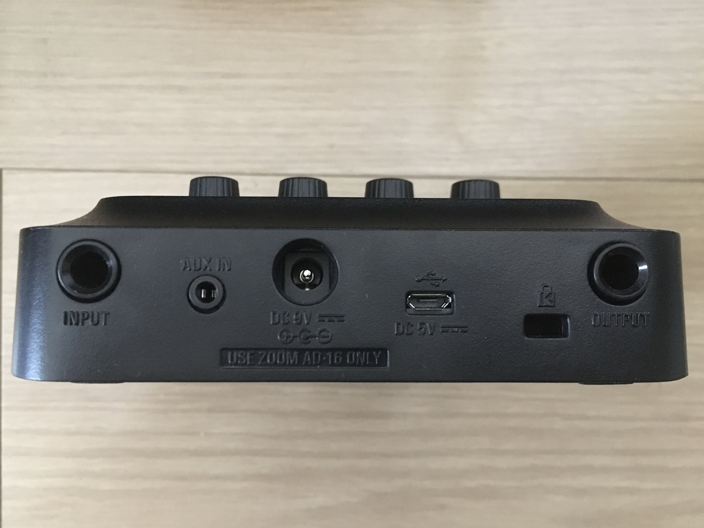</a> Unlit |
| [Zoom G1 original](../brand/ZOOM.md#g1-original) |  Unlit; perpendicular |  Unlit |
| [Zoom G1on](../brand/ZOOM.md#g1on) |  Powered; perpendicular |  Unlit |
| [Zoom G1X FOUR](../brand/ZOOM.md#g1x-four) |  Powered; perpendicular |  Unlit |
| [Zoom G1Xnext](../brand/ZOOM.md#g1xnext) | <a href="../brand/images/zoom-g1xnext-top-9f346e5a5757.jpg">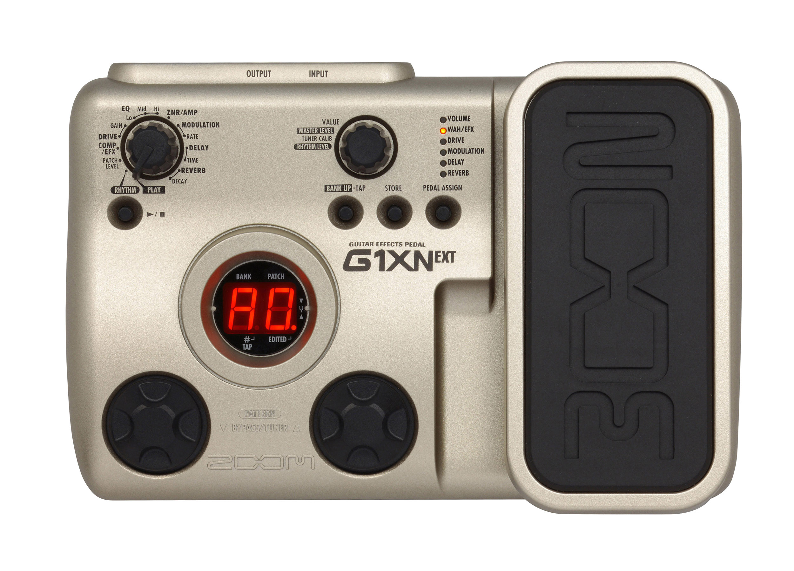</a> Unlit; perpendicular | <a href="../brand/images/zoom-g1xnext-rear-0410ce232eb9.jpg">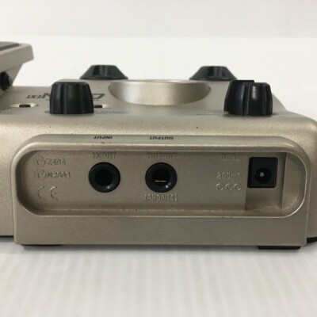</a> Unlit |
| [Zoom G1Xon](../brand/ZOOM.md#g1xon) | <a href="../brand/images/zoom-g1xon-top-948885e4fe45.jpg">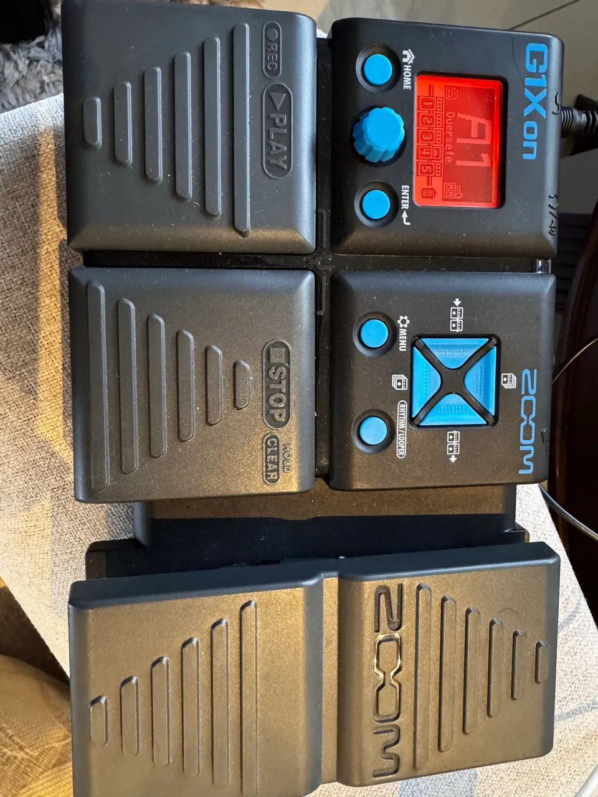</a> Powered; angle not verified perpendicular |  Unlit |
| [Zoom G2 FOUR](../brand/ZOOM.md#g2-four) | <a href="../brand/images/zoom-g2-four-top-590a01aeee3c.jpg">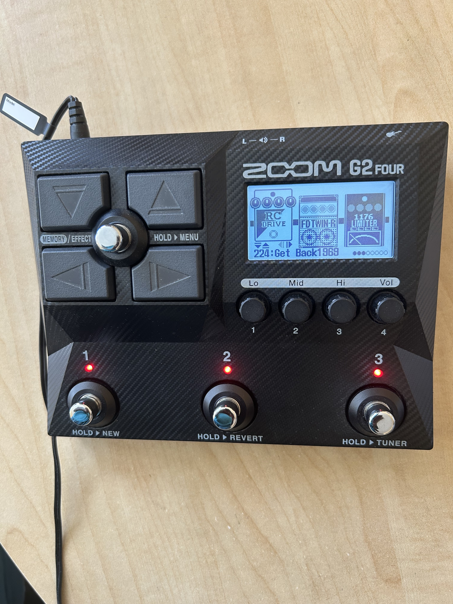</a> Powered; perpendicular |  Powered |
| [Zoom G2.1Nu](../brand/ZOOM.md#g21nu) | <a href="../brand/images/zoom-g2-1nu-top-d4fb1c022741.jpg">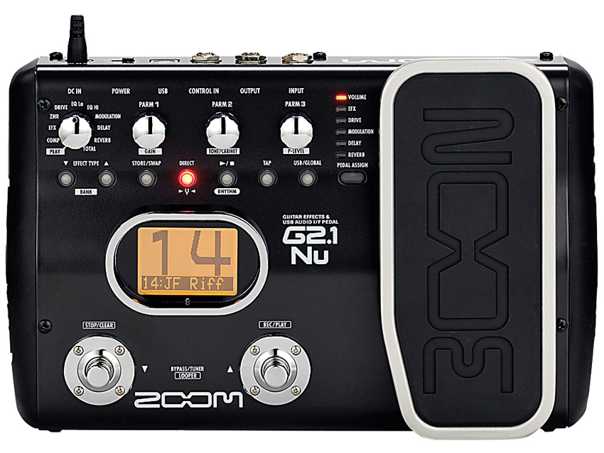</a> Powered; perpendicular |  Unlit |
| [Zoom G2.1u](../brand/ZOOM.md#g21u) |  Powered; angle not verified perpendicular |  Unlit |
| [Zoom G2Nu](../brand/ZOOM.md#g2nu) |  Powered; perpendicular |  Unlit |
| [Zoom G2X FOUR](../brand/ZOOM.md#g2x-four) |  Powered; perpendicular |  Unlit |
| [Zoom G3](../brand/ZOOM.md#g3) |  Powered; perpendicular |  Unlit |
| [Zoom G3n](../brand/ZOOM.md#g3n) |  Powered; perpendicular |  Unlit |
| [Zoom G3X](../brand/ZOOM.md#g3x) |  Powered; perpendicular |  Unlit |
| [Zoom G3Xn](../brand/ZOOM.md#g3xn) |  Powered; angle not verified perpendicular |  Unlit |
| [Zoom G5](../brand/ZOOM.md#g5) |  Powered; perpendicular |  Unlit |
| [Zoom G5n](../brand/ZOOM.md#g5n) |  Powered; perpendicular |  Unlit |
| [Zoom G6](../brand/ZOOM.md#g6) |  Powered; perpendicular |  Unlit |
| [Zoom G7.1ut](../brand/ZOOM.md#g71ut) |  Powered; angle not verified perpendicular |  Unlit |
| [Zoom G11](../brand/ZOOM.md#g11) |  Powered; angle not verified perpendicular |  Unlit |
| [Zoom GFX-3](../brand/ZOOM.md#gfx-3) |  Unlit; angle not verified perpendicular |  Unlit |
| [Zoom GFX-4](../brand/ZOOM.md#gfx-4) |  Powered; angle not verified perpendicular |  Unlit |
| [Zoom GFX-5](../brand/ZOOM.md#gfx-5) |  Powered; angle not verified perpendicular |  Unlit |
| [Zoom GFX-707](../brand/ZOOM.md#gfx-707) |  Powered; angle not verified perpendicular |  Unlit |
| [Zoom MS-50G](../brand/ZOOM.md#ms-50g) |  Powered; angle not verified perpendicular |  Unlit |
| [Zoom MS-50G Plus](../brand/ZOOM.md#ms-50g-plus) |  Powered; angle not verified perpendicular |  Unlit |
| [Zoom MS-60B](../brand/ZOOM.md#ms-60b) |  Powered; angle not verified perpendicular |  Unlit |
| [Zoom MS-60B Plus](../brand/ZOOM.md#ms-60b-plus) |  Powered; angle not verified perpendicular |  Unlit |
| [Zoom MS-70CDR](../brand/ZOOM.md#ms-70cdr) |  Powered; angle not verified perpendicular |  Unlit |
| [Zoom MS-70CDR Plus](../brand/ZOOM.md#ms-70cdr-plus) |  Powered; angle not verified perpendicular |  Unlit |
| [Zoom MS-80IR Plus](../brand/ZOOM.md#ms-80ir-plus) |  Powered; angle not verified perpendicular |  Unlit |
| [Zoom MS-100BT](../brand/ZOOM.md#ms-100bt) |  Powered; angle not verified perpendicular |  Unlit |
| [Zoom NEURIG](../brand/ZOOM.md#neurig) |  Powered; perpendicular |  Powered |
| [Zoom RFX-1000](../brand/ZOOM.md#rfx-1000) |  Powered; angle not verified perpendicular |  Unlit |
| [Zoom RFX-1100](../brand/ZOOM.md#rfx-1100) |  Powered; angle not verified perpendicular |  Unlit |
| [Zoom RFX-2000](../brand/ZOOM.md#rfx-2000) |  Powered; angle not verified perpendicular |  Unlit |
| [Zoom RFX-2200](../brand/ZOOM.md#rfx-2200) |  Powered; angle not verified perpendicular |  Unlit |
| [Zoom V3](../brand/ZOOM.md#v3) |  Powered; perpendicular |  Unlit |
| [Zoom V6-SP](../brand/ZOOM.md#v6-sp) |  Powered; perpendicular |  Unlit |
